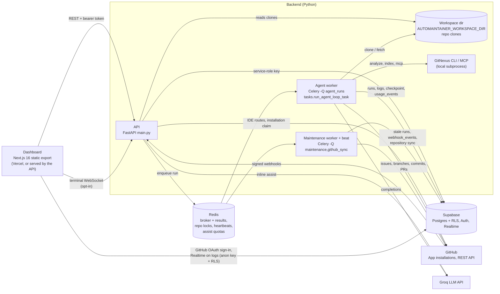
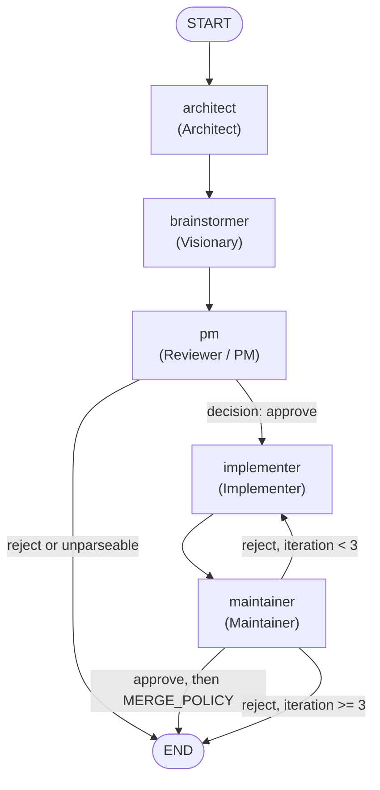

# AutoMaintainer Architecture

This document describes the system as it is implemented on `main`. Each
section names the source file it is based on. When the code changes, update
the section that names it. No test checks this document; the agent-graph
diagram is checked by hand against `backend/agents.py` ("Build the Graph").

For deployment topology, environment variables and the security checklist,
see [`docs/DEPLOYMENT.md`](./docs/DEPLOYMENT.md). For the eval harness, see
[`docs/EVALS.md`](./docs/EVALS.md).

## Components

| Component | Code | Role |
| --- | --- | --- |
| API (control plane) | `backend/main.py` | Authenticates requests, authorizes them against the caller's organization, creates `runs` rows and enqueues Celery tasks, serves the IDE file routes, inline assist, webhooks and the opt-in terminal. It does not run the agent graph. |
| Agent worker | `backend/tasks.py`, `backend/agents.py` | Consumes the `agent_runs` queue and runs the LangGraph pipeline for one run at a time per process (`worker_prefetch_multiplier=1`). |
| Maintenance worker and beat | `backend/tasks.py`, `backend/webhook_processor.py`, `backend/celery_app.py` | Periodic jobs: `cleanup_stale_runs` (every 5 min), `process_webhook_events` (every 5 min), `sync_repositories` (every 6 h). |
| Redis | `backend/celery_app.py`, `backend/redis_locks.py`, `backend/quotas.py` | Celery broker and result backend, per-repository locks, run heartbeats, inline-assist quotas. |
| Supabase | `supabase_schema.sql` | Postgres with Row Level Security, Auth (GitHub OAuth), and Realtime for live logs. |
| Dashboard | `dashboard/` | Next.js 16 static export: run control, live logs, run history, admin page, Monaco-based Web IDE, terminal client. |
| GitNexus | `backend/agents.py`, `backend/main.py` | The worker indexes each clone with `gitnexus analyze` / `gitnexus index` and gives the LLM GitNexus tools over MCP (stdio). The API also starts `gitnexus serve` at startup. Every GitNexus step is best-effort; on failure the agents use a plain completion. |

The API and the `agent_runs` worker must share the workspace directory: the
worker clones repositories there and the IDE routes read them back. See
[`docs/DEPLOYMENT.md`](./docs/DEPLOYMENT.md#topology).

## Request and run lifecycle

1. The user signs in to the dashboard with GitHub through Supabase Auth.
2. `POST /start` (`main.py`) requires a write role (`owner`, `admin` or
   `member`; `viewer` is read-only). It checks that the repository belongs to
   the caller's organization (`repositories` table) and that some Celery worker
   consumes `agent_runs`. If no worker does, it returns `503` and creates no
   run. Otherwise it inserts a `runs` row with status `queued` and enqueues
   `tasks.run_agent_loop_task`.
3. The worker (`tasks._execute_agent_run`):
   - skips the delivery if the run is already `completed`, `failed` or
     `cancelled`;
   - takes the per-repository Redis lock. If another run holds it, the task
     retries every 30 s, up to 60 times, then marks the run `failed`;
   - starts a heartbeat thread that refreshes a Redis key every 20 s;
   - marks the run `running` and calls `agents.run_agent_loop`.
4. `run_agent_loop` binds the run's GitHub credentials (see
   [GitHub authentication](#github-authentication)) and streams the LangGraph
   pipeline. Every node event is written to the `logs` table. The dashboard
   reads `logs` through Supabase Realtime (`dashboard/src/lib/hooks/use-logs.ts`).
5. The run ends as `completed` or `failed`. The task's `finally` block stops
   the heartbeat and releases the repository lock.

Time limits: 30 min soft and 32 min hard per run (`tasks.py`). The `mode`
field of `/start` is stored on the run but does not change the graph. Targeted
behaviour comes only from `target_issue`.

**Cancellation.** `POST /stop` with a `run_id` calls `cancel_run_task`. That
revokes the Celery task with `SIGTERM`, sets the run to `cancelled` and
releases the repository lock. Without a `run_id`, `/stop` cancels every
active run of the organization, which requires an org admin.

**Stale runs.** `cleanup_stale_runs` marks a `queued` or `running` run as
`failed` only when both of these are true: its row has not been updated for
10 minutes, and its Redis heartbeat has expired. It also revokes the task and
frees the lock.

## The agent pipeline (LangGraph)

Source: `backend/agents.py`, section "Build the Graph". The node ids below are
the ids registered with `StateGraph`. The names in parentheses are the
display names used in logs and the dashboard.

<!-- agent-graph: checked by hand against backend/agents.py, "Build the Graph" -->

The routers are `should_implement` (after `pm`) and `should_iterate` (after
`maintainer`). The Implementer runs at most three times per run: the first
attempt plus two revisions.

| Node | What it does |
| --- | --- |
| `architect` | **Targeted mode** (`target_issue` set): fetches that issue and uses it as the directive. The run aborts if the issue cannot be fetched, if the number is a pull request, or if the text names no repository file. **Autonomous mode**: reads the root file list and README through the GitHub API, syncs the local clone, indexes it with GitNexus, builds an AST map (`ast_indexer.py`, tree-sitter), and asks the LLM for a directive. The run aborts if the directive names no target file. |
| `brainstormer` | In autonomous mode, asks the LLM for one feature and opens a GitHub issue for it. The issue carries a hidden run marker. In targeted mode, it reuses the target issue. It is also the resume point after a redelivery (see [Idempotent side effects](#idempotent-side-effects)). |
| `pm` | Asks the LLM to approve or reject the change. It comments the decision on the issue, and closes the issue on rejection, but only if the agent opened it. A human-filed issue stays open. Targeted runs go through this review too. |
| `implementer` | Rewrites **one whole file**: the target file on the default branch, or on the PR branch in later iterations. It refuses files larger than `IMPLEMENTER_MAX_FILE_CHARS` (default 60 000). The model output is validated by `normalize_generated_code` (refusals, truncated output with `finish_reason=length`, ambiguous code fences, empty output) and `validate_generated_code`: a syntax check for Python (`ast`), JSON, TOML and YAML plus a heuristic bracket check for JS/TS, and a shrink guard that refuses a rewrite keeping less than `IMPLEMENTER_MIN_SIZE_RATIO` (default 0.4) of a file larger than `IMPLEMENTER_SHRINK_GUARD_MIN_BYTES` (default 2048) unless the directive explicitly asks for removal. The change is committed to a run-scoped branch and checked against the change limits (see [Change limits](#change-limits)); the node then opens a PR or reuses the existing one, and the change is verified with the repository's tests (see [Verification](#verification)). |
| `maintainer` | Reviews the PR diff (the prompt includes at most 20 000 characters of it) together with the current iteration's verification result (see [Verification](#verification)), comments the review, and applies the merge policy. |

### Structured verdicts

The PM and the Maintainer answer with a JSON object validated by pydantic
(`AgentDecision`, `MaintainerDecision` in `backend/agents.py`):
`{"verdict": "approve" | "reject", "reasons": [...], "blocking_issues": [...]}`,
plus `requested_changes` for the Maintainer (`decision` is accepted as an alias
of `verdict`). An approval that lists blocking issues is invalid. A reply that
does not parse or validate gets one corrective retry; a second failure is a
rejection, so the step fails closed. The older `VERDICT: APPROVE` /
`VERDICT: REJECT` line format is no longer accepted: such a reply is treated
like any other non-JSON reply, and a run checkpointed with a legacy verdict
resumes as a rejection.

### Merge policy

`MERGE_POLICY` (`get_merge_policy`) controls what happens after the
Maintainer approves a PR:

| Value | Behaviour |
| --- | --- |
| `human` (default; also used for unknown values) | Never merges. Leaves the PR open with `merge_status=awaiting_human_review` and requests a review from the issue's assignees, or from the repository owner if it is a user account. |
| `ci` | Merges only if the `automaintainer/verification` commit status on the PR head is `success` (see [Verification](#verification)) **and** every other commit status and check run is in a passing state (`success`, `neutral` or `skipped`, see `_PASSING_CHECK_STATES`). The check runs once, right after the review, so pending checks block the merge. Without a sandbox (and without `VERIFY_ALLOW_LOCAL=true`) verification reports an error, so `ci` never merges. |
| `auto` | Merges on the Maintainer's approval alone (and a trusted trigger, below). Not recommended. |

Under `ci` and `auto`, the merge is also skipped when the review comment could
not be posted, when the diff the Maintainer saw was incomplete (truncated, or
a file without a patch), when the change exceeds the change limits, and when
the run's trigger is not trusted (`backend/trust.py`, #487). The last gate is
deterministic and runs after everything a model decided: every GitHub user who
caused the run must have `write`, `maintain` or `admin` permission on the
repository (`GET /repos/{owner}/{repo}/collaborators/{username}/permission`,
through the run's installation-scoped client, looked up once per run). For a
run started with `POST /start` that is the caller's linked GitHub account
(the numeric user id of their Supabase GitHub identity) and, when the run
targets an issue, that issue's author too, because the issue body is the task
the models follow. Every actor is checked by its GitHub user id: the id is
resolved to its current login (`GET /user/{account_id}`) before the
permission lookup, so a renamed account is checked under its new name and a
freed login re-registered by someone else never stands in for it (#491).
There is no webhook-started run. An unknown actor (no linked GitHub identity,
e.g. the dev-auth bypass, or a run queued without the id), a bot account
(there is no bot allowlist), a non-collaborator or a failed lookup holds the
PR with
`merge_status=awaiting_human_review`, like `human`. Such a hold is sticky for
the run: a redelivery that reviews again finds the earlier `held`
merge_decisions row and holds again. The gate vouches for who
caused the run, not for repository content it reads (README, code comments),
which only a writer can change. The run's own issue (a run without a target
issue) is not an outsider's input either: a redelivery reuses an issue only
when it carries the run's hidden marker **and** was opened by the identity the
run acts as (`<app-slug>[bot]`, or the PAT's user), never a copy of the marker
in someone else's issue (#490; see [Idempotent side
effects](#idempotent-side-effects)). The merge pins the reviewed head SHA, so
GitHub refuses it if the branch moved after the review.

A path on the change-limits denylist is refused **before** it is committed
(#488): nothing reaches the run branch, where a push-triggered workflow could
run it, no PR is opened, and the run fails with `PROTECTED_PATH`. If a later
iteration of a run that already has a PR hits a denied path (the base
branch's `.automaintainer.yml` changed), that PR is held as a draft
`needs-human` PR. If `.automaintainer.yml` on the base branch cannot be read
(any error but a 404, such as a 5xx or a rate limit) or parsed, its `deny`
entries are unknown, so nothing is committed and the run fails the same way.
File and line limits are also evaluated before the commit; a change over
them is still committed and opened as a draft for a human.

### Verification

After each Implementer push, `backend/verification.py` checks out the PR
head and runs the repository's tests: the command from `.automaintainer.yml`
at the repository root, otherwise a detected `pytest` or `npm test`. They run
through `SANDBOX_BACKEND` (the `SandboxRunner` adapter). Running them on the
API/worker host requires `VERIFY_ALLOW_LOCAL=true` in every environment,
because this is untrusted code. The result is added to the PR body and posted
as the `automaintainer/verification` commit status, which gates
`MERGE_POLICY=ci`. The Maintainer's prompt also receives the result (status
and exit code, plus command and output tail inside an `<untrusted-data>`
block, or an explicit "not run" note); see "Maintainer input" in
docs/VERIFICATION.md. Details, settings and the security model are in
[docs/VERIFICATION.md](./docs/VERIFICATION.md).

### Change limits

Before the Implementer commits to the run branch (and before every later
push to it), `backend/change_limits.py` measures the change against the base branch:
changed files (`CHANGE_LIMIT_MAX_FILES`, default 10), changed lines
(`CHANGE_LIMIT_MAX_LINES`, default 500) and a path denylist
(`CHANGE_LIMIT_DENYLIST`, comma-separated globs replacing the default:
`.github/workflows/**`, `Dockerfile*`, `docker-compose*.yml`, lockfiles such as
`uv.lock` or `package-lock.json`, `.env*`, `*.pem`, `*.key`, test-runner
configuration, `.automaintainer.yml`). Test-runner configuration (`conftest.py`
at any depth, `pytest.toml`, `.pytest.toml`, `pytest.ini`, `.pytest.ini`,
`tox.ini`, `noxfile.py`, `setup.cfg`, `pyproject.toml`, `package.json`,
`jest.config.*`, `vitest.config.*`, `vitest.workspace.*`, `vitest.projects.*`,
`vite.config.*`, `.mocharc*`, `karma.conf.*`, `playwright.config.*`) is
denied because a change to it can skip or short-circuit the tests that
verification runs and turn a failing change into a passing one (#480). So are
`pytest.py`, `pytest/**` and `_pytest/**` at any depth, because a custom
`python -m pytest` from the repository root imports a root module of that
name instead of pytest, and `.npmrc`, which configures how `npm test` runs.
Test files, setup files and other modules the tests load are not denied: the
agent writes tests, so a change can still weaken a test or a module it edits,
and no name list can catch a root module shadowing something pytest
imports, standard library included; the detected command puts the
repository root last on `sys.path` instead (docs/VERIFICATION.md,
Limitations). No default entry
protects a custom `test_command`; a repository that sets one should add its
entry point (a script, a `Makefile`) to `deny`. A glob without `/` matches
the file name in any directory; one with `/` is anchored at the repository
root. A repository can override them in the `change_limits`
section of `.automaintainer.yml` (`max_files`, `max_lines`, `deny` adds globs,
`allow` exempts globs, never `.automaintainer.yml`); that file is read from the
**base** branch, so a change cannot relax its own limits. For example,
`allow: ["pyproject.toml"]` lets a repository's agent edit `pyproject.toml`
while every other runner configuration file stays denied. An invalid or
unreadable configuration refuses every commit with `PROTECTED_PATH`, as a
denied path does (see [Merge policy](#merge-policy)); the failure is terminal
and the run has to be rerun by hand. A change over the file or line limit
gets a draft PR, the `needs-human` label and a "Change limits exceeded" PR-body
section, and the Maintainer never merges it under any `MERGE_POLICY`. The
violations are kept in the run state and checkpoint, so they stay in force for
later iterations and redeliveries; the agent never marks such a PR ready for
review.

### Prompt-injection hardening

Issue text, READMEs, file lists, file contents, model-generated directives and
reviews all reach prompts inside `<untrusted-data>` blocks
(`untrusted_block`). Look-alike closing tags in that text are escaped. Every
system prompt that receives such a block includes `UNTRUSTED_DATA_NOTICE`. The
PM prompt tells the model to reject changes to credentials, CI configuration
or access control. These measures reduce the risk; they are not a guarantee.
The guarantee against an unreviewed merge is `MERGE_POLICY=human`.

### LLM access

Models: `llama-3.3-70b-versatile` on Groq, with `llama-3.1-8b-instant` as a
silent fallback on the tool path. Source: `backend/agents.py`,
`backend/rate_limiter.py`.

- **Tool path first.** `run_llm_with_tools` runs a LangGraph ReAct agent with
  the GitNexus MCP tools. Its model is
  `ChatGroq("llama-3.3-70b-versatile").with_fallbacks([ChatGroq("llama-3.1-8b-instant")])`,
  so if a 70B call raises, the 8B model answers instead. Nothing marks a result
  as coming from the 8B model, and the telemetry event still records
  `model_name="llama-3.3-70b-versatile"`. Implementer code and PM or Maintainer
  verdicts can therefore come from the smaller model without any visible
  signal. This is one more reason to keep the default `MERGE_POLICY=human`.
- **Plain completion second.** If the tool path fails as a whole (for example
  GitNexus is not installed), the node falls back to a plain completion with
  `llama-3.3-70b-versatile` only (`run_llm_with_rate_limit`). Inline assist in
  the Web IDE also uses the 70B model only.
- **Key rotation and budgets.** All calls go through `rate_limiter.py`, which
  rotates `GROQ_API_KEY` and `GROQ_API_KEY_1` to `GROQ_API_KEY_19` and enforces
  client-side request and token budgets per key (`GROQ_REQUESTS_PER_MINUTE`,
  default 30; `GROQ_TOKENS_PER_MINUTE`, default 6000). The manager is an
  in-memory singleton guarded by a `threading.Lock`. It does not use Redis, so
  **each API and worker process keeps its own budget for each key**. Several
  processes sharing a key can together exceed Groq's real limit, and then rely
  on the 429 retry path.
- If no LLM path answers, the node raises `PipelineAbortError`, so error text
  never ends up in issues, commits or reviews.

### Errors

A node raises `PipelineAbortError(error_code, message, phase)` to end a run
with a clear reason, for example `NO_TARGET_FILE`, `TARGET_FILE_TOO_LARGE`,
`INVALID_GENERATED_CODE`, `LLM_EXECUTION_FAILED` or `MERGE_FAILED`.
`run_agent_loop` turns it into a fatal `ErrorEvent` and a `failed` run. Any
other exception ends the run as `failed` with `RUN_FAILED`.

## Idempotent side effects

Celery delivers tasks at least once (`task_acks_late=True`,
`task_reject_on_worker_lost=True`), so a run can execute again after a worker
crash. The task has no blanket `autoretry_for`. It retries only on transient
infrastructure errors before the first side effect, and on a busy repository
lock.

| Artifact | How a re-run finds it instead of creating it again |
| --- | --- |
| Issue | A hidden `<!-- automaintainer-run: <run_id> -->` marker in the body. The node scans the 100 newest issues for it. |
| Branch | A deterministic name derived from the run id (`run_branch_name`). |
| PR | Looked up by head branch. |
| Commit | Skipped when the file on the branch already has that content. |
| Merge | Skipped when the PR is already merged. |

`runs.checkpoint` (JSONB) records the completed steps: the issue number and
idea, the PM decision, the branch, PR number and target file, the implemented
and reviewed iteration, the review and the merge status. `brainstormer`
restores the state from it, and each later node skips a step its checkpoint
marks as done. The GitHub lookups above still work if a checkpoint write was
lost. The repository lock is re-entrant for the same `run_id`, so a
redelivered task can take back its own lock.

## Data model (Supabase)

Source: `supabase_schema.sql`. Every table below has Row Level Security
enabled.

| Table | Contents |
| --- | --- |
| `organizations`, `organization_members` | Tenants and memberships with roles. A member with `joined_at IS NULL` has a pending invite and gets no access. |
| `github_installations` | GitHub App installations linked to an organization, including `suspended_at`. |
| `repositories` | Repositories per organization and installation, unique on `(org_id, full_name)`. |
| `runs` | Run status, Celery task id, GitHub issue/PR/branch, error message and `checkpoint`. |
| `logs` | Agent and system events of a run. |
| `usage_events` | Run started, completed and failed events. |
| `webhook_events` | Stored GitHub deliveries with a processing state. A redelivery is detected by `github_delivery_id` (lookup before insert, plus a partial unique index). |
| `ide_sessions` | Defined in the schema; no backend code reads or writes it yet. |
| `verification_results` | One audit row per verification of an agent change (status, command, exit code, output tail, sandbox backend); written by the backend only, read through `GET /runs/{run_id}/verifications`. Not in the realtime publication. See docs/VERIFICATION.md, "Audit trail". |
| `merge_decisions` | One audit row per merge decision after a Maintainer review (policy in force, decision, actor, reasons, evidence links); written by the backend only, read through `GET /runs/{run_id}/decisions`. Not in the realtime publication. See docs/VERIFICATION.md, "Merge decisions audit". |

The `supabase_realtime` publication includes `logs`, `runs`, `webhook_events`
and `ide_sessions` (`supabase_schema.sql`, section 11). Rows of these tables
reach any dashboard client subscribed with the anon key, filtered only by RLS.
The dashboard currently subscribes to `logs` only.

The backend uses the **service-role key**, which bypasses RLS. For that
reason every API route filters by the caller's `org_id` itself. RLS protects
the direct reads from the dashboard, which use the anon key, such as the
Realtime subscription on `logs`. Policies are defined with the helpers
`current_user_org_ids()` and `user_is_org_admin()`.

## Authentication and authorization

Source: `backend/main.py`.

- **Users.** Every route except the health probes, `/webhooks/github` and the
  OpenAPI docs (`/openapi.json`, `/docs`, `/redoc`) depends on
  `get_current_user`. When `dashboard/out` exists, the API also mounts the
  static dashboard build at `/`; those files are public and hold no user data,
  only the compiled UI and its public `NEXT_PUBLIC_*` settings. That dependency validates the
  Supabase access token from `Authorization: Bearer ...` and resolves the
  caller's earliest accepted organization membership.
  `backend/test_route_auth.py` fails if a new route is added without this
  dependency.
- **Roles.** Routes that change data require a write role. Org-wide `/stop`,
  `/admin/metrics` and `/admin/runs` require an org admin.
- **Repository routes** (`/repo/{owner/name}/...`) check that the repository
  belongs to the caller's organization. Repository names and file paths are
  validated. `workspace.py` refuses paths that leave the clone, including
  through symlinks and `.git/`.
- **`AUTH_DEV_BYPASS=true`** trusts every request as a fixed development user.
  It is ignored, and refused at startup, when `ENVIRONMENT=production`.

## GitHub authentication

Source: `backend/github_app.py`. The mode is set by `GITHUB_AUTH_MODE`:

- `app`: every run and IDE route uses a short-lived **installation access
  token** for the repository's own installation
  (`repositories.github_installation_id`). Tokens are cached and refreshed 5
  minutes before they expire. An operation without a known installation is
  refused; it never falls back to a global token.
- `pat`: single-tenant mode. Everything uses `GITHUB_TOKEN`, and a warning is
  logged. Do not use it for more than one tenant.
- Unset: `app` if `GITHUB_APP_ID` and a private key are configured, otherwise
  `pat`.

The worker binds a run's credentials in a `ContextVar`
(`_run_github_credentials`), so concurrent runs for different tenants in one
process never share a token. Git receives the token through the environment
only. It is not written to `.git/config` and not passed in argv, and old
`http.extraheader` entries are scrubbed from existing clones.

**Linking an installation.** `POST /github/installations/claim` takes the
user's GitHub token (`X-GitHub-User-Token`) and verifies with GitHub that the
user can access the installation and owns or administers its account. Only
then is the installation linked to the caller's organization.

**Webhooks.** `POST /webhooks/github` verifies `X-Hub-Signature-256` over the
raw body and stores the delivery in `webhook_events` as `pending`.
`webhook_processor.py` claims a row with a conditional `pending` to
`processing` update, so duplicate deliveries and overlapping sweeps do
nothing. It handles `installation` (`deleted` and `suspend` set
`suspended_at`; `unsuspend` clears it and re-syncs) and
`installation_repositories` (re-sync). Other event types are marked
`ignored`. Failures are retried up to `max_retries`. Known gap: a row left in
`processing` by a worker that crashed is not requeued automatically.

## Web IDE, inline assist and terminal

Source: `backend/main.py`, `dashboard/src/components/WebIDE.tsx`.

- **IDE routes**: `/repo/{name}/tree`, `/search` and `GET /file` read the
  local clone. `POST /file`, `POST /file/create` and `DELETE /file` commit
  **directly to the repository's default branch** through the GitHub API,
  then update the local mirror. `POST /repo/{name}/propose-changes` creates a
  new branch, commits the edited files there and opens a PR. The editor is
  Monaco.
- **Inline assist**: `POST /assist/inline` streams an LLM completion as
  server-sent events. It is limited per user and per organization
  (`quotas.py`: 20 per user per minute, 60 per org per minute, 1000 per org
  per day by default). The counters live in Redis, or in per-process memory
  when Redis is unavailable.
- **Terminal** (`/api/terminal/ws`): **off unless `ENABLE_TERMINAL=true`**,
  in every environment. When enabled, it is still limited to the Supabase user
  ids in `TERMINAL_ADMIN_USER_IDS`; an empty list means nobody. It also checks
  the WebSocket `Origin` against `ALLOWED_ORIGINS` and authorizes the
  requested repository against the caller's organization. The shell receives
  an allowlisted environment without server secrets. **It is not a sandbox.**
  The shell runs as the API's OS user and can read anything that user can,
  including other tenants' clones. Do not enable it on shared or hosted
  deployments.

## Eval harness

Source: `backend/evals/`, documented in [`docs/EVALS.md`](./docs/EVALS.md).
It runs the Implementer's prompt and `normalize_generated_code` on 10 small
synthetic Python tasks and scores the result with hidden tests. Modes:
`oracle`, `noop`, `replay` (offline, recorded cassettes) and `live` (Groq).
`.github/workflows/evals.yml` runs the offline modes on pull requests and a
live run on manual dispatch. The harness measures
only the Implementer step. It does not run in a sandbox, and its numbers are a
regression signal, not a measure of quality in production.

## Observability

Source: `backend/observability.py`. The metric catalogue (names, the bounded
label set of each, and why ids stay out of labels) is in
[docs/OBSERVABILITY.md](./docs/OBSERVABILITY.md).

- **Tracing**: OpenTelemetry with FastAPI instrumentation. Spans go to OTLP
  when `OTEL_EXPORTER_OTLP_ENDPOINT` is set, and to the console outside
  production.
- **Metrics**: an OpenTelemetry meter with a Prometheus reader and, if
  configured, an OTLP metric exporter. The API does not serve a `/metrics`
  HTTP endpoint. The custom metric helpers (`record_llm_tokens` and others)
  are defined but not called yet.
- **Logs**: standard `logging` with `trace_id` and `span_id` added to every
  record. The format is plain text, not JSON.
- **Health**: `/healthz` (liveness, no external calls), `/healthz/supabase`
  and `/healthz/observability`.
- **Run events**: typed domain events (`events.py`: node transitions, plan
  checkpoints, telemetry, errors) are written to `logs` and shown in the
  dashboard. `/admin/metrics` and `/admin/runs` aggregate runs per
  organization.

## Not yet wired in

- No sandbox backend ships with the project: `SANDBOX_BACKEND` must point to
  one you provide (see [docs/VERIFICATION.md](./docs/VERIFICATION.md)), so by
  default verification reports an error and `MERGE_POLICY=ci` never merges.
- `LocalRunner` (no shell, scrubbed environment, timeouts) is not used by the
  agent pipeline.
- The Implementer edits one file per run.

Open work is tracked in the GitHub epics; see
[CONTRIBUTING.md](./CONTRIBUTING.md#finding-work).
