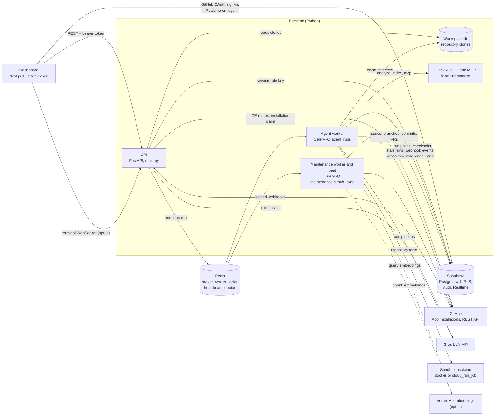
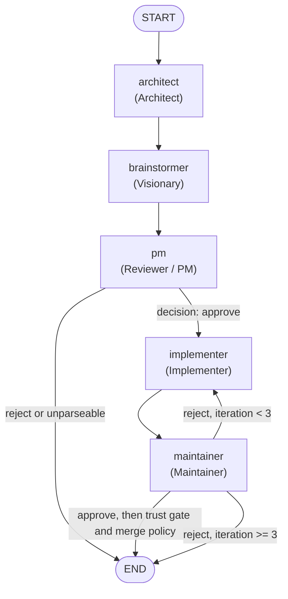

# AutoMaintainer Architecture

This document describes the system as it is implemented on `main`. Each
section names the source files it is based on; when that code changes, update
the section that names it. No test checks this document. The agent-graph
diagram is checked by hand against `build_graph()` in
`backend/automaintainer/_runtime/agents.py`.

This page gives the overall structure and links to the detailed documents
instead of repeating them:

| Topic | Detailed document |
| --- | --- |
| Deployment topologies, environment variables, owner steps, security checklist | [docs/DEPLOYMENT.md](./docs/DEPLOYMENT.md) |
| Test verification, sandbox backends, merge gating, audit tables | [docs/VERIFICATION.md](./docs/VERIFICATION.md) |
| Code retrieval (RAG): index, tenancy, data egress, cost, recall | [docs/RAG.md](./docs/RAG.md) |
| Metric catalogue and label rules | [docs/OBSERVABILITY.md](./docs/OBSERVABILITY.md) |
| Evaluation harnesses | [docs/EVALS.md](./docs/EVALS.md) |
| ADK specialist agents (design and status) | [docs/design/adk-specialist-agents.md](./docs/design/adk-specialist-agents.md) |
| Google Cloud resources (Terraform) | [infra/terraform/README.md](./infra/terraform/README.md) |

## Contents

- [Components](#components)
- [Run lifecycle](#run-lifecycle)
- [The agent pipeline (LangGraph)](#the-agent-pipeline-langgraph)
- [Idempotent side effects](#idempotent-side-effects)
- [Engine SDK](#engine-sdk)
- [Specialists](#specialists)
- [Code retrieval (RAG)](#code-retrieval-rag)
- [Verification and sandbox backends](#verification-and-sandbox-backends)
- [Observability](#observability)
- [Data model (Supabase)](#data-model-supabase)
- [Authentication and authorization](#authentication-and-authorization)
- [GitHub authentication](#github-authentication)
- [Web IDE, inline assist and terminal](#web-ide-inline-assist-and-terminal)
- [Security limits by component](#security-limits-by-component)
- [Defaults and opt-in features](#defaults-and-opt-in-features)
- [Eval harness](#eval-harness)
- [Known limitations](#known-limitations)

## Components

| Component | Code | Role |
| --- | --- | --- |
| API (control plane) | `backend/main.py` | Authenticates requests, authorizes them against the caller's organization, creates `runs` rows and enqueues Celery tasks, serves the IDE file routes, inline assist, webhooks and the opt-in terminal. It does not run the agent graph. |
| Agent worker | `backend/tasks.py`, `backend/automaintainer/_runtime/agents.py` | Consumes the `agent_runs` queue and runs the LangGraph pipeline, one task at a time per worker process (`worker_prefetch_multiplier=1`). |
| Maintenance worker and beat | `backend/tasks.py`, `backend/webhook_processor.py`, `backend/rag_tasks.py`, `backend/celery_app.py` | Consumes `maintenance` and `github_sync`. Beat schedules `cleanup_stale_runs` (every 5 min), `process_webhook_events` (every 5 min) and `sync_repositories` (every 6 h). The code-index tasks also run on `maintenance`. |
| Redis | `backend/celery_app.py`, `backend/automaintainer/_runtime/redis_locks.py`, `backend/quotas.py` | Celery broker and result backend (JSON serialization only), per-repository locks, run heartbeats, inline-assist quotas, index-request deduplication. |
| Supabase | `supabase/migrations/`, `supabase_schema.sql` | Postgres with Row Level Security, Auth (GitHub OAuth), and Realtime for live logs. `code_chunks` uses the pgvector extension. |
| Dashboard | `dashboard/` | Next.js 16 static export: run control, live logs, run history, admin page, Monaco-based Web IDE, terminal client. Served by Vercel or by the API from `dashboard/out`. |
| GitNexus | `backend/automaintainer/_runtime/agents.py`, `backend/main.py` | The worker indexes each clone with `gitnexus analyze` and `gitnexus index` and gives the LLM GitNexus tools over MCP (stdio). The API starts `gitnexus serve` at startup. Every GitNexus step is best-effort; on failure the agents use a plain completion. |
| Sandbox backend | `backend/automaintainer/runners/` | Runs the target repository's tests for verification. See [Verification and sandbox backends](#verification-and-sandbox-backends). |

### Celery queues

Source: `backend/celery_app.py` (`task_routes`, `task_queues`,
`beat_schedule`) and the `queue=` arguments in `backend/rag_tasks.py`.

| Queue | Tasks |
| --- | --- |
| `agent_runs` | `tasks.run_agent_loop_task` |
| `maintenance` | `tasks.cleanup_stale_runs`, the code-index tasks in `rag_tasks.py` |
| `github_sync` | `tasks.sync_repositories`, `webhook_processor.process_webhook_events` |
| `default` | Declared; no task is routed to it |

Celery delivers at least once: `task_acks_late=True` and
`task_reject_on_worker_lost=True`. A worker child is replaced after 10 tasks
or about 512 MB of memory. Exactly one beat process must run in a deployment.

### Process topologies

The same image runs in every topology. [docs/DEPLOYMENT.md](./docs/DEPLOYMENT.md)
describes each one:

- **Docker Compose** (`docker-compose.yml`): API, worker, beat and Redis.
- **Render** (`render.yaml`): one service runs the API and the `agent_runs`
  worker in one container; a second runs the `maintenance,github_sync` worker
  with the embedded beat.
- **Google Cloud** (`infra/terraform/`): the API on Cloud Run; one Compute
  Engine VM runs `celery worker -B` on all queues
  (`agent_runs,maintenance,github_sync,default`) with Redis on the VM or on
  Memorystore; verification runs in a Cloud Run job.

The API and every `agent_runs` worker must share the workspace directory
(`AUTOMAINTAINER_WORKSPACE_DIR`): the worker clones repositories there and the
IDE routes read them back. The Google Cloud deployment does not meet this
invariant, so its IDE routes answer `404`. See
[docs/DEPLOYMENT.md](./docs/DEPLOYMENT.md#topology).

## Run lifecycle

### Starting a run

A run starts in one of two ways. Both create a `runs` row with status
`queued` and enqueue `tasks.run_agent_loop_task` with the same arguments.

1. **`POST /start`** (`backend/main.py`). It requires a write role (`owner`,
   `admin` or `member`; `viewer` is read-only), checks that the repository
   belongs to the caller's organization, and checks that some Celery worker
   consumes `agent_runs` (`backend/worker_probe.py`). Without a worker it
   returns `503` and creates no run. The row records `trigger_source = "api"`
   and the caller's GitHub identity.
2. **Trigger label** (`backend/webhook_processor.py`). When the label named by
   `AUTOMAINTAINER_TRIGGER_LABEL` is added to an open issue of a registered
   repository, the stored `issues.labeled` delivery starts a targeted run on
   that issue. The row records `trigger_source = "label"` and the label
   adder's GitHub user id and login. The feature is off while the variable is
   unset or empty. A bot adder, or an issue author who is not an `OWNER`,
   `MEMBER` or `COLLABORATOR` labelling their own issue, gets no run. The
   delivery is also ignored when the installation is suspended, another run
   is active for the issue, or no agent worker is available.

### Statuses

`runs.status` is one of `queued`, `running`, `completed`, `failed`,
`cancelled` or `awaiting_review` (`supabase_schema.sql`, `runs` table).
`completed`, `failed` and `cancelled` are terminal
(`tasks.TERMINAL_RUN_STATUSES`). `awaiting_review` is allowed by the schema
and counts as active, but no backend code sets it today.

**One active run per issue.** The partial unique index
`runs_one_active_per_issue` on `runs (repository_id, target_issue_number)`,
over rows with status `queued`, `running` or `awaiting_review` and a
non-null `target_issue_number`, allows one active run per issue
(`supabase/migrations/20261117140000_run_trigger_and_active_issue.sql`). Both
start paths check for an active run first; the index decides when two
requests race. The losing insert fails with Postgres error `23505`:
`POST /start` answers `409` with the code `RUN_ALREADY_ACTIVE`, and the label
trigger records the delivery as `ignored`. Runs without a target issue are
not limited by the index.

### Execution

The worker (`tasks._execute_agent_run`):

1. skips the delivery if the run is already terminal;
2. takes the per-repository Redis lock. If another run holds it, the task
   retries every 30 s, up to 60 times, then marks the run `failed`;
3. starts a heartbeat thread that refreshes a Redis key every 20 s;
4. marks the run `running` and calls `agents.run_agent_loop`, with the event
   emitter wrapped in `MetricsEmitter` (see [Observability](#observability));
5. ends the run as `completed` or `failed`. The `finally` block records the
   run metrics, stops the heartbeat and releases the repository lock.

The task retries only on transient infrastructure errors before the first
side effect (at most 3 times, with backoff), and on a busy repository lock.
Time limits are 30 min soft and 32 min hard. A run that hits the soft limit
is stored as `failed` and counted as `timeout` in the metrics. The `mode`
field of `/start` is stored on the run but does not change the graph;
targeted behaviour comes only from `target_issue`.

`run_agent_loop` binds the run's GitHub credentials (see
[GitHub authentication](#github-authentication)) and streams the LangGraph
pipeline. Every node event is written to the `logs` table, which the
dashboard reads through Supabase Realtime
(`dashboard/src/lib/hooks/use-logs.ts`).

**Cancellation.** `POST /stop` with a `run_id` calls `cancel_run_task`. It
stops a run in the same process through `cancel_active_run` (see
[Engine](#engine)), revokes the Celery task with `SIGTERM` for runs in other
processes, sets the run to `cancelled` and releases the repository lock.
Without a `run_id`, `/stop` cancels every active run of the organization and
requires an org admin.

**Stale runs.** `cleanup_stale_runs` marks a `queued` or `running` run as
`failed` only when its row has not been updated for 10 minutes and its Redis
heartbeat has expired. It also revokes the task and releases the lock.

## The agent pipeline (LangGraph)

Source: `backend/automaintainer/_runtime/agents.py`, `build_graph()`. The node
ids below are the ids registered with `StateGraph`; the names in parentheses
are the display names used in logs and the dashboard.

<!-- agent-graph: checked by hand against backend/automaintainer/_runtime/agents.py, build_graph() -->

The routers are `should_implement` (after `pm`) and `should_iterate` (after
`maintainer`). The Implementer runs at most three times per run: the first
attempt plus two revisions. Inside an engine the cap is the config's
`max_iterations` (default 3).

`build_graph(nodes=None)` builds and compiles a new graph on each call.
`nodes` may replace node functions by id; the edges and routers are fixed,
and `backend/test_build_graph.py` pins the structure. The worker uses the
shared graph from `get_default_graph()` (also `agents.app`). Importing
`agents` builds nothing: the graph and the Supabase client (`get_supabase()`)
are created on first use under a lock, and
`backend/test_agents_import_side_effects.py` checks that the import makes no
network calls and writes no files.

| Node | What it does |
| --- | --- |
| `architect` | **Targeted mode** (`target_issue` set): fetches that issue and uses it as the directive. The run aborts if the issue cannot be fetched, if the number is a pull request, or if the text names no repository file. **Autonomous mode**: reads the root file list and README through the GitHub API, syncs the local clone, indexes it with GitNexus, builds an AST map (`backend/automaintainer/_runtime/ast_indexer.py`, tree-sitter), and asks the LLM for a directive. The run aborts if the directive names no target file. |
| `brainstormer` | In autonomous mode, asks the LLM for one feature and opens a GitHub issue for it. The issue carries a hidden run marker. In targeted mode, it reuses the target issue. It is also the resume point after a redelivery (see [Idempotent side effects](#idempotent-side-effects)). |
| `pm` | Asks the LLM to approve or reject the change. With code retrieval on, the prompt also carries the code chunks nearest to the issue (see [Code retrieval (RAG)](#code-retrieval-rag)). It comments the decision on the issue, and closes the issue on rejection, but only if the agent opened it. A human-filed issue stays open. Targeted runs go through this review too. |
| `implementer` | Rewrites **one whole file**: the target file on the default branch, or on the PR branch in later iterations. It refuses files larger than `IMPLEMENTER_MAX_FILE_CHARS` (default 60 000). The model output is validated by `normalize_generated_code` (refusals, truncated output with `finish_reason=length`, ambiguous code fences, empty output) and `validate_generated_code`: a syntax check for Python (`ast`), JSON, TOML and YAML, a heuristic bracket check for JS/TS, and a shrink guard that refuses a rewrite keeping less than `IMPLEMENTER_MIN_SIZE_RATIO` (default 0.4) of a file larger than `IMPLEMENTER_SHRINK_GUARD_MIN_BYTES` (default 2048) unless the directive explicitly asks for removal. The change is checked against the [change limits](#change-limits) and committed to a run-scoped branch; the node then opens a PR or reuses the existing one, and the change is verified with the repository's tests (see [Verification and sandbox backends](#verification-and-sandbox-backends)). |
| `maintainer` | Reviews the PR diff (the prompt includes at most 20 000 characters of it) together with the current iteration's verification result, comments the review, and applies the trust gate and merge policy. With `reviewer_backend="adk"` the review itself comes from the ADK Reviewer (see [Specialists](#specialists)); everything after the decision is the same. |

### Structured verdicts

The PM and the Maintainer answer with a JSON object validated by pydantic
(`AgentDecision`, `MaintainerDecision` in
`backend/automaintainer/_runtime/agents.py`):
`{"verdict": "approve" | "reject", "reasons": [...], "blocking_issues": [...]}`,
plus `requested_changes` for the Maintainer (`decision` is accepted as an
alias of `verdict`). An approval that lists blocking issues is invalid. A
reply that does not parse or validate gets one corrective retry; a second
failure is a rejection, so the step fails closed. The older
`VERDICT: APPROVE` / `VERDICT: REJECT` line format is no longer accepted: such
a reply is treated like any other non-JSON reply, and a run checkpointed with
a legacy verdict resumes as a rejection.

### Merge policy

`MERGE_POLICY` (`get_merge_policy`) controls what happens after the
Maintainer approves a PR. It is the deployment's **ceiling**. A repository
can make it stricter (`human` < `ci` < `auto`) through
`repositories.merge_policy` (NULL inherits), set by org owners and admins in
the dashboard or with `PUT /repositories/{id}/merge-policy`, which refuses a
value looser than the ceiling (422). Each change is recorded in the
append-only `repository_merge_policy_changes` table (old and new value, the
caller's user id, time) by the `set_repository_merge_policy` database
function (service role only), in the same transaction as the change.
Re-setting the current value records nothing. Members read the history with
`GET /repositories/{id}/merge-policy/history` (newest first, `limit` at most
100); the `GET` response carries the latest change as `last_change`.

The run uses the stricter of the ceiling and the repository setting, read at
the merge decision (`backend/automaintainer/_runtime/merge_policy.py`). It
fails closed: if the setting cannot be read the run uses `human` and records
`repository merge policy unreadable (fail closed)`; if the run's `runs` or
`repositories` row is missing (PostgREST returns a row hidden by RLS, a wrong
key or a deleted row as an empty result, which could hide a stricter setting)
it records `repository merge policy row missing (fail closed)`. Only an
existing repository row whose `merge_policy` is NULL inherits the ceiling.
`MERGE_POLICY` must be the same on the API (which shows the ceiling and
validates `PUT`) and on every `agent_runs` worker (which enforces it).
`merge_decisions.policy` records the effective policy, with a
`repository policy 
 (ceiling <c>)` reason when the repository lowered it.

| Value | Behaviour |
| --- | --- |
| `human` (default; also used for unknown values) | Never merges. Leaves the PR open with `merge_status=awaiting_human_review` and requests a review from the issue's assignees, or from the repository owner if it is a user account. |
| `ci` | Merges only if the `automaintainer/verification` commit status on the PR head is `success` **and** every other commit status and check run is in a passing state (`success`, `neutral` or `skipped`, see `_PASSING_CHECK_STATES`). The check runs once, right after the review, so pending checks block the merge. Without a sandbox backend (and without `VERIFY_ALLOW_LOCAL=true`) verification reports an error, so `ci` never merges. |
| `auto` | Merges on the Maintainer's approval alone (and a trusted trigger, below). Not recommended. |

**Further merge gates.** Under `ci` and `auto`, the merge is also skipped
when the review comment could not be posted, when the diff the Maintainer saw
was incomplete (truncated, or a file without a patch), when the change
exceeds the change limits, and when the run's trigger is not trusted. The
merge pins the reviewed head SHA, so GitHub refuses it if the branch moved
after the review.

**Trusted-trigger gate** (`backend/automaintainer/_runtime/trust.py`, #487).
This gate is deterministic and runs after every model decision. Every GitHub
user who caused the run must have `write`, `maintain` or `admin` permission
on the repository (`GET /repos/{owner}/{repo}/collaborators/{username}/permission`,
through the run's installation-scoped client, looked up once per run). The
actors are:

- for a run started with `POST /start`, the caller's linked GitHub account
  (the numeric user id of their Supabase GitHub identity);
- for a run started by the trigger label, the user who added the label;
- for any run that targets an issue, also that issue's author, because the
  issue body is the task the models follow.

Every actor is checked by GitHub user id: the id is resolved to its current
login (`GET /user/{account_id}`) before the permission lookup, so a renamed
account is checked under its new name and a freed login re-registered by
someone else never stands in for it (#491). An unknown actor (no linked
GitHub identity, for example under the development auth bypass), a bot
account (there is no bot allowlist), a non-collaborator or a failed lookup
holds the PR with `merge_status=awaiting_human_review`, as under `human`.
The hold is sticky for the run: a redelivery that reviews again finds the
earlier `held` `merge_decisions` row and holds again.

The gate vouches for who caused the run, not for repository content it reads
(README, code comments), which only a writer can change. The run's own issue
(a run without a target issue) is not an outsider's input either: a
redelivery reuses an issue only when it carries the run's hidden marker
**and** was opened by the identity the run acts as (`<app-slug>[bot]`, or the
PAT's user), never a copy of the marker in someone else's issue (#490).

**Denied paths.** A path on the change-limits denylist is refused **before**
it is committed (#488): nothing reaches the run branch, where a
push-triggered workflow could run it, no PR is opened, and the run fails
with `PROTECTED_PATH`. If a later iteration of a run that already has a PR
hits a denied path (the base branch's `.automaintainer.yml` changed), that
PR is held as a draft `needs-human` PR. If `.automaintainer.yml` on the base
branch cannot be read (any error except a 404, such as a 5xx or a rate
limit) or parsed, its `deny` entries are unknown, so nothing is committed and
the run fails the same way. File and line limits are also evaluated before
the commit; a change over them is still committed and opened as a draft for
a human.

### Change limits

Before the Implementer commits to the run branch (and before every later
push to it), `backend/automaintainer/_runtime/change_limits.py` measures the
change against the base branch:

- changed files: `CHANGE_LIMIT_MAX_FILES`, default 10;
- changed lines: `CHANGE_LIMIT_MAX_LINES`, default 500;
- a path denylist: `CHANGE_LIMIT_DENYLIST`, comma-separated globs that
  replace the default list.

The default denylist covers `.github/workflows/**`, `Dockerfile*`,
`docker-compose*.yml`, lockfiles such as `uv.lock` or `package-lock.json`,
`.env*`, `*.pem`, `*.key`, test-runner configuration and
`.automaintainer.yml`. Test-runner configuration (`conftest.py` at any depth,
`pytest.toml`, `.pytest.toml`, `pytest.ini`, `.pytest.ini`, `tox.ini`,
`noxfile.py`, `setup.cfg`, `pyproject.toml`, `package.json`, `jest.config.*`,
`vitest.config.*`, `vitest.workspace.*`, `vitest.projects.*`,
`vite.config.*`, `.mocharc*`, `karma.conf.*`, `playwright.config.*`) is
denied because a change to it can skip or short-circuit the tests that
verification runs and turn a failing change into a passing one (#480). So are
`pytest.py`, `pytest/**` and `_pytest/**` at any depth, because a custom
`python -m pytest` from the repository root imports a root module of that
name instead of pytest, and `.npmrc`, which configures how `npm test` runs.

Test files, setup files and other modules the tests load are not denied: the
agent writes tests, so a change can still weaken a test or a module it edits,
and no name list can catch a root module shadowing something pytest imports,
standard library included. The detected test command puts the repository
root last on `sys.path` instead (see
[docs/VERIFICATION.md, Limitations](./docs/VERIFICATION.md#limitations)). No
default entry protects a custom `test_command`; a repository that sets one
should add its entry point (a script, a `Makefile`) to `deny`.

A glob without `/` matches the file name in any directory; one with `/` is
anchored at the repository root. A repository can override the limits in the
`change_limits` section of `.automaintainer.yml`: `max_files`, `max_lines`,
`deny` (adds globs) and `allow` (exempts globs, never `.automaintainer.yml`).
That file is read from the **base** branch, so a change cannot relax its own
limits. For example, `allow: ["pyproject.toml"]` lets a repository's agent
edit `pyproject.toml` while every other runner configuration file stays
denied. An invalid or unreadable configuration refuses every commit with
`PROTECTED_PATH`, as a denied path does; the failure is terminal and the run
has to be rerun by hand.

A change over the file or line limit gets a draft PR, the `needs-human`
label and a "Change limits exceeded" section in the PR body, and the
Maintainer never merges it under any `MERGE_POLICY`. The violations are kept
in the run state and checkpoint, so they stay in force for later iterations
and redeliveries; the agent never marks such a PR ready for review.

### Prompt-injection hardening

Issue text, READMEs, file lists, file contents, retrieved code chunks,
model-generated directives and reviews all reach prompts inside
`<untrusted-data>` blocks (`untrusted_block`). Look-alike closing tags in that
text are escaped. Every system prompt that receives such a block includes
`UNTRUSTED_DATA_NOTICE`. The PM prompt tells the model to reject changes to
credentials, CI configuration or access control. These measures reduce the
risk; they are not a guarantee. The guarantee against an unreviewed merge is
`MERGE_POLICY=human`. The red-team fixtures in `backend/tests/redteam` check
these paths (see
[docs/VERIFICATION.md, Red-team fixtures](./docs/VERIFICATION.md#red-team-fixtures)).

### LLM access

Models: `llama-3.3-70b-versatile` on Groq, with `llama-3.1-8b-instant` as a
silent fallback on the tool path. Source:
`backend/automaintainer/_runtime/agents.py`,
`backend/automaintainer/_runtime/rate_limiter.py`.

- **Tool path first.** `run_llm_with_tools` runs a LangGraph ReAct agent with
  the GitNexus MCP tools. Its model is `llama-3.3-70b-versatile` with
  `llama-3.1-8b-instant` as a fallback, so if a 70B call raises, the 8B model
  answers instead. Nothing marks a result as coming from the 8B model, and the
  telemetry event still records `model_name="llama-3.3-70b-versatile"`.
  Implementer code and PM or Maintainer verdicts can therefore come from the
  smaller model without any visible signal. This is one more reason to keep
  the default `MERGE_POLICY=human`.
- **Plain completion second.** If the tool path fails as a whole (for example
  GitNexus is not installed), the node falls back to a plain completion with
  `llama-3.3-70b-versatile` only (`run_llm_with_rate_limit`). Inline assist in
  the Web IDE also uses the 70B model only.
- **Key rotation and budgets.** All calls go through `rate_limiter.py`, which
  rotates `GROQ_API_KEY` and `GROQ_API_KEY_1` to `GROQ_API_KEY_19` and
  enforces client-side request and token budgets per key
  (`GROQ_REQUESTS_PER_MINUTE`, default 30; `GROQ_TOKENS_PER_MINUTE`, default
  6000). The manager is an in-memory singleton guarded by a `threading.Lock`.
  It does not use Redis, so **each API and worker process keeps its own
  budget for each key**. Several processes sharing a key can together exceed
  Groq's real limit and then rely on the 429 retry path.
- If no LLM path answers, the node raises `PipelineAbortError`, so error text
  never ends up in issues, commits or reviews.

Inside an engine, each node's phase maps to a `ModelRouting` role, and the
engine calls the routed model and its fallback (see [Engine](#engine)).

### Errors

A node raises `PipelineAbortError(error_code, message, phase)` to end a run
with a clear reason, for example `NO_TARGET_FILE`, `TARGET_FILE_TOO_LARGE`,
`INVALID_GENERATED_CODE`, `LLM_EXECUTION_FAILED`, `MERGE_FAILED` or
`REVIEWER_BACKEND_UNAVAILABLE`. `run_agent_loop` turns it into a fatal
`ErrorEvent` and a `failed` run. Any other exception ends the run as `failed`
with `RUN_FAILED`.

Some steps report a problem without ending the run, as a non-fatal
`ErrorEvent` (`fatal=False`). The ADK Reviewer emits
`SPECIALIST_REVIEW_FAILED` for every fail-closed rejection (a budget, the
timeout, an invalid answer after the retry, a checkout failure), with the
reason in the message; the rejection then goes through the normal retry
loop.

## Idempotent side effects

Celery delivers tasks at least once, so a run can execute again after a
worker crash. The task has no blanket `autoretry_for`; it retries only as
described in [Execution](#execution).

| Artifact | How a re-run finds it instead of creating it again |
| --- | --- |
| Issue | A hidden `<!-- automaintainer-run: <run_id> -->` marker in the body. The node scans the 100 newest issues for it and reuses one only if the run's own account (the App bot, or the PAT user) opened it (#490). |
| Branch | A deterministic name derived from the run id (`run_branch_name`). |
| PR | Looked up by head branch. |
| Commit | Skipped when the file on the branch already has that content. |
| Merge | Skipped when the PR is already merged. |

`runs.checkpoint` (JSONB) records the completed steps: the issue number and
idea, the PM decision, the branch, PR number and target file, the implemented
and reviewed iteration, the review and the merge status. `brainstormer`
restores the state from it, and each later node skips a step its checkpoint
marks as done. The GitHub lookups above still work if a checkpoint write was
lost. The repository lock is re-entrant for the same `run_id`, so a
redelivered task can take back its own lock.

## Engine SDK

`backend/automaintainer` is both the server's runtime and an installable
library. `AutoMaintainerEngine` runs the pipeline in-process with its own
configuration and clients; the API and Celery path use a process-default
engine that keeps their environment-driven behaviour.

### Engine configuration

`backend/automaintainer/config.py` defines `AutoMaintainerConfig` (#183): one
immutable Pydantic v2 model (`frozen`, `extra="forbid"`) for the engine's
credentials, model routing, execution and safety settings.
`AutoMaintainerEngine` runs on it; `run_agent_loop` (the API and Celery path)
still reads the environment.

- Values resolve in this order: explicit argument; the environment variable
  the runtime reads (`from_env(environ)` reads only the mapping it is given,
  default `os.environ`); for credentials only, an optional `SecretProvider`
  callable (name in, value or `None` out); the runtime's default. The
  defaults equal the runtime's behaviour, for example every role routed to
  `llama-3.3-70b-versatile` with the `llama-3.1-8b-instant` fallback,
  `max_iterations=3`, `merge_policy="human"`, `reviewer_backend="langgraph"`,
  `rag_retrieval_enabled=False` and `rag_top_k=8` (range 1 to 50).
- Credentials (`GITHUB_TOKEN`, `GITHUB_APP_ID`, `GITHUB_APP_PRIVATE_KEY`, the
  `GROQ_API_KEY` pool) are `SecretStr`; neither `repr`, dumps nor validation
  errors contain their values.
- Validation is stricter than the runtime. A malformed or unknown value (for
  example `MERGE_POLICY=yolo`) is an error instead of a logged fallback, and
  so are an App id without a private key, an empty Groq key pool, a blank
  Groq key, a relative `workspace_dir`, `timeout_seconds` above
  `max_timeout_seconds` (the runtime silently caps it), and
  `reviewer_backend="adk"` without the `adk` extra installed. All problems
  are reported together in one `ValidationError`.
- Boolean variables (`VERIFY_CHANGES`, `VERIFY_ALLOW_LOCAL`,
  `RAG_RETRIEVAL_ENABLED`) accept exactly `1/true/yes/on` and
  `0/false/no/off`; anything else is an error, never pydantic's lax
  `f`/`n` = false, which would turn the verification gate off where the
  runtime keeps it on.
- `github_auth_mode="pat"` without `GITHUB_TOKEN` is accepted, as in the
  runtime: such a run proceeds without GitHub access.
- `model_copy(update=...)` skips validation (pydantic's behaviour); derive
  variants by constructing a new config instead.
- `enable_hitl` is derived (`merge_policy == "human"`), not a separate flag.
  There are no OpenAI or Anthropic keys, command denylist or cost ceiling,
  because the runtime has no provider, mechanism or meter they would map to.
  Settings of the API, persistence and broker are out of scope;
  `backend/tests/test_engine_config.py` lists each one with its reason and
  fails when the runtime starts reading a variable that is in neither list.

### Engine

`backend/automaintainer/engine.py` defines
`AutoMaintainerEngine(config, *, supabase=None, llm=None, github=None, emitter=None, nodes=None, retriever=None)`
(#186; `retriever`, #526). Several engines with different configurations can
run in one process and one event loop without sharing clients, settings or
caches.

- **Engine context.** For each run the engine publishes one `EngineContext`
  through the `current_engine` ContextVar (`automaintainer/context.py`). It
  carries the config, the engine id, the database client, the injected `llm`,
  `github` and `retriever` collaborators, the engine's rate-limiter factory
  and its GitHub App slug cache. The helpers the nodes call look there first
  and fall back to their previous behaviour when no engine is active:
  `agents.get_supabase` (the engine's client, or none; never the process
  client), `rate_limiter.get_rate_limit_manager` (the engine's own key pool
  and budgets), the GitHub App identity, auth mode and PAT in `github_app`,
  the App slug cache, the workspace root and git timeout, `verification`
  (`verify_changes`, `runner_type`, timeouts, `sandbox_backend`),
  `merge_policy.deployment_ceiling`, `change_limits.default_limits`, the
  Implementer limits, `max_iterations`, `reviewer_backend` and the retrieval
  settings. Node tasks and `asyncio.to_thread` workers inherit it.
- **Injected collaborators.** All are optional. `supabase` is the engine's
  database client (without it the engine runs without a database; it never
  uses the process client). `llm` replaces the Groq call; rate limiting and
  key rotation still apply. `github` replaces the credentials factory.
  `emitter` is the default event emitter. `nodes` replaces node functions by
  id. `retriever` is a code-retrieval factory: called once per prompt with
  the run's `RetrievalScope`, it returns a `Retriever` bound to that
  repository, or `None`. Without it the runtime builds a pgvector retriever
  over the engine's database client.
- **Lazy clients.** The constructor does no I/O. The compiled graph
  (`agents.build_graph(nodes)`) is built on the first run and the
  `RateLimitManager` on the first LLM call. Use the engine as an async context
  manager or call `aclose()`.
- **Caches.** Installation tokens are cached by (installation, repository,
  permissions, App id), and a credential keeps the App it was created for.
  The workspace scrub runs once per workspace root; clone locks are keyed by
  absolute path, which includes the root.
- **`run()`** returns a `RunResult` (`status`, `run_id`, `pr_url`,
  `error_code`, `error`, `raw`). The run executes in an asyncio task owned by
  the engine; its ContextVars are set with tokens and reset when it ends.
- **Cancellation.** `cancel(run_id, grace_seconds=None)` stops the run before
  its next node starts. Every graph node checks first, because LangGraph's
  `astream` runs ahead of its consumer; a node in flight finishes. A cancel
  that arrives during the last node leaves the run `completed`. With
  `grace_seconds` the task is also cancelled after that delay. Either way the
  run emits `RUN_CANCELLED` once and is marked `cancelled`, also when the
  cancel lands before the graph starts (during the `runs` upsert or
  credential binding) and when its task is cancelled. The final `completed`
  write is shielded (#524): a grace cancel that lands during it lets it finish
  and the run stays `completed`, since its work (possibly a merge) is done; a
  cancelled caller of `run()` still gets `CancelledError` after the write.
  `aclose()` stops the engine's runs the same way, so their `run()` calls
  return `cancelled`. `tasks.cancel_run_task` calls `cancel_active_run`,
  which reaches a run in the same process.
- **`run_agent_loop`** is a thin wrapper over the process-default engine,
  which has no config and publishes no engine context, so the API and Celery
  path keep their behaviour. It is not built from
  `AutoMaintainerConfig.from_env()` on purpose: that validation is stricter
  than the runtime and snapshots the environment, which would change when and
  how a misconfigured run fails. A second call with the `run_id` of a run
  still in progress in the process returns a `failed` result
  (`RUN_ALREADY_ACTIVE`) and leaves that run's row and events alone.
- **Workspace root.** An engine's `workspace_dir=None` is
  `<tmp>/automaintainer`; the engine never reads
  `AUTOMAINTAINER_WORKSPACE_DIR`. Two engines that both leave it unset share
  that root (and its clone locks), as two processes would.
- **Denylist.** `forbidden_paths=()` denies nothing but `.automaintainer.yml`,
  the same as `CHANGE_LIMIT_DENYLIST=","` on the environment path; the
  built-in list applies only when it is `None`.
- **Nodes.** Every node is wrapped by the cancel check, which carries the
  node's signature and passes its arguments through, so LangGraph injects
  `config` and the like as for an unwrapped node. Async functions, partials
  of them and objects with an async `__call__` are awaited.
- **Not per engine yet** (still read from the host process inside an engine
  run): the runners' `dry_run`; `GITHUB_APP_SLUG` (the slug fallback when
  `GET /app` fails); `ENVIRONMENT` (`verification._is_production`);
  `VERIFY_PYTHON`; `VERIFY_MAX_OUTPUT_BYTES`; the short sandbox alias
  `cloud_run_job` (only `SANDBOX_BACKEND` knows it; `sandbox_backend` takes
  the full `package.module:factory` form); the host environment copied into
  test processes (`verification._ENV_ALLOWLIST`) and into git subprocesses;
  and logging and warnings setup, which is process-global by nature.

**Concurrency guarantees** (pinned by `backend/tests/concurrency/`, #187).
Engines in one event loop never see each other's database client, rate
limiter, App identity, token, workspace root, retriever or settings, also
from tasks and `asyncio.to_thread` workers their runs start. A run's
ContextVars are gone from the caller after success, failure, an exception or
a cancel. A cancelled run (also one stopped by `aclose()` or a caller cancel
before its task took a step) emits one `RUN_CANCELLED`. Installation tokens
never cross Apps under thread contention, but two threads missing the same
cache entry at once may both mint (both tokens are valid). Clone locks
serialise one clone and never block clones under another root. Two
concurrent trigger-label deliveries for one issue start one run (see
[Statuses](#statuses)).

### Package and wheel

`backend/automaintainer` is distributed as the `automaintainer` wheel
(`uv build` in `backend/`, hatchling, version from
`automaintainer.__version__`). `.github/workflows/publish-sdk.yml` publishes
it on `sdk-v*.*.*` tags, and does nothing until the repository variable
`SDK_PUBLISH_ENABLED` is `true` (see
[docs/DEPLOYMENT.md](./docs/DEPLOYMENT.md#ci-publishing-the-python-sdk)).

- **Public surface.** `automaintainer` exports `AutoMaintainerConfig`,
  `AutoMaintainerEngine`, `RunResult`, `RunAlreadyActive`,
  `cancel_active_run`, the runners (`BaseRunner`, `LocalRunner`,
  `SandboxRunner`, `SandboxBackend`) and the `RunnerError` family, all
  resolved lazily: `import automaintainer` does no I/O and loads no runtime
  module. Importing the runtime loads no `.env` file and logs nothing either:
  `main` and `celery_app` call `github_app.configure_process_environment()` at
  startup, which loads `.env` and logs the PAT-mode warning.
- **Layout.** The wheel contains only the `automaintainer` package
  (`[tool.hatch.build.targets.wheel] packages = ["automaintainer"]`):
  - `automaintainer/config.py`, `context.py`, `engine.py`: the public engine;
  - `automaintainer/runners/`: `base`, `local`, `sandbox`, `docker_sandbox`,
    `cloud_run_job_sandbox`;
  - `automaintainer/_runtime/` (private): `agents`, `ast_indexer`,
    `change_limits`, `events`, `github_app`, `merge_audit`, `merge_policy`,
    `rate_limiter`, `redis_locks`, `retrieval`, `trust`, `verification`,
    `workspace`. These modules import each other relatively;
  - `automaintainer/_specialists/` (private): see [Specialists](#specialists).

  The server modules (`main`, `tasks`, `celery_app`, `quotas`,
  `observability`, `telemetry_metrics`, `rag_tasks`, `webhook_processor`) are
  not in the wheel, and the package never imports them.
- **Legacy module aliases.** `backend/agents.py`, `backend/retrieval.py`,
  `backend/runners/` and the other old top-level paths are aliases: each puts
  the moved module itself in `sys.modules` under the old name, so
  `import agents`, `mock.patch("agents.x")`, the old logger names and
  `SANDBOX_BACKEND=runners.docker_sandbox:create` reach the code that runs.
  They exist only in the source tree (the server). SDK users import
  `automaintainer.*`, for example
  `automaintainer.runners.docker_sandbox:create`.
- **Dependencies.** The base install is what the engine imports (LangGraph,
  langchain-groq, PyGithub, Supabase, Redis, tree-sitter, MCP, PyJWT, and
  FastAPI, because `workspace` raises `fastapi.HTTPException`). Optional
  extras: `server` (uvicorn, Celery, OpenTelemetry and its exporters, and the
  other server-only packages), `adk` (`google-adk`, `litellm`) and `rag`
  (`google-genai`). The image, CI and `scripts/export-backend-requirements.sh`
  install `server`; the Dockerfile's `EXTRAS` build argument adds more.
  `[tool.uv] package = false` stays: `uv sync` manages the server's
  environment and does not install the project.
- **CI.** In `.github/workflows/ci-backend.yml`, the `sdk-wheel` job builds
  the wheel, installs it in a fresh venv with no extras and imports the
  engine outside the source tree. The `test-extras` job installs the `adk`
  and `rag` extras and runs `tests/specialists`,
  `tests/concurrency/test_concurrency_adk_reviewer.py`, `tests/rag` and
  `tests/redteam`, failing if any of those tests is skipped.

## Specialists

Source: `backend/automaintainer/_specialists/` (`contracts.py`, `tools.py`,
`reviewer_adk.py`). Design and rollout:
[docs/design/adk-specialist-agents.md](./docs/design/adk-specialist-agents.md)
(#525).

A specialist is a read-only, tool-using agent that one graph node calls with
a typed request. LangGraph keeps run state, cancellation, the retry loop, the
trust gate, merge policy and every GitHub write. The package sits next to
`_runtime`, imports ADK only inside its functions, and never imports the
server's `observability` module, so the wheel without extras still imports
it.

The only specialist is the **ADK Reviewer** (`reviewer_adk.py`), built with
Google's Agent Development Kit. It is **off by default**:

- **Switch.** `reviewer_backend` (`REVIEWER_BACKEND`), `"langgraph"` (default,
  the single-shot review) or `"adk"`. `adk` needs the `adk` extra. An engine
  config with `adk` and no extra fails validation; a process without an
  engine that reads `REVIEWER_BACKEND=adk` without the extra aborts the run
  with `REVIEWER_BACKEND_UNAVAILABLE`. Neither falls back to the other review.
  An unknown `REVIEWER_BACKEND` value is logged and the default kept.
- **Seam.** It replaces only the review call in `maintainer_node` and returns
  the same `MaintainerDecision`. The comment, trust gate, merge policy and
  checkpoint after it are shared.
- **Tools.** Per review it builds a fresh agent and session with the
  Maintainer's routed model and a key from the engine's rate limiter. The
  model gets four read-only tools (`tools.ReviewTools`): `get_diff`,
  `read_file`, `search_code` and `get_verification_log`, over a temporary
  shallow clone of the PR at its head SHA. Paths are resolved and refused
  outside the checkout (including through symlinks) or under `.git`; every
  output is capped. `search_code` uses the code index when retrieval is on
  and the index holds exactly the PR head commit, and ripgrep otherwise.
  Tool results reach the model as `<untrusted-data>`.
- **Budgets** (`ReviewBudget`): 8 tool calls, 11 model calls, 60 000 tokens,
  4 096 output tokens per answer, 180 s per review.
- **Fail closed.** Budgets, timeout, errors, a call to an unregistered tool, a
  run stop and an answer that is still invalid after one retry all end in a
  rejection that says why. A cancelled task propagates `CancelledError`, so it
  produces no decision. With no PR there is nothing to check out, so the ADK
  backend always rejects (the LangGraph review still reviews the generated
  code in the graph state).
- **Tracing and accounting.** Each review is a `specialist.reviewer` span
  with `specialist.tool` children, from the OpenTelemetry API's global tracer,
  and one `TelemetryEvent` for its tokens.
- **Transport.** It calls the provider through ADK (LiteLLM for Groq, or the
  Gemini client), not through an engine's injected `llm` transport. A host
  that injects a transport, including the evaluation harness's recording
  and replay, does not see these calls, so ADK reviews can only be
  evaluated live.

What is still open before anyone enables it (the Groq spike, the live
comparison) is listed in the design note's Status section.

## Code retrieval (RAG)

Source: `backend/automaintainer/_runtime/retrieval.py`, `backend/rag_tasks.py`,
`agents.retrieved_context` and `agents.resolve_retriever`. Details:
[docs/RAG.md](./docs/RAG.md). Indexing and retrieval are **off by default**.

- **Storage.** The `code_chunks` table (pgvector, 768 dimensions, HNSW cosine
  index) holds one row per chunk and commit. RLS lets authenticated members
  read only their organizations' chunks; only the backend writes. The
  `match_code_chunks(org, repository, embedding, k)` function filters by
  organization and repository itself, because the backend calls it with the
  service role; `k` is clamped to 0 to 50. Migrations:
  `20261118120000_code_chunks_pgvector.sql` and
  `20261118183000_code_chunks_org_transfer.sql`.
- **Chunker.** `chunk_repository` splits Python, JavaScript and TypeScript
  files at function, method and class boundaries with tree-sitter, keeps
  decorators with their definitions, and adds gap chunks for module-level
  code. Other text files become file-level chunks. Files named like
  credentials (`.env*`, `*.pem`, `*.key`, SSH keys, keystores, `.npmrc`,
  `.pypirc`, `.netrc`, `.git-credentials`) are never chunked. This is a name
  list, not secret scanning.
- **Embedders.** `VertexEmbedder` calls Vertex AI `text-embedding-005`
  through the `rag` extra; `HashingEmbedder` is an offline embedder for tests
  and the recall eval.
- **Retrievers.** `PgvectorRetriever` calls `match_code_chunks` over
  PostgREST; `InMemoryRetriever` ranks in Python. `format_untrusted_chunks`
  wraps each chunk in an `<untrusted-data>` block.
- **PM integration.** With `RAG_RETRIEVAL_ENABLED` (engine:
  `rag_retrieval_enabled`), the PM prompt gets the `RAG_TOP_K` (default 8)
  chunks nearest to the issue text (the query is capped at 2 000 characters,
  the section at 12 000). Retrieval runs in a thread with a 10 s timeout. Any
  error or timeout is logged by exception type and the prompt stays as it
  would be with retrieval off.
- **Reviewer integration.** The ADK Reviewer's `search_code` uses the same
  resolution, scoped to the run's repository and the PR head commit (see
  [Specialists](#specialists)).
- **Retriever resolution.** `resolve_retriever` uses the engine's injected
  factory when there is one, and otherwise a `PgvectorRetriever` over the
  run's database client.
- **Indexing trigger.** With `RAG_INDEXING_ENABLED`, a Celery `task_prerun`
  handler for `tasks.run_agent_loop_task` enqueues
  `ensure_repository_indexed_task` on the `maintenance` queue, at most once
  per repository every 10 minutes (Redis `NX` key). The task compares the
  default branch's head (`git ls-remote`) with the indexed commit,
  shallow-clones only when the index is stale, and indexes under a
  per-repository lock. `RAG_MAX_CHUNKS` (default 20 000) caps the chunks per
  repository. A failure to enqueue never affects the run. Only default
  branches are indexed, so the Reviewer mostly uses ripgrep for PR heads.
- **Organization transfer.** A composite foreign key from
  `code_chunks (repository_id, org_id)` to `repositories (id, org_id)` with
  `ON UPDATE CASCADE ON DELETE CASCADE` keeps each chunk's organization equal
  to its repository's, so chunks follow a repository that moves.

With `rag_enabled = true`, Terraform sets `RAG_INDEXING_ENABLED` and
`RAG_RETRIEVAL_ENABLED` together, and repository code is sent to Vertex AI
in `rag_location` (see
[docs/RAG.md, Data egress](./docs/RAG.md#data-egress)).

## Verification and sandbox backends

Source: `backend/automaintainer/_runtime/verification.py`,
`backend/automaintainer/runners/`. Details:
[docs/VERIFICATION.md](./docs/VERIFICATION.md).

After each Implementer push, verification checks out the PR head and runs the
repository's tests: the command from `.automaintainer.yml` at the repository
root, otherwise a detected `pytest` or `npm test`. The result is added to the
PR body, posted as the `automaintainer/verification` commit status (which
gates `MERGE_POLICY=ci`), stored in `verification_results`, and given to the
Maintainer's prompt: status and exit code, plus the command and output tail
inside an `<untrusted-data>` block, or an explicit "not run" note.
`VERIFY_CHANGES=false` turns verification off; the result is then `skipped`,
which still blocks `ci`.

The test command is untrusted repository code, so it runs through the backend
named by `SANDBOX_BACKEND` (the `SandboxRunner` adapter; an engine uses its
`sandbox_backend`):

| Backend | Selected with | Where it runs |
| --- | --- | --- |
| Docker | `SANDBOX_BACKEND=automaintainer.runners.docker_sandbox:create` | A fresh, ephemeral container per command, started through the `docker` CLI. See [Docker sandbox backend](./docs/VERIFICATION.md#docker-sandbox-backend). |
| Cloud Run job | `SANDBOX_BACKEND=cloud_run_job` (short for `automaintainer.runners.cloud_run_job_sandbox:create`) | One execution of a Cloud Run job per command. The working copy and the result move through a per-run bucket with signed URLs; the job's service account has no role, and its network has no route to the internet. See [Cloud Run Jobs sandbox backend](./docs/VERIFICATION.md#cloud-run-jobs-sandbox-backend). |
| Local host | `VERIFY_ALLOW_LOCAL=true` (engine: `runner_type="local"`) | The API or worker host itself. Refused in every environment unless explicitly enabled, and Terraform refuses `VERIFY_ALLOW_LOCAL` in `app_env`. |

A set but unusable `SANDBOX_BACKEND` raises an error instead of falling back
to the host. Defaults by deployment:

- Docker Compose and Render set no `SANDBOX_BACKEND`, so verification reports
  an error and `MERGE_POLICY=ci` never merges until the operator configures a
  backend.
- The Google Cloud worker VM sets `SANDBOX_BACKEND=cloud_run_job` and the
  `CLOUD_RUN_SANDBOX_*` variables (`infra/terraform/modules/worker/main.tf`);
  `infra/terraform/sandbox.tf` creates the job, its network and the bucket.
  The owner smoke test of this backend has not been run yet (see
  [docs/DEPLOYMENT.md, Sandboxed verification](./docs/DEPLOYMENT.md#sandboxed-verification)).

`LocalRunner` (no shell, scrubbed environment, timeouts) is not used by the
agent pipeline.

## Observability

Source: `backend/observability.py`, `backend/telemetry_metrics.py`,
`backend/tasks.py`, `backend/celery_app.py`. The metric catalogue (names,
labels, and where each is recorded) is in
[docs/OBSERVABILITY.md](./docs/OBSERVABILITY.md).

- **Tracing.** OpenTelemetry with FastAPI, HTTPX, requests and Redis
  instrumentation. Spans go to the console outside production, to OTLP when
  `OTEL_EXPORTER_OTLP_ENDPOINT` is set, and to Cloud Trace when
  `OTEL_CLOUD_TRACE_ENABLED` is true. On Google Cloud, Terraform sets the
  Cloud Trace switch on the API service only (`cloud_trace_enabled`, default
  `false`).
- **Metrics.** An OpenTelemetry meter with a Prometheus reader in the API,
  an OTLP exporter when `OTEL_EXPORTER_OTLP_ENDPOINT` is set, and a Cloud
  Monitoring exporter (every 60 s) when `OTEL_CLOUD_MONITORING_ENABLED` is
  true. The API does not serve a `/metrics` HTTP endpoint. Metrics are
  recorded on the server side only:
  - `tasks._execute_agent_run` records `agent_runs_total` and
    `agent_run_duration_seconds` once per run that held the repository lock,
    with the outcome `completed`, `cancelled`, `failed` or `timeout`;
  - `MetricsEmitter` (`telemetry_metrics.py`) wraps each run's event emitter
    and records `llm_tokens_total`, `llm_phase_tokens_total` and
    `llm_estimated_cost_usd_total` from every `TelemetryEvent`, then forwards
    the event unchanged. The cost is an estimate and an upper bound: the
    engine reports one unsplit token count per call, which is priced at the
    model's higher rate;
  - `celery_app.py` calls `install_celery_worker_hooks()`, so each worker
    process initializes telemetry and reports `celery_worker_heartbeat`.

  The engine package never imports `observability`; SDK users bring their own
  telemetry. Several catalogued metrics have no caller yet (listed in
  [docs/OBSERVABILITY.md](./docs/OBSERVABILITY.md#where-the-metrics-are-recorded)).
- **Alerts.** `infra/terraform/monitoring.tf` defines a dashboard and alert
  policies. The Cloud Run 5xx alert works on its own; the four alerts on the
  application's metrics are behind `monitoring_app_alerts_enabled` (default
  `false`), because Cloud Monitoring refuses a policy on a metric type that
  has never been written. Turn on `cloud_monitoring_enabled` first (see
  [docs/DEPLOYMENT.md, Metrics and alerts](./docs/DEPLOYMENT.md#metrics-and-alerts)).
- **Logs.** Standard `logging` with `trace_id` and `span_id` added to every
  record. The format is plain text, not JSON.
- **Health.** `/healthz` (liveness, no external calls), `/healthz/supabase`
  and `/healthz/observability`.
- **Run events.** Typed domain events
  (`backend/automaintainer/_runtime/events.py`: node transitions, plan
  checkpoints, telemetry, errors) are written to `logs` and shown in the
  dashboard. `/admin/metrics` and `/admin/runs` aggregate runs per
  organization.

## Data model (Supabase)

Source: `supabase/migrations/` (applied in order) and the generated
`supabase_schema.sql`. Every table below has Row Level Security enabled.

| Table | Contents |
| --- | --- |
| `organizations`, `organization_members` | Tenants and memberships with roles. A member with `joined_at IS NULL` has a pending invite and gets no access. |
| `github_installations` | GitHub App installations linked to an organization, including `suspended_at`. |
| `repositories` | Repositories per organization and installation, unique on `(org_id, full_name)`, with the optional `merge_policy`. |
| `repository_merge_policy_changes` | Append-only history of `merge_policy` changes, written by `set_repository_merge_policy`. |
| `runs` | Run status, Celery task id, trigger (`trigger_source`, `trigger_github_id`, `trigger_login`), GitHub issue, PR and branch, error message and `checkpoint`. |
| `logs` | Agent and system events of a run. |
| `usage_events` | Run started, completed and failed events. |
| `webhook_events` | Stored GitHub deliveries with a processing state. A redelivery is detected by `github_delivery_id` (lookup before insert, plus a partial unique index). |
| `ide_sessions` | Defined in the schema; no backend code reads or writes it yet. |
| `verification_results` | One audit row per verification of an agent change; written by the backend only, read through `GET /runs/{run_id}/verifications`. See [docs/VERIFICATION.md, Audit trail](./docs/VERIFICATION.md#audit-trail). |
| `merge_decisions` | One audit row per merge decision after a Maintainer review; written by the backend only, read through `GET /runs/{run_id}/decisions`. See [docs/VERIFICATION.md, Merge decisions audit](./docs/VERIFICATION.md#merge-decisions-audit). |
| `code_chunks` | Code index for retrieval; members of the owning organization can read, only the backend writes. See [Code retrieval (RAG)](#code-retrieval-rag). |

The `supabase_realtime` publication includes `logs`, `runs`,
`webhook_events` and `ide_sessions`. Rows of these tables reach any dashboard
client subscribed with the anon key, filtered only by RLS. The dashboard
subscribes to `logs` only.

The backend uses the **service-role key**, which bypasses RLS. For that
reason every API route filters by the caller's `org_id` itself, and
`match_code_chunks` filters by organization and repository. RLS protects the
direct reads from the dashboard, which use the anon key, such as the Realtime
subscription on `logs`. Policies use the helpers `current_user_org_ids()` and
`user_is_org_admin()`. The RLS tests in `backend/tests/rls/` run against a
real Postgres with pgvector in `.github/workflows/ci-db.yml`.

## Authentication and authorization

Source: `backend/main.py`.

- **Users.** Every route except the health probes, `/webhooks/github`,
  `/github/app/setup` and the OpenAPI docs (`/openapi.json`, `/docs`,
  `/redoc`) depends on `get_current_user`. That dependency validates the
  Supabase access token from `Authorization: Bearer ...` and resolves the
  caller's earliest accepted organization membership. When `dashboard/out`
  exists, the API also mounts the static dashboard build at `/`; those files
  are public and hold no user data, only the compiled UI and its public
  `NEXT_PUBLIC_*` settings. `backend/test_route_auth.py` fails if a new route
  is added without the dependency.
- **Roles.** Routes that change data require a write role. Org-wide `/stop`,
  `/admin/metrics` and `/admin/runs` require an org admin.
- **Repository routes** (`/repo/{owner/name}/...`) check that the repository
  belongs to the caller's organization. Repository names and file paths are
  validated. `backend/automaintainer/_runtime/workspace.py` refuses paths that
  leave the clone, including through symlinks and `.git/`.
- **`AUTH_DEV_BYPASS=true`** trusts every request as a fixed development
  user. It is ignored, and refused at startup, when `ENVIRONMENT=production`.

### Route auth matrix

Built from `app.routes` and enforced by `backend/test_route_inventory.py`
(#210): every route must be classified there, every non-public HTTP route
answers 401 without a valid token, a resource of another organization
answers exactly like a missing one (404, same body, no side effects), and
WebSockets refuse with 4401 (no or invalid token) or 4403 (not allowed).

| Route | Auth | Tenant check | Role |
| --- | --- | --- | --- |
| `GET /healthz`, `/healthz/supabase`, `/healthz/observability` | public (probes) | none, no tenant data | - |
| `POST /webhooks/github` | public; HMAC `X-Hub-Signature-256`, 503 without a secret | installation resolved from the signed payload | - |
| `GET /github/app/setup` | public; signed expiring `state` + OAuth code | ownership verified with GitHub | admin re-checked |
| `/openapi.json`, `/docs`, `/redoc` | public | none, schema only | - |
| `GET /repo/{name}/tree`, `/search`, `/file` | token | `require_repo_access` | member |
| `POST /repo/{name}/file`, `/file/create`, `DELETE /repo/{name}/file` | token | `require_repo_access` | write; never the default or a protected branch (#139) |
| `POST /repo/{name}/propose-changes` | token | `validate_repo_access` | write |
| `POST /start` | token | `validate_repo_access` on `repo_name` | write |
| `POST /stop` with `run_id` | token | run `org_id` | write |
| `POST /stop` without `run_id` | token | caller's org only | admin |
| `GET /status/{id}`, `/runs/{id}/verifications`, `/runs/{id}/decisions` | token | run `org_id` | member |
| `GET /runs` | token | filtered by `org_id` | member |
| `GET`/`PUT /repositories/{id}/merge-policy`, `GET .../merge-policy/history` | token | repository `org_id` | read: member; write: admin |
| `POST /assist/inline` | token | none (request body only) | member, rate-limited |
| `POST /github/installations/claim`, `/github/app/install-url` | token + GitHub user token | verified with GitHub; never moved between orgs (409) | admin |
| `GET /admin/metrics`, `/admin/runs` | token | filtered by `org_id` | admin |
| `WS /api/terminal/ws` | subprotocol `["bearer", token]` (never a query string, which access logs record) | `repo_url` must belong to the caller's org | `ENABLE_TERMINAL=true` and `TERMINAL_ADMIN_USER_IDS` |

The terminal is a full interactive shell (`/bin/bash`, or `COMSPEC` on
Windows) running as the API's OS user: it can run any command that user can.
It stays **off unless `ENABLE_TERMINAL=true`**, in every environment; see
[Web IDE, inline assist and terminal](#web-ide-inline-assist-and-terminal).
Every check runs before the handshake is accepted. A refused handshake from
an allowed origin is then accepted and closed at once, because a close
before accepting reaches a browser only as code 1006; a foreign origin is
refused without completing the handshake.

## GitHub authentication

Source: `backend/automaintainer/_runtime/github_app.py`. The mode is set by
`GITHUB_AUTH_MODE`:

- `app`: every run and IDE route uses a short-lived **installation access
  token** for the repository's own installation
  (`repositories.github_installation_id`). Tokens are cached and refreshed 5
  minutes before they expire. An operation without a known installation is
  refused; it never falls back to a global token.
- `pat`: single-tenant mode. Everything uses `GITHUB_TOKEN`, and a warning is
  logged. Do not use it for more than one tenant.
- Unset: `app` if `GITHUB_APP_ID` and a private key are configured, otherwise
  `pat`.

The worker binds a run's credentials in a `ContextVar`
(`_run_github_credentials`), so concurrent runs for different tenants in one
process never share a token. Git receives the token through the environment
only. It is not written to `.git/config` and not passed in argv, and old
`http.extraheader` entries are scrubbed from existing clones.

**Linking an installation.** `POST /github/installations/claim` takes the
user's GitHub token (`X-GitHub-User-Token`) and verifies with GitHub that the
user can access the installation and owns or administers its account. Only
then is the installation linked to the caller's organization.

**Webhooks.** `POST /webhooks/github` verifies `X-Hub-Signature-256` over the
raw body (401 on a bad signature) and stores the delivery in
`webhook_events` as `pending`. `webhook_processor.py` claims a row with a
conditional `pending` to `processing` update, so duplicate deliveries and
overlapping sweeps do nothing. It handles:

- `installation`: `deleted` and `suspend` set `suspended_at`; `unsuspend`
  clears it and re-syncs;
- `installation_repositories`: re-sync;
- `issues.labeled` with the trigger label: starts a run (see
  [Starting a run](#starting-a-run)).

Other event types are marked `ignored`. Failures are retried up to
`max_retries`. Known gap: a row left in `processing` by a worker that crashed
is not requeued automatically.

## Web IDE, inline assist and terminal

Source: `backend/main.py`, `dashboard/src/components/WebIDE.tsx`.

- **IDE writes.** `POST /file`, `POST /file/create` and `DELETE /file` commit
  through the GitHub API to the request's `branch`, or, when it is omitted,
  to the caller's working branch `automaintainer/ide-<hash>` (created from
  the default branch on first use). They **never** commit to the default
  branch or a protected branch (409) (#139), and never write the shared
  clone. An explicit `branch` under `automaintainer/ide-` other than the
  caller's own working branch is refused (403). `POST /repo/{name}/propose-changes`
  creates a new branch, commits the staged files there and opens a PR. The
  editor is Monaco.
- **IDE reads.** `/repo/{name}/tree`, `/search` and `GET /file` read the
  caller's own **view** (#505): a git worktree of the shared clone under
  `<workspace>/_ide_views/`, checked out at the caller's working branch, or at
  the default branch when they have none. `tree` (opening the IDE) and every
  write refresh the view from GitHub (one `ls-remote`, plus a fetch when
  something changed); `file` and `search` read the existing view. One user's
  saves and created files are therefore invisible to other users, and
  untracked files in the shared clone are never served. If GitHub is
  unreachable the last fetched state is served; if no view can be built the
  routes answer 503 rather than fall back to the shared clone. Views are
  evicted after `IDE_VIEW_TTL_HOURS` unused and beyond `IDE_VIEW_MAX` (least
  recently used first). `GET /repo/{name}/working-changes` lists the files the
  caller's working branch changes against the default branch. View git
  commands run with hooks and fsmonitor disabled and do not write the clone's
  `FETCH_HEAD`.
- **Inline assist.** `POST /assist/inline` streams an LLM completion as
  server-sent events. It is limited per user and per organization
  (`quotas.py`: 20 per user per minute, 60 per org per minute, 1000 per org
  per day by default). The counters live in Redis, or in per-process memory
  when Redis is unavailable.
- **Terminal** (`/api/terminal/ws`): **off unless `ENABLE_TERMINAL=true`**,
  in every environment. When enabled, it is limited to the Supabase user ids
  in `TERMINAL_ADMIN_USER_IDS` (an empty list means nobody). It checks the
  WebSocket `Origin` against `ALLOWED_ORIGINS` and authorizes the requested
  repository against the caller's organization. The shell receives an
  allowlisted environment without server secrets. **It is not a sandbox.**
  The shell runs as the API's OS user in the shared clone and can read
  anything that user can, including other tenants' clones and the
  `refs/automaintainer-ide/<key>/{base,head}` refs that pin every IDE user's
  last fetched branch. Do not enable it on shared or hosted deployments.

## Security limits by component

Each row summarizes a boundary described in full elsewhere on this page or
in the linked document.

| Component | Limits |
| --- | --- |
| API | Supabase JWT on every non-public route; org-scoped checks with identical 404s across tenants; write and admin roles; `AUTH_DEV_BYPASS` refused in production ([Authentication and authorization](#authentication-and-authorization)). |
| Webhooks | HMAC signature over the raw body; stored and processed once per delivery; the trigger label ignores bots and outsiders labelling their own issues ([GitHub authentication](#github-authentication)). |
| Agent runs | Prompts wrap untrusted text; structured verdicts fail closed; change limits and path denylist read from the base branch; trusted-trigger gate; `MERGE_POLICY=human` by default; at most 3 Implementer attempts ([The agent pipeline (LangGraph)](#the-agent-pipeline-langgraph)). |
| GitHub credentials | Installation tokens per repository; never written to `.git/config` or argv; bound per run in a `ContextVar` ([GitHub authentication](#github-authentication)). |
| Verification | Untrusted test commands run only in a sandbox backend; host execution needs an explicit opt-in ([Verification and sandbox backends](#verification-and-sandbox-backends), [docs/VERIFICATION.md, Security model](./docs/VERIFICATION.md#security-model)). |
| ADK Reviewer | Read-only tools confined to a checkout at the PR head; fixed budgets; every failure is a rejection ([Specialists](#specialists)). |
| Code retrieval | Org-scoped RLS and an org-filtered search function; credential-named files never indexed; retrieved chunks are untrusted data; code is sent to Vertex AI only when enabled ([docs/RAG.md, Schema and row-level security](./docs/RAG.md#schema-and-row-level-security)). |
| Database | RLS on every table; the backend's service-role key bypasses it, so routes filter by `org_id` ([Data model (Supabase)](#data-model-supabase)). |
| Redis | JSON-only Celery messages; on Google Cloud, a password from Secret Manager (`redis_auth_enabled`, default `true`) but no TLS ([docs/DEPLOYMENT.md, Option D](./docs/DEPLOYMENT.md#option-d-google-cloud-terraform)). |
| Web IDE and terminal | IDE writes never reach the default or a protected branch; per-user views; the terminal is off by default and is not a sandbox ([Web IDE, inline assist and terminal](#web-ide-inline-assist-and-terminal)). |

## Defaults and opt-in features

The features added for the ADK Reviewer, code retrieval and Cloud Monitoring
ship switched off. A deployment that changes nothing behaves as before.

| Feature | Switch | Default |
| --- | --- | --- |
| ADK Reviewer | `REVIEWER_BACKEND` (engine: `reviewer_backend`) | `langgraph` |
| Retrieved code in the PM prompt and `search_code` | `RAG_RETRIEVAL_ENABLED` (engine: `rag_retrieval_enabled`) | off |
| Code indexing on run start | `RAG_INDEXING_ENABLED` | off |
| Both RAG switches and Vertex AI on Google Cloud | Terraform `rag_enabled` | `false` |
| Cloud Trace span export | `OTEL_CLOUD_TRACE_ENABLED` (Terraform `cloud_trace_enabled`) | off |
| Cloud Monitoring metric export | `OTEL_CLOUD_MONITORING_ENABLED` (Terraform `cloud_monitoring_enabled`) | off |
| Alerts on application metrics | Terraform `monitoring_app_alerts_enabled` | `false` |
| Sandbox backend | `SANDBOX_BACKEND` | unset; the Google Cloud worker sets `cloud_run_job` |
| Tests on the host | `VERIFY_ALLOW_LOCAL` | off |
| Merging | `MERGE_POLICY` | `human` |
| Run on a labelled issue | `AUTOMAINTAINER_TRIGGER_LABEL` | unset (off) |
| Web terminal | `ENABLE_TERMINAL` | off |
| SDK publishing | repository variable `SDK_PUBLISH_ENABLED` | unset (off) |

### Owner steps

Some steps cannot be done in code: they need credentials, a live project, or
they cost money. The order and the commands are in
[docs/DEPLOYMENT.md, Option D](./docs/DEPLOYMENT.md#option-d-google-cloud-terraform),
[docs/RAG.md, Owner steps](./docs/RAG.md#owner-steps)
and issue #532. As of this writing, none of the following has been run:

- the first `terraform apply`, the secret values (including `redis-url`) and
  the repository variables for `deploy-gcp.yml`;
- the Cloud Run sandbox smoke test (start latency, and isolation from the
  metadata server, the worker, Redis and the internet);
- the first live end-to-end evaluation;
- the ADK spike against Groq and the live Reviewer comparison;
- the Vertex AI recall check before enabling `RAG_INDEXING_ENABLED` or
  `RAG_RETRIEVAL_ENABLED`;
- enabling Cloud Monitoring, then the application alerts;
- configuring PyPI trusted publishing before setting `SDK_PUBLISH_ENABLED`.

## Eval harness

Source: `backend/evals/`, documented in [docs/EVALS.md](./docs/EVALS.md).

- **Implementer evals** run the Implementer's prompt and
  `normalize_generated_code` on 30 small synthetic tasks and score the result
  with hidden tests.
- **End-to-end evals** (`backend/evals/e2e/`) run the whole
  `AutoMaintainerEngine` on 24 tasks, plus a 27-case Reviewer change set,
  with GitHub, Supabase and the model replaced through the engine's injection
  points. They report resolve rate, false approvals and rejections, fix
  iterations, tokens, estimated cost and latency. `--reviewer-backend`
  compares the two review backends.

Both support the modes `oracle`, `noop`, `replay` (offline, recorded
cassettes) and `live` (Groq). `.github/workflows/evals.yml` runs the offline
modes on pull requests and a live run on manual dispatch. The numbers are a
regression signal, not a measure of quality in production; replay of the
committed fixture cassettes measures the harness, not a model.

## Known limitations

- The Implementer edits one file per run.
- The ADK Reviewer has not been validated against a live model; keep
  `REVIEWER_BACKEND=langgraph` until the comparison in the design note is
  done.
- Code retrieval has not been run against Vertex AI; recall is measured only
  with the offline hashing embedder.
- The ADK Reviewer reserves a fixed token estimate from the rate limiter and
  does not report its real usage back, so it can exceed a key's per-minute
  budget.
- The ADK Reviewer's `search_code` falls back to ripgrep, which the runtime
  image does not install; see
  [docs/DEPLOYMENT.md, ADK Reviewer](./docs/DEPLOYMENT.md#adk-reviewer).
- The ADK Reviewer's `read_file` and ripgrep do not apply the chunker's
  credential-name list, so a credential file committed in a PR can reach the
  model provider through the Reviewer even though indexing skips it.
- On Google Cloud, the API and the worker do not share clones, so the IDE
  routes answer `404` (epic #418).
- On Google Cloud, every Celery queue, beat and (by default) Redis run on one
  VM in one zone, with no autohealing; see
  [docs/DEPLOYMENT.md, Limitations](./docs/DEPLOYMENT.md#limitations).
- Redis traffic is not encrypted inside the VPC.
- Several catalogued metrics have no caller yet (see
  [docs/OBSERVABILITY.md](./docs/OBSERVABILITY.md#where-the-metrics-are-recorded)).

Open work is tracked in the GitHub epics; see
[CONTRIBUTING.md](./CONTRIBUTING.md#finding-work).
