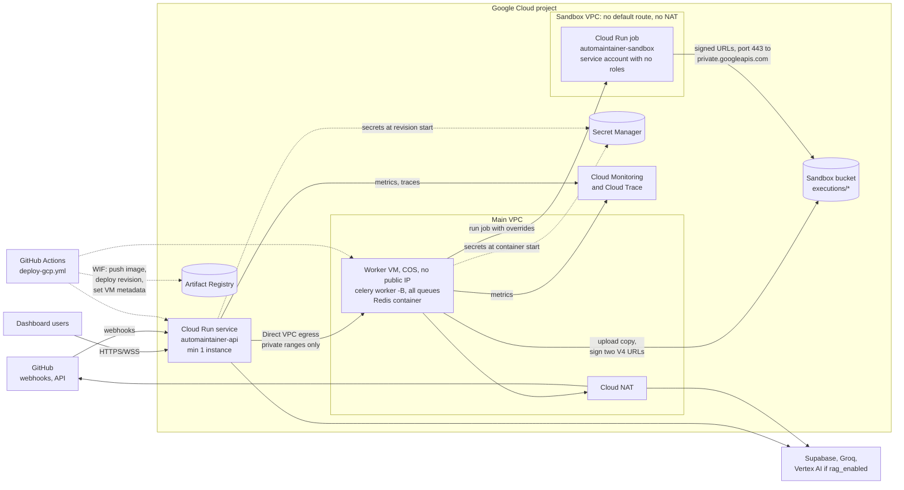

# Deploying AutoMaintainer

This guide covers the supported ways to run AutoMaintainer outside a dev
laptop: Docker Compose, Render, a single container (for example Hugging Face
Spaces) and Google Cloud with Terraform, plus hosting the dashboard on Vercel.
It lists every environment variable the backend reads and the security rules
for production.

- [Topology](#topology)
- [Database](#database)
- [Option A: Docker Compose](#option-a-docker-compose-local-or-a-single-prod-like-host)
- [Option B: Render](#option-b-render)
- [Option C: a single container](#option-c-a-single-container-plain-docker-run-hugging-face-spaces-without-the-ide)
- [Option D: Google Cloud (Terraform)](#option-d-google-cloud-terraform)
- [Dashboard on Vercel](#dashboard-on-vercel)
- [The image](#the-image)
- [Environment variables](#environment-variables)
- [Security checklist](#security-checklist)
- [What was and was not verified](#what-was-and-was-not-verified)
- [CI: Supabase keep-alive](#ci-supabase-keep-alive)
- [CI: Publishing the Python SDK](#ci-publishing-the-python-sdk)
- [Upgrade notes](#upgrade-notes)

## Topology

AutoMaintainer has four runtime pieces:

- **API**: FastAPI. It serves the REST/WebSocket API and, from the Docker image, the static dashboard.
- **Agent worker**: a Celery worker on the `agent_runs` queue. It clones target repos and runs the LangGraph agents.
- **Maintenance worker and beat**: Celery on `maintenance` and `github_sync`, plus the periodic scheduler.
- **Redis**: the Celery broker and result backend, also used for repo locks and rate limiting.

Supabase (Postgres and Auth), GitHub and Groq are external services.

```
              browser (dashboard: Vercel, or served by the API)
                     │  HTTPS / WSS
                     ▼
 ┌──────────────────────────────────────────┐        ┌───────────────┐
 │ API (uvicorn main:app)                   │◄──────►│ Supabase      │
 │  /start ─► enqueue ──────────┐           │        │ (DB + Auth)   │
 │  /repo/.../tree|file|search  │ reads     │        └───────────────┘
 │  /api/terminal/ws (opt-in)   │ clones    │               ▲
 └──────────────┬───────────────┼───────────┘               │
                │               ▼                           │
                │   ┌─────────────────────────┐             │
                │   │ WORKSPACE DIR (shared)  │             │
                │   │ AUTOMAINTAINER_         │             │
                │   │   WORKSPACE_DIR         │             │
                │   └─────────────────────────┘             │
                │               ▲ clones / writes           │
                ▼               │                           │
 ┌──────────────────┐  ┌────────┴─────────────────┐         │
 │ Redis            │◄►│ Celery worker            │─────────┤
 │ broker / locks   │  │ -Q agent_runs            │──► GitHub, Groq
 └──────────────────┘  └──────────────────────────┘         │
          ▲            ┌──────────────────────────┐         │
          └───────────►│ Celery worker + beat     │─────────┘
                       │ -Q maintenance,github_sync│
                       └──────────────────────────┘
```

**Invariant: the API and every `agent_runs` worker must see the same
`AUTOMAINTAINER_WORKSPACE_DIR`.** The worker clones repositories there, and
the API's IDE routes and terminal read them back from it. If they do not share
it, the IDE returns `404 Repository not cloned yet` for repos the agent has
just processed. Maintenance and beat never touch clones.

This still holds with per-user IDE views (#505, merged in PR #507): each
user's view is a git worktree of the shared clone, and the
API refreshes it from GitHub with `ls-remote`/`fetch` into that clone. The API
never creates the clone itself; only an agent run on the worker does. On an
API host without the worker's clone, the IDE routes answer `404` and the
terminal opens without a repository. Separating the two needs the API to
clone on demand or read through the GitHub API (epic #418).

Redis is the only channel between the API and the workers, so every process
must use the same `REDIS_URL`.

## Database

The schema is a set of versioned migrations in
[`supabase/migrations/`](../supabase/migrations), named
`<UTC timestamp>_<name>.sql` as the Supabase CLI expects. The first one,
`20261116000000_baseline.sql`, is the whole schema as of #473; every later
change is a new file. [`supabase_schema.sql`](../supabase_schema.sql) at the
repository root is generated from them (`python scripts/db-migrate schema`)
for pasting into the SQL Editor. Do not edit it by hand. CI fails when it is
out of date.

Every migration can be applied again without harm (`IF NOT EXISTS`,
`CREATE OR REPLACE`, `DROP ... IF EXISTS` before `CREATE`). The `ci-db`
workflow applies them twice to PostgreSQL 16, and also on top of an older
schema. It checks that nothing errors, that the schema is unchanged and that
no row is lost.

### New deployment

Use one of these:

- **Supabase CLI:** `supabase link --project-ref <ref>`, then
  `supabase db push`. If the CLI asks for `supabase/config.toml`, run
  `supabase init` once first. It keeps the existing `supabase/migrations`.
- **`scripts/db-migrate`** works on a Supabase project through its direct
  connection string, or on another PostgreSQL that provides the objects
  Supabase does: the `anon`, `authenticated` and `service_role` roles and the
  `auth` schema with `auth.uid()` and `auth.users` (the tests use the
  stand-in `backend/tests/rls/supabase_shim.sql`). The migrations do not
  create them, so on a plain PostgreSQL server the first `up` fails. It needs
  only psycopg2, which is a backend dependency:

  ```bash
  export DATABASE_URL='postgresql://postgres:<password>@<host>:5432/postgres'
  uv run --project backend python scripts/db-migrate up      # apply pending migrations
  uv run --project backend python scripts/db-migrate status  # applied / pending
  ```

  It applies each pending file in its own transaction, together with a row in
  `automaintainer_migrations.schema_migrations`. That schema is outside
  `public`, so the API does not expose it. A failing migration is rolled back
  and stops the run. Connect as the role that owns the schema (`postgres` on
  Supabase).
- **SQL Editor:** paste the whole of `supabase_schema.sql` and run it. This
  method does not record which migrations were applied.

Use one method per database. The CLI records versions in
`supabase_migrations.schema_migrations` and the runner records them in its own
table, so each tool would apply everything once more. That is harmless, but
it is confusing.

### Upgrading

Apply pending migrations before you roll out the new API and worker image:
`supabase db push` or
`uv run --project backend python scripts/db-migrate up`. If you use the SQL Editor,
paste the new `supabase_schema.sql` again.

**A database created from the old single-file `supabase_schema.sql`** (before
#473) needs no manual steps, provided it is the multi-tenant schema (`runs`
and `logs` have an `org_id` column). Back it up (Supabase dashboard, Database ->
Backups, or `pg_dump`), then apply the migrations as above. The baseline adopts
such a database: it creates only what is missing and redefines policies,
functions, triggers and views to their current form. That covers
`runs.checkpoint`, `runs.repo_name`, `repository_in_org`/`run_in_org`, the
tenant checks in the run and IDE policies, service-role-only
`github_installations` writes and the `repositories_org_immutable` trigger. It
keeps every row. These were the statements earlier upgrade notes told you to
pick out by hand. One behaviour differs from the old file. The old file
dropped and re-created the `supabase_realtime` publication. The baseline only
adds `logs`, `runs`, `webhook_events` and `ide_sessions` to it, so any other
tables you added stay.

Two cases need preparation:

- **Pre-multi-tenant databases** (`runs`/`logs` without `org_id`, from the
  earliest version of the file, `0147b09`) cannot be adopted directly: the
  baseline fails at `runs_org_idx` and rolls back, because the rows have no
  organization. Keep the run history with
  [`scripts/import-legacy-history.sql`](../scripts/import-legacy-history.sql),
  run with `psql`. Each step is one transaction and can be run again:
  1. Back up the database, then move the old tables aside:
     `psql "$DATABASE_URL" -v step=prepare -f scripts/import-legacy-history.sql`.
     This moves `runs` and `logs` to the `automaintainer_legacy` schema, which
     PostgREST does not expose. It also drops their old anonymous-read
     policies, their `supabase_realtime` membership, and any views that read
     them. Each dropped view's definition is printed so you can re-create it.
  2. Apply the migrations as above.
  3. Sign in, create (or choose) the organization that will own the history,
     and link the GitHub App installation that covers the old repositories.
     Then run
     `psql "$DATABASE_URL" -v step=import -v org_id=<organization id> -f scripts/import-legacy-history.sql`.
     Runs are attributed to the organization's first owner, or to
     `-v user_id=<member id>`. Each run is matched to the organization's
     repository of the same name. If any name has no match, the import stops
     and lists the names. Runs still marked `running` are imported as `failed`.
     Log types the new schema does not allow become `message`, and the
     original type is kept in `metadata.legacy_log_type`. Rows that were
     already imported are skipped, so you can safely run this step again.
  4. Check the history in the dashboard, then
     `psql "$DATABASE_URL" -v step=drop -f scripts/import-legacy-history.sql`.
     This drops `automaintainer_legacy`, and refuses while any legacy row has
     not been imported.

  The script's header lists the full column mapping. The `ci-db` workflow
  runs the procedure against a database built from the `0147b09` schema.
- **Views of your own that depend on `monthly_usage_summary` or `org_health`**
  make the baseline's `DROP VIEW` fail (PostgreSQL refuses to drop a view
  others depend on) and the migration rolls back. Save their definitions
  (`pg_get_viewdef`), drop them, apply the baseline, then re-create them.

Running the baseline takes short exclusive locks on the tables while it
replaces their policies and triggers. To record it as applied without running
it, use `supabase migration repair 20261116000000 --status applied` or
`uv run --project backend python scripts/db-migrate up --baseline`. Do that only for a database that already
has the complete current schema. Otherwise the missing pieces stay missing:
without `runs.repo_name`, for example, every `POST /start` fails.

### Changing the schema

1. Add a file: run `supabase migration new <name>`, or create
   `supabase/migrations/$(date -u +%Y%m%d%H%M%S)_<name>.sql`. Never edit a
   migration that has been released. `scripts/db-migrate up` refuses to run
   when an applied file's checksum has changed.
2. Write it so that it can run again: `IF NOT EXISTS` / `IF EXISTS`,
   `CREATE OR REPLACE`, `DROP POLICY|TRIGGER|VIEW IF EXISTS` before `CREATE`,
   and a `DO` block that checks `pg_constraint` before
   `ALTER TABLE ... ADD CONSTRAINT`. Do not write `BEGIN`/`COMMIT`.
3. Run `python scripts/db-migrate schema` and commit the regenerated
   `supabase_schema.sql`.
4. Run the database tests against a local PostgreSQL superuser:
   `DATABASE_URL_RLS_TEST=postgresql://postgres@localhost:5432/postgres uv run pytest tests/rls`
   from `backend/`. The `ci-db` workflow runs them on every PR.

## Option A: Docker Compose (local or a single prod-like host)

```bash
# 1. cp backend/.env.example backend/.env, then fill it in (at least SUPABASE_*, GROQ_API_KEY, GITHUB_*)
# 2. Optional: export the public dashboard build values
export NEXT_PUBLIC_SUPABASE_URL=https://<project>.supabase.co
export NEXT_PUBLIC_SUPABASE_ANON_KEY=<anon key>
# 3. Start everything
docker compose up --build
# API + dashboard: http://localhost:8000   liveness: http://localhost:8000/healthz
```

[`docker-compose.yml`](../docker-compose.yml) starts `api`, `worker`, `beat`
and `redis`. `api` and `worker` mount the named volume `workspaces` at
`/var/lib/automaintainer/workspaces`. To add agent capacity, run
`docker compose up --scale worker=3`; all replicas share the volume. Run only
one `beat`.

Compose sets `ENVIRONMENT=production` unless you export
`ENVIRONMENT=development`. The `env_file` `required: false` syntax needs
Docker Compose v2.24 or later.

`api`, `worker` and `beat` start only after Redis answers `redis-cli ping`
(`depends_on: condition: service_healthy`). The worker's healthcheck is a
`celery inspect ping` of its own node. If the worker is down, `POST /start`
answers `503` with `"code": "AGENT_WORKER_UNAVAILABLE"` and creates no run,
instead of queueing a run nobody consumes (`AGENT_WORKER_CHECK`, below).
Agent runs are queued in two places, both behind that check
(`backend/worker_probe.py`): `POST /start`, and the webhook processor when
`AUTOMAINTAINER_TRIGGER_LABEL` is set and that label is added to an issue.
The webhook route itself only enqueues `process_webhook_events_task` on
`github_sync`; that task queues the label's run on `agent_runs`. An issue has
at most one queued, running or awaiting-review run (a unique index on `runs`):
`/start` for such an issue answers `409` with `"code": "RUN_ALREADY_ACTIVE"`,
and a label delivery is recorded as ignored. The helper
`tasks.start_agent_task` enqueues without the worker check; nothing in the
backend calls it, so a future caller must add the check. Redis
itself keeps queued tasks (`appendonly yes`, `noeviction`) across restarts.
Only `api` publishes a port; Redis is reachable only inside the Compose
network.

Secrets come from `backend/.env`, which is git-ignored and excluded from the
image by `.dockerignore`. [`backend/.env.example`](../backend/.env.example)
lists the variable names to fill in.

### Smoke test

[`scripts/compose-smoke.sh`](../scripts/compose-smoke.sh) runs this topology
end to end. CI runs it on pull requests that touch the `Dockerfile`,
`docker-compose.yml` or `backend/` (workflow `compose-smoke.yml`). To run it
locally you need Docker with Compose v2.24.4 or later, `curl`, `python3`, and
host port 8000 free:

```bash
bash scripts/compose-smoke.sh                               # builds the image
COMPOSE_SMOKE_SKIP_BUILD=1 bash scripts/compose-smoke.sh    # reuse automaintainer:local
```

It starts `api`, `worker`, `beat` and `redis` under the project name
`automaintainer-smoke`, so the volumes of a dev stack are not touched. Then it
checks, in order:

1. `GET /healthz` answers `200`.
2. The worker answers `celery inspect ping`.
3. A file the worker writes to the `workspaces` volume is visible from `api`.
4. `POST /start` is accepted. `/start` returns `503` when no worker consumes
   `agent_runs`, so this proves the path from the API through Redis to the
   worker.
5. The run reaches a terminal state, and has a `celery_task_id` (set by the
   API) and a `started_at` (set by the worker when it picks the run up).

The test uses no credentials. The override file
[`scripts/compose-smoke/compose.smoke.yml`](../scripts/compose-smoke/compose.smoke.yml)
does the following, for this test only:

- It adds `fake-supabase`, an in-memory stand-in for Supabase's REST API
  (`scripts/compose-smoke/fake_supabase.py`, standard library only). It is
  seeded with one repository.
- It sets `ENVIRONMENT=development` and `AUTH_DEV_BYPASS=true`. The base
  `docker-compose.yml` keeps its production defaults.
- It sets `GITHUB_AUTH_MODE=app` without App credentials.
- It skips `backend/.env` (`env_file: !reset []`) and blanks the GitHub and
  Groq variables, so real secrets on the machine never reach the stack.

The run therefore ends `failed` with `GitHub credentials unavailable`. The
worker stops at its first GitHub step, before any call to GitHub or Groq. The
script treats exactly that outcome as success: the run went from `queued`
through the worker to a terminal state. A run that ends in `completed` needs
real GitHub and LLM credentials and is not automated.

The script always prints `docker compose ps` and the logs of every service,
then runs `docker compose down --volumes`, whether it passes or fails. The
fake server answers only the PostgREST filters it implements (`eq`, `neq`,
`is`, `in`) and returns an error for any other. If a periodic `beat` task such
as stale-run cleanup fires during the test, that error appears in the worker
log. This is expected and does not affect the result.

## Option B: Render

[`render.yaml`](../render.yaml) is a Blueprint with three services:

| Service | Type | Runs |
|---|---|---|
| `automaintainer-backend` | web, Docker, **1 instance** | `automaintainer-api-and-worker`: uvicorn plus the `agent_runs` Celery worker in one container |
| `automaintainer-celery-maintenance` | worker, Docker, 1 instance | `celery worker -Q maintenance,github_sync -B` |
| `automaintainer-redis` | Redis (`noeviction`) | broker, results, locks |

**Why the API and the agent worker share one service.** A Render persistent
disk attaches to exactly one service and cannot be shared, and services do not
share a filesystem. With a separate worker service, its clones would never be
visible to the API. Running both processes in one container is the simplest
correct layout. It has three consequences:

- The backend service must stay at one instance, because each instance has
  its own filesystem. Scale agent throughput with `CELERY_CONCURRENCY` or a
  larger plan.
- Clones live on the container's ephemeral filesystem. They are lost on
  deploy or restart and re-cloned on the next run. No disk is attached: Render
  mounts disks root-owned, and the image runs as a non-root user.
- The launcher exits if either process dies, so Render restarts the whole
  service. SIGTERM is forwarded to both processes, and Celery's `acks_late`
  requeues an interrupted run.

Both services get `REDIS_URL` from the same `automaintainer-redis` instance
(`fromService` with `property: connectionString`, the Key Value instance's
internal URL), so the API enqueues where the workers consume. That property
name matters: Render's Blueprint schema allows only `host`, `port`,
`hostport`, `slug` and `connectionString` here. With any other name `REDIS_URL`
is not set, both services fall back to `redis://localhost:6379/0`, they never
share a broker, and every `POST /start` answers `503`. The service keeps
`type: redis`, Render's deprecated alias for `keyvalue`, because a service's
type cannot be changed after creation. Per-user IDE views (PR #507) do not remove the need to co-locate: the
views are worktrees of the clone the agent worker makes (see
[Topology](#topology)). The long-term fix, which lets workers scale
independently, is for the API to clone on demand or read files through the
GitHub API (epic #418).

**Migrating from the old blueprint:** delete the old
`automaintainer-celery-worker` service if a Blueprint sync leaves it in place.
Otherwise it keeps consuming `agent_runs` into its own, unshared filesystem.

All services build the repository `Dockerfile`, because Render's native Python
runtime has no Node or gitnexus. Set every `sync: false` variable in the Render
dashboard.

## Option C: a single container (plain `docker run`; Hugging Face Spaces without the IDE)

The image's default command starts only the API. A single-container platform
also needs an agent worker and an external Redis:

```bash
docker run -p 7860:7860 --init \
  -e REDIS_URL=rediss://... -e SUPABASE_URL=... -e SUPABASE_SERVICE_KEY=... \
  -e GROQ_API_KEY=... -e GITHUB_TOKEN=... \
  ghcr.io/pxa-labs/automaintainer:latest automaintainer-api-and-worker
```

If you run the API without any worker, `POST /start` answers `503`
(`AGENT_WORKER_UNAVAILABLE`) and creates no run. A Hugging Face Docker Space
runs the image's default command, which is the API alone, and the repository
has no Space start script (the sync workflow is
`.github/workflows/hf-sync.yml.disabled`). Such a Space therefore needs a
worker elsewhere on the same Redis, which also means its IDE has no clones:
agent runs work, but the IDE routes answer `404` for every repository. Treat
a Hugging Face Space as degraded, not as a supported topology for the IDE.
The default command is not the launcher: without a reachable Redis the
launcher's worker retries the broker and then exits, which takes the API down
with it and would restart-loop a container meant to run the API alone.
Periodic maintenance (stale-run cleanup, repo sync) also
needs a beat process. On a single container, add `CELERY_QUEUES=agent_runs,maintenance,github_sync`
and run `celery -A celery_app beat -s /tmp/celerybeat-schedule` somewhere, for
example as a second Space.

## Option D: Google Cloud (Terraform)

[`infra/terraform`](../infra/terraform) describes a production deployment on
Google Cloud, in the project `automaintainer-prod` by default (#527). Its
[README](../infra/terraform/README.md) explains each file, resource, role and
switch. Supabase stays the database. This section is the owner's runbook:
what the deployment contains, the steps before and after the first
`terraform apply`, and the optional features.

| Piece | Runs on |
|---|---|
| API | Cloud Run service `automaintainer-api`: always 1 instance or more (GitHub allows a webhook 10 seconds), at most `api_max_instances`, public ingress with unauthenticated invocation (GitHub webhooks and the dashboard call it; the app checks Supabase JWTs and webhook signatures itself), startup and liveness probes on `/healthz` |
| Agent, maintenance and sync workers, beat | One Compute Engine VM (Container-Optimized OS, no public IP, egress through Cloud NAT) running the same image as `celery worker -B` on every queue. One VM, so exactly one beat |
| Redis | `redis_mode = "vm"` (default): a Redis container on the worker VM. `"memorystore"`: Memorystore basic tier. Cloud Run reaches either over Direct VPC egress. Password required by default ([Redis](#redis)) |
| Secrets | Secret Manager, one secret per variable. Cloud Run mounts them as environment variables; on the VM, the container reads them at start with the VM's service account (`modules/worker/secrets_exec.py`) |
| Images | Artifact Registry, pushed by `.github/workflows/deploy-gcp.yml` through Workload Identity Federation (no key) |
| Verification | Cloud Run job `automaintainer-sandbox` in its own VPC, one execution per test command ([Sandboxed verification](#sandboxed-verification)) |
| Traces | Cloud Trace, API only, when `cloud_trace_enabled = true` |
| Metrics and alerts | Cloud Monitoring, API and worker, when `cloud_monitoring_enabled = true`; alert policies and a dashboard ([Metrics and alerts](#metrics-and-alerts)) |
| Cost control | A billing budget with alerts at 50 %, 90 % and 100 % of actual spend and at 100 % of forecast spend |

The diagram shows the default layout (`redis_mode = "vm"`). Solid arrows are
requests; the dotted arrow is the deploy path. It is drawn from
`infra/terraform` and has not been checked against a live project.



The API reaches the public internet (Supabase, GitHub) through Cloud Run's
own egress: its VPC egress setting is `PRIVATE_RANGES_ONLY` (`run.tf`), so
only traffic to private addresses, such as Redis on the VM, goes through the
VPC. The worker reaches the internet only through Cloud NAT. The sandbox job
has no route to the internet at all. In `memorystore` mode Redis moves off
the VM to a Memorystore instance in the main VPC, and nothing else changes.

The deployer service account, which GitHub Actions impersonates, can push
images, deploy new API revisions and set the worker VM's metadata. It cannot
read secrets or change IAM. Google lets a job impersonate it only if the
token is for `PxA-Labs/AutoMaintainer` (name and numeric repository and owner
ids), the `production` environment, and the ref `main` or a `v*` tag. The
roles of every account are listed in the Terraform README,
[Least privilege](../infra/terraform/README.md#least-privilege).

### Defaults and optional features

Every opt-in feature from #530-#541 starts off; the table lists what is on
by default. Each optional feature is described below the runbook, with how
to turn it on and what it costs.

| Feature | Default | Controlled by |
|---|---|---|
| Redis password (AUTH) | on | `redis_auth_enabled` |
| Sandboxed verification | always created; every verification reports an error until `sandbox_image` is set | `sandbox_image` |
| Cloud Trace | off | `cloud_trace_enabled` |
| Metrics export to Cloud Monitoring | off | `cloud_monitoring_enabled` |
| API 5xx alert and operations dashboard | on | always created |
| Alerts on application metrics | off | `monitoring_app_alerts_enabled` |
| Code retrieval (RAG) | off | `rag_enabled`, plus the repository variable `IMAGE_EXTRAS` |
| ADK Reviewer | off (`REVIEWER_BACKEND` unset means `langgraph`) | `REVIEWER_BACKEND` in `app_env`, plus `IMAGE_EXTRAS` |
| Memorystore instead of Redis on the VM | off | `redis_mode` |
| SSH through Identity-Aware Proxy | on | `enable_iap_ssh` |

### Limitations

**The IDE has no clones.** The API on Cloud Run and the agent worker on the
VM do not share `AUTOMAINTAINER_WORKSPACE_DIR`, so this deployment breaks the
[topology invariant](#topology) in the same way as the Hugging Face Space in
Option C: agent runs work, but the IDE routes answer
`404 Repository not cloned yet` and the terminal has no repository (it is
also off: Terraform refuses `ENABLE_TERMINAL`). The fix is the API cloning on
demand or reading through the GitHub API (epic #418). Running the agent
worker inside the Cloud Run service, as Render does, was not chosen: Cloud
Run bills and scales by request and may stop an instance that serves none,
which does not suit agent runs that last many minutes.

**Verification fails closed until the sandbox is ready.** The worker always
sends verification to the Cloud Run job. Until `sandbox_image` points at an
image with `python3` and the [smoke test](#sandboxed-verification) passes,
every verification reports an error, so `MERGE_POLICY=ci` never merges.
Keep `MERGE_POLICY=human`. Terraform refuses `VERIFY_ALLOW_LOCAL` in
`app_env`: the worker container uses the VM's host network and can reach the
metadata server, so code running in it could obtain the worker service
account's token and its secrets.

### Redis

**Why the VM by default.** The Redis container costs nothing extra. It shares
the VM's memory (capped at `redis_vm_maxmemory`, `noeviction`) and is down
while the VM restarts, when the worker is down too. Queued tasks survive
restarts (append-only file on the VM disk). Memorystore is managed and keeps
the queue up while the worker restarts, but its basic tier has no replica
either and it costs more than the VM (see [the cost table](#estimated-monthly-cost)).
Only the subnet can reach either one (VPC firewall rules, and the VM's own
firewall for the container), and Celery accepts only JSON messages, so a
write to the broker cannot become a pickle payload. The subnet includes every
Cloud Run instance, so a server-side request forgery in the API could still
reach Redis; hence Redis AUTH. Neither mode uses TLS, so the password crosses
the VPC in clear.

**Redis AUTH** (`redis_auth_enabled`, default `true`, #532). Redis requires a
password, which exists only in Secret Manager. Terraform creates the empty
secret `redis-url` (no version, so the password is never in the Terraform
state; a `random_password` would be). The owner adds the full broker URL,
`redis://:<password>@<redis_address>/0`, as its version
([step 3](#step-3-add-the-secret-values)). Then:

- Cloud Run mounts it as `REDIS_URL` once `mount_secrets = true`. Before
  that the API gets the URL without the password and Redis answers
  `NOAUTH`, but the API has no other secret yet either.
- The worker container reads it at start through `secrets_exec.py`, which
  refuses a value that is not a `redis://` or `rediss://` URL with a password
  and never prints it.
- `vm` mode: `run-redis.sh` reads the same secret with the VM's account and
  starts Redis with `requirepass`, passed on stdin (`redis-server -`), so the
  password is on no command line and in no `docker inspect` output. It
  accepts only `A-Z a-z 0-9 . _ ~ -` and at least 32 characters
  (`openssl rand -hex 32` gives 64), so the URL needs no escaping.
- `memorystore` mode: the instance has AUTH enabled and Google generates the
  password (the AUTH string; `gcloud redis instances get-auth-string`).
  Caveat: the Google provider stores that generated string in the Terraform
  state (sensitive attribute `auth_string`) and no setting avoids it, so keep
  the state bucket owner-only.

Until the version exists, the worker and the self-hosted Redis do not start
(systemd retries every 10-30 seconds). Celery and kombu mask the password
when they log the broker URL. Redis AUTH costs nothing beyond one more
Secret Manager secret, which is already in the cost table.

### Before you start

Everything in this runbook needs the owner's credentials, and `terraform
apply` creates billable resources. The code does nothing on Google Cloud by
itself: no CI job holds Google credentials or runs `plan` or `apply`.

1. Rotate the keys leaked in #60, restore the Supabase project and apply all
   migrations, including the pgvector and `code_chunks` ones
   ([Database](#database)).
2. Install Terraform 1.9 or later and the gcloud CLI. Run
   `gcloud auth application-default login` with an account that owns the
   project and can create budgets on its billing account (Billing Account
   Administrator, or Costs Manager on it).
3. On GitHub, add a tag ruleset for `v*` under Settings > Rules > Rulesets
   that limits who can create, update or delete such tags. A `v*` tag
   triggers a production deploy, and without a ruleset anyone with write
   access can push one.

The commands in this runbook use the default names: project
`automaintainer-prod`, region `us-central1` and zone `us-central1-a`. If you
changed `project_id`, `region` or `zone` in `terraform.tfvars`, substitute
your values. After the first apply,
`terraform output -json github_repository_variables` prints them
(`GCP_PROJECT_ID`, `GCP_REGION`, `GCP_WORKER_ZONE`).

### Step 1: Create the state bucket and secure the default service account

Create the state bucket once:

```bash
gcloud storage buckets create gs://automaintainer-prod-tfstate \
  --project automaintainer-prod --location us-central1 \
  --uniform-bucket-level-access --public-access-prevention
gcloud storage buckets update gs://automaintainer-prod-tfstate --versioning
```

Enabling the Compute Engine API creates the project's default compute
service account, which Google normally grants `roles/editor`. Nothing here
uses it. Either enforce the organization policy
`iam.automaticIamGrantsForDefaultServiceAccounts` before the API is enabled,
or enable the API now and remove the grant:

```bash
P=automaintainer-prod
gcloud services enable compute.googleapis.com --project $P
N=$(gcloud projects describe $P --format='value(projectNumber)')
gcloud projects remove-iam-policy-binding $P \
  --member="serviceAccount:$N-compute@developer.gserviceaccount.com" --role=roles/editor
```

If you skip this and let the first apply enable the API, run the last two
commands after the apply.

### Step 2: Set the variables and apply

Fill in `terraform.tfvars` (git-ignored) from the example.
`gcloud billing projects describe automaintainer-prod` prints the billing
account. Set `monitoring_alert_email` to an address or to `null`; it has no
default. Leave `mount_secrets = false` and the optional switches off for now.
The [Terraform README](../infra/terraform/README.md#variables-that-matter)
lists the variables that matter.

```bash
cd infra/terraform
cp backend.tf.example backend.tf            # git-ignored; state goes to the bucket
cp terraform.tfvars.example terraform.tfvars
terraform init -backend-config="bucket=automaintainer-prod-tfstate"
terraform plan -out=tfplan
terraform apply tfplan
```

The first apply enables the APIs, then creates everything else. If a
resource fails because an API it just enabled has not propagated yet, run
`plan` and `apply` again. The API starts with Google's public "hello"
placeholder image and the worker waits for its first image.
`terraform output api_url` prints the API URL.

### Step 3: Add the secret values

Terraform created empty secrets (`terraform output secret_ids`). Add a
version to each one that is mounted, that is every entry of `var.secrets`
with `api` or `worker` true (by default all but `github-token`):

```bash
P=automaintainer-prod
printf '%s' '<service-role key>' | gcloud secrets versions add supabase-service-key --data-file=- --project $P
printf '%s' '<groq key>'         | gcloud secrets versions add groq-api-key --data-file=- --project $P
gcloud secrets versions add github-app-private-key --data-file=<app>.private-key.pem --project $P
printf '%s' '<webhook secret>'   | gcloud secrets versions add github-webhook-secret --data-file=- --project $P
printf '%s' '<client secret>'    | gcloud secrets versions add github-app-client-secret --data-file=- --project $P
```

With `redis_auth_enabled` (the default), add the Redis URL with its password
to `redis-url`, from `infra/terraform`. In `vm` mode, generate the password:

```bash
PW="$(openssl rand -hex 32)"
printf 'redis://:%s@%s/0' "$PW" "$(terraform output -raw redis_address)" \
  | gcloud secrets versions add redis-url --data-file=- --project $P
unset PW
```

In `memorystore` mode, use the AUTH string Google generated instead:
`PW="$(gcloud redis instances get-auth-string automaintainer-redis --region us-central1 --project $P --format='value(authString)')"`,
then the same `printf` line.

In both modes, then reset the worker VM
(`gcloud compute instances reset automaintainer-worker --zone us-central1-a`)
so the worker starts with the new secret. In `vm` mode the Redis container
on the VM also restarts with it; in `memorystore` mode no Redis runs on the
VM.

Do not put the values in shell history on a shared machine (`read -rs` into
a variable first). Then set `mount_secrets = true`, set `ALLOWED_ORIGINS` and
`DASHBOARD_URL` in `app_env` to the API URL (it also serves the dashboard),
and run `terraform plan -out=tfplan` and `terraform apply tfplan` again.

### Step 4: Set the repository variables and the environment

`terraform output -json github_repository_variables` prints the `GCP_*`
variables and `IMAGE_EXTRAS`. The three `NEXT_PUBLIC_*` variables in the
table below are not in that output; set them yourself. Set each with
`gh variable set <NAME> --body '<value>' -R PxA-Labs/AutoMaintainer`. None is
a secret.

| Variable | Required | Value |
|---|---|---|
| `GCP_PROJECT_ID`, `GCP_REGION` | yes | From the output |
| `GCP_WORKLOAD_IDENTITY_PROVIDER` | yes | From the output. While it is empty the workflow is skipped |
| `GCP_DEPLOYER_SERVICE_ACCOUNT` | yes | From the output |
| `GCP_IMAGE_REPOSITORY` | yes | From the output |
| `GCP_RUN_SERVICE` | yes | From the output |
| `GCP_WORKER_INSTANCE`, `GCP_WORKER_ZONE` | yes | From the output |
| `IMAGE_EXTRAS` | no | Backend extras for the image build, `server` when unset. The output shows `server,rag` when `rag_enabled` is on. Add `adk` for the ADK Reviewer |
| `NEXT_PUBLIC_SUPABASE_URL` | yes | Supabase project URL |
| `NEXT_PUBLIC_SUPABASE_ANON_KEY` | yes | The anon key, never the service key |
| `NEXT_PUBLIC_BACKEND_URL` | yes | The API URL |

The workflow checks the seven `GCP_*` variables other than the provider and
stops with an error that names any that is missing. It does **not** check
the `NEXT_PUBLIC_*` variables: they are inlined into the dashboard bundle at
build time, and a missing one builds a dashboard with an empty value and no
error. Check them before the first deploy
(`gh variable list -R PxA-Labs/AutoMaintainer`).

Under Settings > Environments, create `production` with required reviewers,
and limit its deployment branches and tags to `main` and `v*.*.*`.

### Step 5: First deploy

Actions > "Deploy to Google Cloud" > Run workflow on `main`, and approve the
`production` deployment. The workflow builds the image, pushes it to Artifact
Registry, deploys it to Cloud Run by digest, checks `/healthz`, and sets the
worker VM's `automaintainer-image` metadata. The workflow ends there.

The VM checks that metadata key every 20 seconds (`watch-image.sh`). When it
changes, the VM stops the old worker container with a grace period of
`worker_stop_timeout_seconds` (default 300) so running tasks can finish,
pulls the new image and starts it. A worker restart can therefore take
several minutes, and the workflow does not wait for it or confirm that the
new worker is up. Release tags (`v*.*.*`) deploy the same way.

Check the worker in Logs Explorer (resource "VM Instance",
`automaintainer-worker`): `POST /start` answers
`503 AGENT_WORKER_UNAVAILABLE` until it is up. The deployer holds
`roles/run.developer` on the one service only, with no project-level Run
role. A real deploy has not exercised this yet; if `gcloud run deploy` is
denied, the error names the missing permission.

### Step 6: Point the GitHub App at the new URL

Set the webhook URL to `<api_url>/webhooks/github` (secret: the
`github-webhook-secret` value), and the Callback URL and Setup URL to
`<api_url>/github/app/setup` ([Install flow](#install-flow-setup-url)). Add
`<api_url>/auth/callback/` to the Supabase Auth redirect URLs. Then send a
test delivery from the App's *Advanced* tab: it should get `2xx`.

After this step, complete [Sandboxed verification](#sandboxed-verification)
before relying on verification results.

### Changing configuration later

`app_env`, `var.secrets`, the switches and the scaling settings are applied
with `terraform apply`. Cloud Run picks them up in a new revision at once.
The VM rewrites its configuration only at boot, so after a change that
touches the worker, run
`gcloud compute instances reset automaintainer-worker --zone us-central1-a`;
running tasks are requeued (`acks_late`). A new secret version is read when
a Cloud Run instance or the worker container starts: redeploy (or reset the
VM) after rotating a key.

To rotate the Redis password in `vm` mode, add a new `redis-url` version,
reset the VM (Redis and the worker restart with it) and deploy a new API
revision; the API cannot reach Redis in between. In `memorystore` mode
Google owns the AUTH string; how to rotate it has not been checked for this
guide (see the Memorystore AUTH documentation). Afterwards, update
`redis-url` the same way.

### Rolling back a deploy

The deploy workflow builds a new image from the chosen ref every time; it
has no input for an earlier image. Artifact Registry keeps the 20 newest
images (the cleanup policy in `main.tf` deletes older ones after 30 days),
so you can roll back to any of them by digest without rebuilding.

**Before you roll back, check the database.** `scripts/db-migrate` only
applies migrations (`up`, `status`, `schema`); there is no `down`. Rolling
back the image does not undo a migration the new release applied. An older
image usually runs against a newer schema, because migrations add rather
than remove, but read the migrations applied since the target release
(`supabase/migrations/`) before you rely on that.

1. **Find the image.** List the recent digests and the git SHA each was
   tagged with:

   ```bash
   REPO="$(terraform output -raw image_repository)"
   gcloud artifacts docker images list "$REPO" --include-tags \
     --sort-by=~UPDATE_TIME --limit=10
   ```

   Set `IMAGE="$REPO@sha256:<digest>"` for the release you want.

2. **Roll back the API.** Deploy that digest the same way the workflow does:

   ```bash
   gcloud run deploy automaintainer-api --image "$IMAGE" \
     --region us-central1 --project automaintainer-prod --quiet
   curl -fsS "$(terraform output -raw api_url)/healthz"
   ```

   Terraform ignores the service's image (`ignore_changes` in `run.tf`), so
   a later `terraform apply` keeps the image you deployed.

3. **Roll back the worker.** Set the VM's metadata key; `watch-image.sh`
   restarts the worker with that image within about 20 seconds plus the
   stop grace period (see [Step 5](#step-5-first-deploy)):

   ```bash
   gcloud compute instances add-metadata automaintainer-worker \
     --zone us-central1-a --project automaintainer-prod \
     --metadata "automaintainer-image=$IMAGE"
   ```

   Roll back the API and the worker to the same image. They share Redis
   and the Celery task signatures, so a mixed pair is untested.

4. **Confirm.** `POST /start` answers `503 AGENT_WORKER_UNAVAILABLE` until
   the worker is back. Check the worker's log in Logs Explorer (resource
   "VM Instance", `automaintainer-worker`).

Run these commands with the owner's credentials. The deployer service
account cannot be used from a workstation: only GitHub Actions can
impersonate it, through Workload Identity Federation.

**Alternative: redeploy a release tag.** Running "Deploy to Google Cloud"
on an earlier `v*.*.*` tag rebuilds that source and deploys it. This keeps
the change in the workflow's history, but the rebuild resolves the same
lock files to a new image, not the bytes that ran before.

When the fix is ready, the next normal deploy replaces the rolled-back image
on both the API and the worker.

### Recovering the Terraform state

[Step 1](#step-1-create-the-state-bucket-and-secure-the-default-service-account)
turns on object versioning for the state bucket, so every earlier state is
kept as a noncurrent version of `automaintainer/prod/default.tfstate`.
Restore one only when the current state is corrupt or was overwritten by
mistake. Restoring state never changes resources; the next `plan` compares
the restored state with what exists.

```bash
B=gs://automaintainer-prod-tfstate
OBJ=$B/automaintainer/prod/default.tfstate
gcloud storage ls --all-versions -l "$OBJ"      # pick a generation number
gcloud storage cp "$OBJ#<generation>" ./restored.tfstate
terraform state push ./restored.tfstate         # refuses an older serial
terraform plan                                  # review before any apply
```

`terraform state push` refuses a state with a lower serial than the current
one. Add `-force` only after you have checked that the restored state is
the one you want. Hold no other Terraform run while you do this; the GCS
backend locks the state during `push`, `plan` and `apply`.

### Tearing down

`terraform destroy` removes almost everything this configuration created.
Read this list first: some of it cannot be undone.

- **Secret values are deleted.** Terraform owns the Secret Manager
  containers, so destroying them also deletes every version you added in
  [Step 3](#step-3-add-the-secret-values). Copy any value you still need
  first, and rotate the keys if the project might have been compromised.
- **Images are deleted** with the Artifact Registry repository.
- **The sandbox bucket is emptied and deleted** (`force_destroy = true`); it
  holds only transient copies.
- **Memorystore data is lost** in `memorystore` mode. Queued Celery tasks
  and locks live in Redis, so drain the worker first.

Steps:

1. Stop new work: remove the GitHub App's webhook URL (or uninstall the
   App) and wait until no run is `queued` or `running` in the dashboard.
2. Set `deletion_protection = false` in `terraform.tfvars`, then
   `terraform plan -out=tfplan` and `terraform apply tfplan`. It guards the
   Cloud Run service, the sandbox job and the worker VM.
3. `terraform destroy`, and review the plan it prints before you confirm.

What stays afterwards, and what to do with it:

| Left behind | Why | Action |
|---|---|---|
| Enabled project APIs | `disable_on_destroy = false` in `main.tf` and `sandbox.tf`, so a destroy does not break other users of the project | Disable them by hand, or delete the project |
| Custom IAM roles | Soft-deleted; their ids stay reserved for weeks | Nothing. To apply again soon, see the [Terraform README caveats](../infra/terraform/README.md#caveats) |
| Default compute service account | Created by Google when the Compute Engine API was enabled | Leave it without `roles/editor` (Step 1) or delete the project |
| State bucket | Created by hand in Step 1, outside Terraform | Delete it last: `gcloud storage rm --recursive gs://automaintainer-prod-tfstate` |
| Repository variables and the `production` environment on GitHub | Set by hand in Step 4 | Delete them so `deploy-gcp.yml` is skipped again (it runs only while `GCP_WORKLOAD_IDENTITY_PROVIDER` is set) |
| Supabase project | Not managed here | Keep or delete it separately |

If the project exists only for AutoMaintainer, `gcloud projects delete`
removes everything above except the GitHub settings and Supabase. A deleted
project can be restored for 30 days.

### Sandboxed verification

`infra/terraform/sandbox.tf` runs every verification command as one
execution of the Cloud Run job `automaintainer-sandbox` (#158). The worker
container always gets `SANDBOX_BACKEND=cloud_run_job` with the job and
bucket names; no other deployment option sets this backend.
[VERIFICATION.md](VERIFICATION.md#cloud-run-jobs-sandbox-backend) describes
the backend and its threat model.

**What it isolates.** The job runs as `automaintainer-sandbox@`, which holds
no role at all. Its egress goes into its own VPC
(`automaintainer-sandbox-vpc`), which has no default route, no NAT, no
peering and a deny-all egress firewall, with one exception: TCP 443 to
Private Google Access, so the job can fetch its working copy and upload its
result through two URLs the worker signs for that run only. The bucket
(`<project>-automaintainer-sandbox`) has uniform access, public access
prevention and a 1-day lifecycle delete. The worker may run, read and cancel
executions of that one job, use objects in that bucket and sign blobs as
itself. Once the steps below pass, verification results are real, so
`MERGE_POLICY=ci` can merge again.

**What stays open: Google APIs.** This is weaker than the Docker backend's
`--network=none`. The one allowed destination, the Private Google Access
range (199.36.153.8/30), serves *every* `*.googleapis.com` API, not only this
bucket. The job's own identity can do nothing, but test code needs no
identity to write to a bucket someone else made publicly writable, or to
poll one for commands. So a hostile test can still send the repository's
contents and its own output out through Google Cloud Storage. Under
`MERGE_POLICY=ci`, that is the remaining risk for private repositories whose
issues come from outsiders. VPC Service Controls around the project would
close it, but they are not set up here.

**Settings.** `modules/worker` merges `SANDBOX_BACKEND` and
`CLOUD_RUN_SANDBOX_PROJECT`, `_REGION`, `_JOB`, `_BUCKET` and `_SIGNER`
*over* `var.app_env`, so a value set there is silently replaced. This fails
closed: no `app_env` entry can switch the worker back to local or Docker
verification. To change them, edit `modules/worker/main.tf`.
`CLOUD_RUN_SANDBOX_START_SECONDS` is not set by the module, so `app_env`
controls it. The job's size is `sandbox_cpu` and `sandbox_memory`.

**Cost.** Each verification command is one Cloud Run job execution, billed
for its CPU and memory time, plus small bucket and private DNS zone charges.
This guide has no estimate for them; check the
[pricing calculator](https://cloud.google.com/products/calculator).

#### Owner steps after the first deploy

1. **Point the job at an image with `python3` and the test toolchain.** The
   default `sandbox_image` is Google's sample job image, which has no
   `python3`, so until this step every verification reports an error. The
   app image works (Python 3.11, git, node):

   ```bash
   IMAGE="$(terraform output -raw image_repository)@$(gcloud artifacts docker images describe \
     "$(terraform output -raw image_repository):<deployed git sha>" --format='value(image_summary.digest)')"
   # terraform.tfvars:  sandbox_image = "<IMAGE>"
   terraform plan -out=tfplan && terraform apply tfplan
   gcloud compute instances reset automaintainer-worker --zone us-central1-a
   ```

   The deploy workflow does not update the job; the entrypoint is sent with
   each execution, so the image only needs changing when the tests need a
   newer toolchain. Pin it by digest.

2. **Run the smoke test** below and keep its output with the deployment
   notes. It has not yet been run against a real project.

#### Smoke test: start latency and isolation

Opt-in and manual: it starts real executions (a few cents). Run it from
`infra/terraform` with the owner's credentials.

```bash
P=automaintainer-prod; R=us-central1; Z=us-central1-a; JOB=automaintainer-sandbox
BUCKET=$(terraform output -raw sandbox_bucket)
WORKER_IP=$(gcloud compute instances describe automaintainer-worker --zone $Z \
  --project $P --format='value(networkInterfaces[0].networkIP)')

# 1. Start latency: five runs of a no-op; note each wall time.
for i in 1 2 3 4 5; do
  /usr/bin/time -f "%e s" gcloud run jobs execute $JOB --region $R --project $P \
    --wait --args="-c,print(1)" >/dev/null
done

# 2. Isolation probes, one execution. "^|^" makes | the list separator.
PROBE='import json, socket, sys, urllib.request as u
def tcp(host, port):
    try:
        socket.create_connection((host, port), timeout=5).close()
        return "OPEN"
    except OSError as e:
        return "blocked (" + type(e).__name__ + ")"
worker, bucket = sys.argv[1], sys.argv[2]
for name, host, port in [("worker redis", worker, 6379), ("worker ssh", worker, 22),
                         ("internet 1.1.1.1", "1.1.1.1", 443),
                         ("github.com", "github.com", 443),
                         ("other Google API by name", "iamcredentials.googleapis.com", 443),
                         ("storage via private VIP", "storage.googleapis.com", 443)]:
    print(name, tcp(host, port))
md = "http://169.254.169.254/computeMetadata/v1/instance/service-accounts/default/"
h = {"Metadata-Flavor": "Google"}
print("metadata identity", u.urlopen(u.Request(md + "email", headers=h), timeout=5).read().decode())
token = json.load(u.urlopen(u.Request(md + "token", headers=h), timeout=5))["access_token"]
try:
    u.urlopen(u.Request("https://storage.googleapis.com/storage/v1/b/" + bucket + "/o",
                        headers={"Authorization": "Bearer " + token}), timeout=10)
    print("bucket list ALLOWED")
except u.HTTPError as e:
    print("bucket list HTTP", e.code)'
gcloud run jobs execute $JOB --region $R --project $P --wait \
  --args="^|^-c|$PROBE|$WORKER_IP|$BUCKET"
gcloud logging read "resource.type=cloud_run_job AND resource.labels.job_name=$JOB" \
  --project $P --limit 20 --format='value(textPayload)'
```

Expected: every `tcp` probe `blocked` except `storage via private VIP`
(`OPEN`); `metadata identity` is `automaintainer-sandbox@...`, never the
worker's account; `bucket list HTTP 403`. With `redis_mode = "memorystore"`,
add the Memorystore host to the probe list. Denied connections also appear
in Logging under the `automaintainer-sandbox-deny-egress` firewall rule.

The metadata server cannot be blocked: a Cloud Run job always reaches its
own (169.254.169.254 is served outside the VPC). The check is therefore that
it answers as the sandbox account, whose token is useless (no role), not
that the address is unreachable.

#### Smoke test: the backend's own path

The probes above start executions with `gcloud`. They do not test the calls
the worker itself makes: the V4 signed URLs, the `runWithOverrides` body, the
execution name in the run response, and whether the worker's custom role is
enough without `actAs` on the sandbox account. This step does. Run it on the
VM. It sends a throwaway directory, never a repository.

```bash
gcloud compute ssh automaintainer-worker --zone $Z --project $P -- \
  sudo docker exec -i automaintainer-worker python - <<'EOF'
import asyncio, tempfile, time
from pathlib import Path
from automaintainer.runners.cloud_run_job_sandbox import create
from automaintainer.runners.base import CommandTimeoutError

async def main():
    work = Path(tempfile.mkdtemp())
    (work / "hello.txt").write_text("copied in\n")
    box = create(work)  # reads CLOUD_RUN_SANDBOX_* from the container's env
    t = time.monotonic()
    print(await box.exec_command(["python3", "-c", "print(open('hello.txt').read())"], timeout=60))
    print("round trip %.1f s" % (time.monotonic() - t))
    print(await box.exec_command(["python3", "-c", "import sys; sys.exit(3)"], timeout=60))
    try:
        await box.exec_command(["sleep", "30"], timeout=5)
    except CommandTimeoutError as e:
        print("timeout ok:", e)

asyncio.run(main())
EOF
gcloud storage ls "gs://$BUCKET/executions/" --project $P   # expect nothing left
```

Expected: `(0, 'copied in\n\n', '')` with a round trip a few seconds above
the start latency from the first test, then `(3, '', '')`, then
`timeout ok`. The bucket should be empty, and
`gcloud run jobs executions list --job $JOB --region $R --project $P` should
show three new executions: the first succeeded, the other two failed. The
third failed because the entrypoint killed `sleep` at 5 s; it was not
cancelled. A `403` from `signBlob` or `:run` means the worker's role is
missing a permission. `the job run returned no execution` means the response
shape is not the one the backend expects. In both cases verification fails
closed with an `error` until it is fixed.

Then open an issue on a test repository with the App installed and check the
run's verification: the PR's `automaintainer/verification` status should be
`success` or `failure`, not `error`. Logs Explorer, resource "Cloud Run Job",
shows the execution; the worker's log shows no `could not delete` or
`could not cancel` warnings.

#### When to fall back to GKE Sandbox

Keep Cloud Run Jobs if a start takes well under
`CLOUD_RUN_SANDBOX_START_SECONDS` (20 s) and every probe is as expected.
Otherwise:

- *Start latency.* If starts regularly approach 20 s (the most the worker
  allows: 20 s plus up to 8 s of cleanup must fit in verification's own
  30-second grace), lower `sandbox_memory` and the image size. If that is
  not enough, or the probe shows `storage via private VIP` blocked (Direct
  VPC egress did not use the private zone, so the job cannot fetch its copy;
  verification then fails closed with an error), the job model does not
  fit.
- *Egress.* If any probe other than storage is `OPEN`, stop: remove the App
  from untrusted repositories and set `sandbox_image` back to the default
  (verification fails closed) until it is understood.

The fallback is a GKE Standard cluster with a GKE Sandbox (gVisor) node pool
(recent Autopilot versions also accept `runtimeClassName: gvisor`; check the
current GKE documentation before choosing): one Kubernetes Job per
verification, `runtimeClassName: gvisor`, a Kubernetes service account bound
through Workload Identity to an account with no role, a default-deny egress
`NetworkPolicy` (with an allow rule for Private Google Access only), no NAT
for the node subnet, and the metadata server reachable only through GKE's
metadata server (which serves the pod's own identity). Pods start in seconds
on a warm node, at the cost of a cluster to run and pay for (a management
fee plus at least one always-on node). It needs a new `SandboxBackend`
against the Kubernetes API; that client is not in `backend/uv.lock` today.

### Cloud Trace

Off by default. Set `cloud_trace_enabled = true` and apply. Terraform grants
the API's service account `roles/cloudtrace.agent` and sets
`OTEL_CLOUD_TRACE_ENABLED=true` on the API, which adds a Cloud Trace span
exporter next to the console and OTLP exporters (`backend/observability.py`).
`GOOGLE_CLOUD_PROJECT` (set by Terraform) selects the project. The worker
does not export traces as long as `app_env` does not set
`OTEL_CLOUD_TRACE_ENABLED`: Terraform overrides that variable on the API
only, and the worker account has no `roles/cloudtrace.agent`. A failure to set up the exporter (no credentials,
package missing) is logged and does not stop the API. The spans are listed
in [OBSERVABILITY.md, Traces](OBSERVABILITY.md#traces).

Cost: at low volume, within the free allotment (see the cost table; the
figure is uncertain).

### Metrics and alerts

Off by default. Metrics, alerts and the dashboard are separate steps.

**1. Export the metrics.** Set `cloud_monitoring_enabled = true` in
`terraform.tfvars`, apply, and reset the worker VM. Terraform sets
`OTEL_CLOUD_MONITORING_ENABLED=true` on Cloud Run and on the worker VM;
`app_env` may not set the variable itself. The backend then adds a reader
that exports its OpenTelemetry metrics to Cloud Monitoring every 60 seconds,
next to Prometheus and OTLP. Both service accounts already hold
`roles/monitoring.metricWriter`. A missing package or missing credentials is
logged once and the process keeps running. The worker exports from every
prefork process: `celery_app.py` calls
`observability.install_celery_worker_hooks()`, so each process sets up its
exporter after the fork. A worker started with `--pool solo` or `threads`
exports no metrics.

Each metric becomes the metric type `workload.googleapis.com/<name>` on the
`generic_task` resource (`job` is `automaintainer-backend` or
`automaintainer-worker`, one `task_id` per process). What the worker records
today, all with bounded labels
([OBSERVABILITY.md](OBSERVABILITY.md#metric-catalogue) has the full
catalogue):

- runs finished, by mode and outcome (`agent_runs_total`), and their duration
  (`agent_run_duration_seconds`, buckets up to an hour), recorded when a run
  ends (`backend/tasks.py`). The outcome is `completed`, `cancelled`,
  `failed` or `timeout`: a run stopped by the 30-minute limit is stored as
  `failed` but measured as `timeout`, and the failure-rate alert counts both.
  A redelivered run that is already finished and a run that gave up waiting
  for the repository lock are not counted;
- LLM tokens by model, phase and kind (`llm_phase_tokens_total`) and the
  **estimated** LLM cost by model and phase (`llm_estimated_cost_usd_total`),
  from the engine's `TelemetryEvent`s (`backend/telemetry_metrics.py`). The
  engine reports one token count per LLM call, not split into prompt and
  completion, so the kind is `total` and the cost is priced at the model's
  higher (output) rate: an upper bound, at most about a third above the real
  figure for `llama-3.3-70b-versatile`, so the cost alert fires early rather
  than late;
- one `celery_worker_heartbeat` series per live worker process.

The API exports its HTTP metrics.

The cost is an estimate from Groq's earlier public list prices, which could
not be confirmed; models missing from the price table add tokens but no
cost. Set `LLM_PRICES_JSON` (in `app_env`) to your contract prices before
quoting it.

**2. What `terraform apply` always creates** (`infra/terraform/monitoring.tf`):

- an e-mail notification channel for `monitoring_alert_email`, unless it is
  `null`;
- an alert on the API's 5xx ratio (Cloud Run's own `request_count`, above
  `alert_api_5xx_ratio` for 5 minutes). It works without
  `cloud_monitoring_enabled`;
- an operations dashboard (`terraform output monitoring_dashboard_url`). Its
  application charts stay empty until the metrics are exported.

**3. Turn on the application alerts.** `monitoring_app_alerts_enabled = true`
adds alerts on the run failure rate over the last hour, the p95 run duration
over the last hour, the estimated LLM cost over the last 24 hours, and the
absence of any worker heartbeat (thresholds: the `alert_*` variables). Cloud
Monitoring refuses a policy on a metric type that has never been written, so
the apply fails until all four types exist. Since #540 the worker records
them, and they appear in this order once `cloud_monitoring_enabled` is on:

- `celery_worker_heartbeat`: within about a minute of the worker starting;
- `agent_runs_total` and `agent_run_duration_seconds`: when the first run
  that acquired the repository lock ends;
- `llm_estimated_cost_usd_total`: after the first LLM call on a model in the
  price table. A run that fails before calling the LLM writes none.

Check Metrics Explorer for the four `workload.googleapis.com` types, then set
the switch and apply.

With few runs a single failure can cross the failure-rate threshold, and at
low traffic a few 5xx answers can cross the 5xx ratio. The thresholds,
conditions and charts are listed in
[OBSERVABILITY.md](OBSERVABILITY.md#cloud-monitoring-alerts-and-dashboard).

Cost: custom metrics are billed by volume past Cloud Monitoring's free
allotment; the 60-second export interval keeps the number of points low. At
low volume the cost table assumes the free allotment (uncertain).

### Code retrieval (RAG)

Off by default (`rag_enabled = false`). [docs/RAG.md](RAG.md) explains what
it does. Read its [Data egress](RAG.md#data-egress) section first: with it
on, the code of every repository the App works on is sent to Vertex AI in
`rag_location`.

`rag_enabled = true` makes `terraform apply`:

- enable `aiplatform.googleapis.com`;
- grant the worker's service account `roles/aiplatform.user`. Only the worker
  embeds (indexing on the `maintenance` queue, queries in the agent runs);
  the API only enqueues runs, so it gets no Vertex AI role;
- set `RAG_INDEXING_ENABLED=true`, `RAG_RETRIEVAL_ENABLED=true` and
  `GOOGLE_CLOUD_LOCATION=<rag_location>` (default `us-central1`) in the
  shared environment. `app_env` refuses these three names; set the
  variables instead.

The image must also contain the Vertex AI client (the `rag` extra), which the
default image leaves out.

Owner steps:

1. Run the Vertex recall check described in
   [RAG.md, Offline evaluation](RAG.md#offline-evaluation) before turning retrieval on.
2. Apply the `code_chunks` migrations ([Database](#database)).
3. Set `rag_enabled = true` (and `rag_location` if not `us-central1`) in
   `terraform.tfvars`, then `terraform apply`.
4. Set the repository variable `IMAGE_EXTRAS` to `server,rag`, the value in
   `terraform output github_repository_variables`.
5. Run the deploy workflow, then reset the worker VM so it reads its new
   environment ([Changing configuration later](#changing-configuration-later)).
6. Check the worker's logs: a repository is indexed when its next run starts
   (`rag index: ...`, or `rag index of repository ... skipped: ...`), and a
   failed query is logged as `Code retrieval for the ... prompt failed`; a
   failure leaves the prompts as with retrieval off.

The one switch turns indexing and retrieval on together. Until a repository
is indexed, its PM prompts get no context, but each PM query is still
embedded.

To turn it off, set `rag_enabled = false`, apply, reset the VM, and set
`IMAGE_EXTRAS` back to `server` (or delete it) for the next deploy. The
indexed chunks stay in Supabase until deleted.

Cost: Vertex AI embeddings, billed by Google per character embedded; see
[RAG.md, Cost](RAG.md#cost) for an estimate to verify.

### ADK Reviewer

Off by default: with `REVIEWER_BACKEND` unset (or `langgraph`), the
Maintainer reviews with the single-shot LangGraph prompt. `REVIEWER_BACKEND=adk`
selects the read-only ADK Reviewer (#525), which uses tools to read the PR
head before deciding; the trust gate and merge policy are unchanged. Design:
[docs/design/adk-specialist-agents.md](design/adk-specialist-agents.md).

Terraform has no switch for it. To turn it on:

1. Run the ADK spike (`python -m evals.spike_adk_groq` from `backend/`),
   the go/no-go check on Groq tool calling, and record the result. The
   design note describes it.
2. Compare the two reviewers
   ([EVALS.md, Comparing Reviewer backends](EVALS.md#comparing-reviewer-backends-525)).
   Keep `langgraph` unless the ADK Reviewer's false-approval rate is no
   worse.
3. Add `adk` to the repository variable `IMAGE_EXTRAS` (for example
   `server,adk`, or `server,rag,adk` with code retrieval) and deploy. The
   Terraform output does not know about this extra, so it keeps showing
   `server` or `server,rag`.
4. Add `REVIEWER_BACKEND = "adk"` to `app_env`, apply, and reset the worker
   VM.

Cost: the review uses more model calls than the single-shot prompt, within
the review budget; its tokens are counted like any other LLM call.

### Estimated monthly cost

Approximate us-central1 list prices for the default settings, in USD. They
were not checked against the current price list, and items marked
*uncertain* depend on usage or on a pricing detail that should be confirmed
in the [pricing calculator](https://cloud.google.com/products/calculator)
before relying on them.

| Item | Assumption | USD / month |
|---|---|---|
| Cloud Run API | 1 always-on instance, 1 vCPU and 1 GiB, request-based billing, mostly idle | ~10-20 (*uncertain*: idle rate of a minimum instance, request volume) |
| Worker VM | e2-medium, on demand, all month | ~25 |
| Worker disk | 30 GB balanced persistent disk | ~3 |
| Cloud NAT | one VM, low traffic | ~1-5 (*uncertain*: data processed) |
| Redis, `vm` mode | on the worker VM | 0 |
| Redis, `memorystore` mode (instead) | basic tier, 1 GB | ~35 (*uncertain*) |
| Artifact Registry | 20 kept images of about 1-2 GB each (Node build, Node tools, Python venv), 30-day cleanup | ~2-4 (*uncertain*: image size, layers shared between versions) |
| Secret Manager | 7 secrets (with `redis-url`), accesses at instance start | <1 |
| Logging, Monitoring, Trace | low volume, within the free allotments | 0 (*uncertain*: log volume) |
| Internet egress | API responses, GitHub, Groq and Supabase traffic | *uncertain* |
| Verification sandbox | job executions, bucket, private DNS zone | not estimated |
| Vertex AI embeddings (`rag_enabled`) | see [RAG.md, Cost](RAG.md#cost) | not included |
| **Total** | `vm` mode / `memorystore` mode, without the two rows above | **~40-60 / ~75-95** |

Groq and Supabase are billed by their providers. The budget
(`budget_amount`, 100 by default) sends alerts but never stops spending.

## Dashboard on Vercel

The dashboard is a static Next.js export (`output: 'export'` in
`dashboard/next.config.ts`). The Docker image serves it from the API, so a
separate host is optional. To host it on Vercel, import the repository with
the root directory `dashboard/`; [`dashboard/vercel.json`](../dashboard/vercel.json)
sets the output directory `out` and security headers. Set the build values
`NEXT_PUBLIC_SUPABASE_URL`, `NEXT_PUBLIC_SUPABASE_ANON_KEY` (the anon key,
never the service key) and `NEXT_PUBLIC_BACKEND_URL` in the Vercel project,
and add the Vercel origin to the API's `ALLOWED_ORIGINS` and, for the
install flow, `DASHBOARD_URL`.

## The image

- Multi-stage build: the Next.js export, Node tools, the Python venv and the
  runtime are separate stages. Compilers stay in the builder stages.
- The Python venv is installed with `uv sync --frozen --no-dev` from
  `backend/pyproject.toml` and `backend/uv.lock`, so the image gets exactly the
  locked runtime versions and the build fails if the lock is stale. uv comes
  from `ghcr.io/astral-sh/uv` (the `UV_IMAGE` build arg) and is only present in
  the builder stage. To change backend dependencies, update the lock with uv
  (see CONTRIBUTING.md, "Managing backend dependencies") and rebuild.
  No `requirements.txt` is committed; `scripts/export-backend-requirements.sh`
  exports one from the lock for platforms that need a pip requirements file.
- Base images are pinned to `node:22.23.5-bookworm-slim` and
  `python:3.11.18-slim-bookworm`. gitnexus is pinned to `1.6.12` (it needs Node
  `^22.18 || >=24.11`). Bump these through the `ARG`s at the top of the
  Dockerfile.
- Runs as the unprivileged user `app` (uid 10001). Application code is
  read-only for that user. Only `$HOME` and `/var/lib/automaintainer/workspaces`
  are writable.
- `ENVIRONMENT=production` and
  `AUTOMAINTAINER_WORKSPACE_DIR=/var/lib/automaintainer/workspaces` are baked
  in.
- `HEALTHCHECK` calls `GET /healthz`, a liveness check that does not depend on
  Supabase or Redis. Use `/healthz/supabase` for readiness and monitoring, not
  as a restart trigger. Worker and beat containers reuse the image, so they
  must override or disable the healthcheck (Compose does this).
- `NEXT_PUBLIC_SUPABASE_URL`, `NEXT_PUBLIC_SUPABASE_ANON_KEY` and
  `NEXT_PUBLIC_BACKEND_URL` are build args, inlined into the static dashboard.
  They are public values. Never pass secrets as build args.
- `EXTRAS` (build arg, default `server`) lists the backend extras to install,
  comma-separated: `server` is always installed, `rag` adds the Vertex AI
  client for code retrieval ([RAG](RAG.md)), `adk` the ADK Reviewer; any
  other name fails the build. Example:
  `docker build --build-arg EXTRAS=server,rag .`
- Published images: `.github/workflows/docker-publish.yml` pushes the image to
  `ghcr.io/pxa-labs/automaintainer` from `main` (tags `main` and `latest`),
  from `v*.*.*` release tags (the version and `<major>.<minor>`), and with a
  commit SHA tag. It builds with the default `EXTRAS=server`. Pull requests
  that touch the image build it without pushing. The Google Cloud deployment
  builds its own image (Option D).

## Environment variables

The API (`main`) and the Celery worker (`celery_app`) load `backend/.env` at
startup, before any module reads its settings; variables already set in the
environment win. Importing the SDK (`import automaintainer`) loads no `.env`
file and logs nothing: an application embedding the engine passes an
`AutoMaintainerConfig` or sets its own environment (#524).

Variables marked "off" are opt-in. On Google Cloud, Terraform sets some
variables itself; see
[Set by Terraform on Google Cloud](#set-by-terraform-on-google-cloud).

### Required (API and workers)

| Variable | Purpose |
|---|---|
| `SUPABASE_URL` | Supabase project URL. |
| `SUPABASE_SERVICE_KEY` | Supabase **service-role** key. It bypasses RLS, so keep it server-side only. |
| `GROQ_API_KEY` | LLM provider key used by the agents. |
| `REDIS_URL` | Celery broker and result backend, locks and rate limits. Use `rediss://` for TLS. |
| `GITHUB_TOKEN` *or* `GITHUB_APP_ID` + `GITHUB_APP_PRIVATE_KEY` (or `GITHUB_APP_PRIVATE_KEY_PATH`) | GitHub access. Prefer the GitHub App, which has short-lived installation tokens. |
| `GITHUB_WEBHOOK_SECRET` | Verifies `POST /webhooks/github` signatures. Required if webhooks are configured. |
| `ALLOWED_ORIGINS` (alias `CORS_ORIGINS`) | Comma-separated exact dashboard origins. Used for CORS and the terminal WebSocket origin check. Wildcards are rejected. |

### Deployment and security

| Variable | Default | Purpose |
|---|---|---|
| `ENVIRONMENT` | `production` in the image, `development` in the code | Must be `production` in any deployment. It closes production-only gates such as the terminal. |
| `ENABLE_TERMINAL` | unset (off) | The interactive terminal WebSocket (`/api/terminal/ws`) is refused in **every** environment unless this is `true`. Even when enabled, the shell runs as the server's OS user; its environment is scrubbed of secrets, but it is not a sandbox (it can still read files the server can). Leave it unset. |
| `TERMINAL_ADMIN_USER_IDS` | unset (nobody) | Comma-separated Supabase user IDs allowed to open the terminal when `ENABLE_TERMINAL=true`. It fails closed: empty means nobody. The check also applies under `AUTH_DEV_BYPASS`, so the dev user ID must be listed for local terminal use. |
| `GITHUB_AUTH_MODE` | `app` if App credentials are set, else `pat` | `app`: every run and IDE route acts with the GitHub App **installation token** of the repository's installation (cached, refreshed 5 minutes before expiry); a run or route with no known installation is refused, never silently downgraded to a PAT. `pat`: single-tenant mode using `GITHUB_TOKEN` for everything (a warning is logged at startup). Any other value is a startup error. |
| `ASSIST_RATE_PER_MINUTE` / `ASSIST_ORG_RATE_PER_MINUTE` / `ASSIST_DAILY_REQUESTS_PER_ORG` | `20` / `60` / `1000` | Quotas for `/assist/inline` (per user per minute, per org per minute, per org per UTC day). Exceeding one returns `429` with `Retry-After`. Counters live in Redis; without Redis they fall back to per-process memory, so limits are then per API process rather than global. |
| `WORKER_PING_TIMEOUT_SECONDS` / `WORKER_PING_CACHE_SECONDS` | `1.0` / `5.0` | Before creating a run, `/start` asks the Celery workers which queues they consume (`inspect active_queues`) and returns `503` with `"code": "AGENT_WORKER_UNAVAILABLE"` and a `Retry-After` header when none consuming `agent_runs` answers within the timeout, or the broker cannot be reached. No run row is created. A maintenance-only worker does not count. The probe opens its own broker connection with the timeout as its socket connect and read timeout and one retry, and `/start` waits for it at most `2 × timeout + 0.5` seconds (2.5 s by default) even if the broker host does not answer at all; while a probe is stuck past that, further `/start` calls answer `503` at once. The answer, positive or negative, is cached for the given number of seconds. |
| `AGENT_WORKER_CHECK` | `true` | Set to `false` (or `0`, `no`, `off`) to skip that check, for local development or tests without a broker. Runs are then queued even if no worker will consume them. Any other value keeps the check on. Leave it unset in deployments; with `ENVIRONMENT=production` the API logs a warning the first time `/start` skips the check. |
| `AUTOMAINTAINER_TRIGGER_LABEL` | unset (off) | Label name that starts an agent run when it is added to an open issue (`issues.labeled` webhook; compared case-insensitively). The run is the one `/start` would create for that issue, attributed to the org's first owner, with the label's adder as the trigger: under `MERGE_POLICY=ci`/`auto` its PR is merged only if the adder and the issue's author both have write access (`backend/automaintainer/_runtime/trust.py`), otherwise it waits for a human. No run is started when the adder is a bot, when an outsider's own issue got the label (an issue template applying it), when the repository is not registered to the installation's org, when a run for that issue is still queued, running or awaiting review, or when no `agent_runs` worker is available (the `/start` check above, so `AGENT_WORKER_CHECK` applies too); each is logged and the delivery is marked `ignored`. Set it on the service that processes webhooks: the worker consuming `github_sync`, or the API when `REDIS_URL` is unset. Requires the *Issues* webhook event (below). **Before enabling it:** anyone who can label issues, which includes users with only the *triage* role, can then start runs that spend LLM budget (and the worker time and GitHub API quota of a run). Such a run cannot be merged automatically unless the adder and the issue's author can write, so it ends as a PR for a human at worst, but the cost is spent either way. **A label added while no worker is available is ignored and not retried**: remove it and add it again once an `agent_runs` worker runs. The run row records who added the label (`runs.trigger_source = 'label'`, `trigger_github_id`, `trigger_login`); `runs.user_id` is the org's first owner. Details: `backend/webhook_processor.py`. |
| `CHANGE_LIMIT_MAX_FILES` / `CHANGE_LIMIT_MAX_LINES` / `CHANGE_LIMIT_DENYLIST` | `10` / `500` / built-in list | An agent change over the file or line limit is opened as a **draft** PR with the `needs-human` label and a "Change limits exceeded" section, and the run never merges it under any `MERGE_POLICY`. A change to a **denied path** is refused before it is committed (#488): nothing reaches the run branch, no PR is opened, and the run fails with `PROTECTED_PATH`. That failure is terminal (a redelivery does not retry it), so a human makes the change or reruns by hand; only a run that already has a PR from an earlier iteration also gets that PR held as a draft `needs-human` PR. If the base branch's `.automaintainer.yml` cannot be read (any error but a 404, such as a GitHub 5xx or a rate limit) or parsed, its `deny` entries are unknown and **every** commit is refused the same way (`PROTECTED_PATH`, terminal, manual rerun), so a transient GitHub error ends the run. `CHANGE_LIMIT_DENYLIST` is a comma-separated list of globs that **replaces** the built-in one (workflows, Dockerfiles, compose files, lockfiles, `.env*`, `*.pem`, `*.key`, and test-runner configuration such as `conftest.py`, `pytest.toml`, `pytest.ini`, `tox.ini`, `setup.cfg`, `pyproject.toml`, `package.json`, `jest`/`vitest`/`vite`/`playwright` configs, `.npmrc`, and `pytest.py`/`pytest/`/`_pytest/` modules that would replace pytest; `.automaintainer.yml` is always denied). A deployment that sets `CHANGE_LIMIT_DENYLIST` keeps its own list after upgrading and gets **none** of the new test-runner entries; add them to it, or unset it to use the built-in list. Repositories can tighten or relax them with a `change_limits` mapping in `.automaintainer.yml`, read from the base branch (e.g. `allow: ["pyproject.toml"]`). Existing deployments start seeing draft `needs-human` PRs for large changes after upgrading, and `PROTECTED_PATH` failures once test-runner configuration is denied: every fix that edits `pyproject.toml` or `package.json` (a dependency bump, a tool setting) is now refused and left for a human; see [ARCHITECTURE.md](../ARCHITECTURE.md#change-limits). |
| `MERGE_POLICY` | `human` | Whether the agent may merge its own PRs. `human` (default): never auto-merge; the agent opens the PR, posts its review and requests a human reviewer. `ci`: merge only if the Maintainer approves **and** every status/check on the PR head has passed, with at least one check present (evaluated once after the PR opens, so it usually fails closed). `auto`: merge on Maintainer approval alone; not recommended. Under `ci` and `auto` the merge also needs a trusted trigger: the user who started the run and the author of a targeted issue, each identified by GitHub user id and resolved to their current login (#491), must have write, maintain or admin permission on the repository, or the PR stays open for a human (`backend/automaintainer/_runtime/trust.py`). Users who start runs from the dashboard therefore need to have signed in with GitHub; with the dev-auth bypass nothing is merged automatically. The lookup (`GET /repos/{owner}/{repo}/collaborators/{username}/permission`) needs no new App permission: the REST reference lists none for it beyond the mandatory *Metadata: read*, which every installation grants. If GitHub ever refuses it, the merge fails closed (the PR is held, reason `trigger permission check failed`). Unknown values fall back to `human` with a warning. `MERGE_POLICY` is the **ceiling** for every repository: org owners and admins can make a single repository stricter (never looser) from the dashboard's *Merge policy* control or `PUT /repositories/{id}/merge-policy` (stored in `repositories.merge_policy`, migration `20261116220000_repository_merge_policy.sql`); the run uses the stricter of the two, and `human` if the repository's setting cannot be read or its row is missing. Lowering `MERGE_POLICY` later also lowers every repository whose setting is now above it. Set `MERGE_POLICY` **identically on the API and on every `agent_runs` worker**: the workers enforce it, the API uses it for the ceiling shown in the dashboard and for rejecting looser settings. Docker Compose shares one `env_file`; on Render or a custom deployment set it on each service, or the dashboard shows (and admins can choose) only what the API's value allows while runs follow the worker's value (enforcement stays safe, since the worker always takes the stricter of its ceiling and the setting). |
| `GIT_TIMEOUT_SECONDS` | `300` | Timeout for each `git clone`/`fetch` the worker runs; the git process is killed and a partial clone removed when it expires. |
| `AUTOMAINTAINER_WORKSPACE_DIR` | image: `/var/lib/automaintainer/workspaces`, code: `<tmp>/automaintainer` | Where repos are cloned. It must be the same path on the API and the `agent_runs` workers. |
| `IDE_VIEW_TTL_HOURS` / `IDE_VIEW_MAX` | `24` / `50` | The Web IDE reads each user's working branch from a per-user git worktree of the shared clone, under `<workspace>/_ide_views/` (#505). Each view is one checkout of the repository (objects are shared with the clone), so budget about `IDE_VIEW_MAX` x the checkout size on top of the clones. Views unused for the TTL are removed, and beyond the cap the least recently used go first; a removed view is rebuilt on the user's next read. The sweep runs in the API process at most once a minute. A malformed value is ignored (with a warning in the log) and the default is used. |
| `AUTH_DEV_BYPASS` | unset | **Never set this in a deployment.** When `true`, every request is trusted as `AUTH_DEV_USER_ID` / `AUTH_DEV_ORG_ID`, with no authentication. It is only for local development. |
| `AUTH_DEV_USER_ID`, `AUTH_DEV_ORG_ID`, `AUTH_DEV_ROLE` | fixed UUIDs, `owner` | Identity used by `AUTH_DEV_BYPASS`. Local only. |

### GitHub App permissions

Register the GitHub App with these permissions. Every installation must accept
them; an installation that has not granted a required permission is refused
with an error naming the missing ones, rather than failing half-way through a
run.

| Permission | Level | Why |
|---|---|---|
| Repository: *Contents* | write | Clone, read files, commit agent changes and IDE saves. |
| Repository: *Pull requests* | write | Open, review and (under `MERGE_POLICY`) merge pull requests. |
| Repository: *Issues* | write | Open issues and post the Reviewer's decision. |
| Repository: *Commit statuses* | write | Post the verification status on the agent's commit. |
| Repository: *Metadata* | read | Mandatory for every App; repository listing for sync; the trusted-trigger lookups (below). |
| Repository: *Checks* | read | Optional. Needed only for `MERGE_POLICY=ci`, which reads check runs; without it that merge fails closed. |
| Organization: *Members* | read | Lets the install callback and `POST /github/installations/claim` confirm that the installing user is an owner of the installing organization. |

The trusted-trigger merge gate (`backend/automaintainer/_runtime/trust.py`) needs no further
permission. It resolves each actor's GitHub user id to the current login with
`GET /user/{account_id}`, which GitHub's "Endpoints available for GitHub App
installation access tokens" page lists; its "Permissions required for
GitHub Apps" page does not list it under any permission. It then reads
`GET /repos/{owner}/{repo}/collaborators/{username}/permission`, listed there
under *Metadata: read*. If GitHub refuses either call, the PR is held (reason
`trigger permission check failed`), never merged.

#### Webhook events

Point the App's webhook at `https://<api-host>/webhooks/github` with
`GITHUB_WEBHOOK_SECRET` as its secret. A delivery whose
`X-Hub-Signature-256` is missing or wrong is answered `401` before anything
is read or stored; a correctly signed but malformed one gets `400`.
Subscribe the App to these events:

| Event | Used for |
|---|---|
| *Installation* and *Installation repositories* | Always delivered to Apps; suspend/delete deactivate an installation, repository changes re-sync it. |
| *Issues* | `issues.labeled` with `AUTOMAINTAINER_TRIGGER_LABEL` starts a run. Needed only when that variable is set; other `issues` actions (including `opened`) are stored and ignored. |

*Pull request* events are not needed: `pull_request.closed` (and every
other action) is stored and ignored, since a run follows its own PR.

*Workflows* is deliberately not requested, even if the App registration
grants it. Agent commits and IDE saves that touch `.github/workflows/*` are
refused by GitHub (403/404), so an agent cannot change a repository's CI.
Edit workflow files outside AutoMaintainer.

Tokens are narrower than the App registration. In `GITHUB_AUTH_MODE=app` the
backend never uses an installation's full grant:

- A run or repository route mints an installation token with exactly
  `contents`, `pull_requests`, `issues`, `statuses`: write and `metadata`:
  read, plus `checks`: read when the installation has granted it. When the
  caller names the repository (`credentials_for_installation(...,
  repository="owner/name")`), the token is limited to that one repository.
  **Not yet in effect:** the run and repository-route call sites do not pass
  a repository yet, so their tokens still cover every repository the
  installation can access (with the narrowed permissions above).
- Repository sync mints a `metadata: read` token.
- Before minting, the backend refuses an installation whose row is marked
  suspended (the `installation` suspend/deleted webhooks set
  `github_installations.suspended_at`) or that GitHub reports as suspended or
  no longer installed. No token is issued or cached for it. The webhook also
  drops cached tokens, but only in the process that handles it (normally the
  Celery worker); tokens already cached by the API server or agent processes
  remain cached for up to about an hour, and GitHub rejects them itself.

**Upgrading an existing App.** Run tokens now request every required
permission up front. An installation that has not granted one of them (for
example *Commit statuses: write*, which older registrations did not ask for)
has every run refused with an error naming the missing permission until an
owner of that account accepts the App's updated permissions on GitHub. Add
the permissions to the App registration before deploying, and ask installers
to accept them.

#### Install flow (Setup URL)

Configure the App registration:

- Enable **Request user authorization (OAuth) during installation**.
- Set the **Callback URL** and the **Setup URL** to
  `<backend origin>/github/app/setup`, and enable *Redirect on update*.

And the backend:

| Variable | Purpose |
|---|---|
| `GITHUB_APP_SLUG` | The App's URL name, for `https://github.com/apps/<slug>/installations/new`. |
| `GITHUB_APP_CLIENT_ID`, `GITHUB_APP_CLIENT_SECRET` | The App's OAuth client credentials, used to exchange the install-time code. The secret also keys the HMAC that signs the install `state`, so rotating it invalidates installs that are in progress (at most 10 minutes old). |
| `DASHBOARD_URL` | Exact dashboard origin the callback redirects to; when unset or not a bare origin, the API's own `/`. |

The flow: an org owner/admin calls `POST /github/app/install-url` with only
their Supabase session (no GitHub token, so it works after a page reload or a
session refresh, when Supabase no longer has `provider_token`) and is sent to
the returned URL. Its `state` is HMAC-signed, expires after 10 minutes, can be
used once, and is bound to the AutoMaintainer user, their org and their GitHub
user id. The GitHub user id is read server-side from the user's GitHub
identity in Supabase Auth (admin API, `auth.identities`); a user without
exactly one GitHub identity gets a 409 and must sign in with GitHub. After the
install, GitHub sends the browser to `/github/app/setup` with
`installation_id`, `setup_action`, `state` and an OAuth `code`. The route
verifies and consumes the state, re-checks the user's org role, exchanges the
code for the installer's user token, and runs the same ownership check and
write as `POST /github/installations/claim` (the installer must be the GitHub
user the state names). Only then is the installation linked. It redirects to
`DASHBOARD_URL` with `github_setup=<outcome>` (`linked`, `unverified`,
`invalid`, `expired`, `forbidden`, `unauthorized`, `conflict`, `requested`,
`unavailable` or `error`) and, when linked, `github_installation_id`. A
replayed state reports `expired`. The `installation_id` in the URL is never
trusted on its own; a callback without `state` and `code` links nothing
(`unverified`), and the installation can still be linked with
`POST /github/installations/claim`.

Why no GitHub token is needed to start the install (#481):

- **Ownership is proven at the callback, by GitHub.** The installer's OAuth
  code is single-use, issued by GitHub to whoever completed the install, and
  exchanged server-side with the App's client secret. With that token GitHub
  must confirm the installation is accessible to the installer and that its
  account is the installer's own account or an organization they are an
  active admin of. Nothing the browser sends at either step can stand in for
  that check.
- **The state ties the install to one AutoMaintainer user and org.** It is
  only issued to an org owner/admin, and the callback re-checks that role.
  Without a GitHub user in the state, an admin of org A could hand an install
  link to the owner of GitHub org B and have B's installation linked to A. The
  state therefore names a GitHub user, and the callback refuses an installer
  who is anyone else. That user comes from the Supabase GitHub identity, which
  Supabase records only after a completed GitHub OAuth sign-in and which users
  cannot edit (unlike `user_metadata`), so it carries the same assurance as
  the provider token it replaces.
- **Single use.** Each state's nonce is recorded on first use (in Redis with
  `SET NX` and the state's remaining lifetime when `REDIS_URL` is set,
  otherwise in process memory) before the OAuth code is redeemed, so a
  captured setup URL cannot be replayed, even with a new code. Without
  `REDIS_URL` the record is per process, which is enough for one API process
  but not for several; set `REDIS_URL` when the API runs more than one
  process. If Redis is unreachable the callback links nothing
  (`unavailable`).
- **Trade-off.** The identity was verified when the user last signed in with
  GitHub, not when the install URL is issued. That binding alone grants
  nothing: a link still needs a fresh OAuth code from that same GitHub user
  that passes the ownership check. The admin lookup is one extra Supabase
  call per install URL, and the `AUTH_DEV_BYPASS` user has no identity, so
  local development without Supabase Auth cannot start the install flow.

### Verification and sandboxes

| Variable | Default | Purpose |
|---|---|---|
| `VERIFY_CHANGES` / `SANDBOX_BACKEND` / `VERIFY_ALLOW_LOCAL` | on / unset / unset | Agent changes are verified with the repository's tests after each push. They run through `SANDBOX_BACKEND`; running them on the host needs `VERIFY_ALLOW_LOCAL=true` in **any** environment (untrusted code). Without either, verification reports an error, which blocks `MERGE_POLICY=ci`. `SANDBOX_BACKEND` takes `cloud_run_job` or a `package.module:factory` path such as `runners.docker_sandbox:create`. Under `ci` the GitHub App also needs the *Commit statuses: write* permission. |
| `VERIFY_TIMEOUT_SECONDS` / `VERIFY_MAX_TIMEOUT_SECONDS` / `VERIFY_MAX_OUTPUT_BYTES` / `VERIFY_PYTHON` | `300` / `900` / `65536` / `python` | Test timeout, its ceiling, the output kept, and the interpreter of the detected pytest command. Details and per-repository `.automaintainer.yml`: [VERIFICATION.md](./VERIFICATION.md#server-settings). |
| `SANDBOX_IMAGE` / `SANDBOX_NETWORK` / `SANDBOX_RUNTIME` (with `SANDBOX_BACKEND=runners.docker_sandbox:create`) | `python:3.12-slim` / `none` / unset | The shipped Docker sandbox backend runs each test command in an ephemeral, hardened container through the `docker` CLI, which the worker then needs, together with access to a Docker daemon (local socket or `DOCKER_HOST`; the working copy is streamed to the container, so the daemon need not share the worker's filesystem). Access to a Docker daemon is root-equivalent on that daemon's host: run the verification worker on a dedicated sandbox host or point `DOCKER_HOST` at one, and use rootless Docker and/or `SANDBOX_RUNTIME=runsc` (gVisor). Limits (`SANDBOX_MEMORY`, `SANDBOX_WORKSPACE_SIZE`, `SANDBOX_TMPFS_SIZE`, `SANDBOX_CPUS`, `SANDBOX_PIDS_LIMIT`, `SANDBOX_USER`) and the threat model are in [VERIFICATION.md](./VERIFICATION.md#docker-sandbox-backend). |
| `CLOUD_RUN_SANDBOX_PROJECT` / `_REGION` / `_JOB` / `_BUCKET` / `_SIGNER` (with `SANDBOX_BACKEND=cloud_run_job`) | project: `GOOGLE_CLOUD_PROJECT`; region, job, bucket: required; signer: the credentials' account | Where the Cloud Run Jobs sandbox runs. Terraform sets all of them on the Google Cloud worker. See [VERIFICATION.md](./VERIFICATION.md#cloud-run-jobs-sandbox-backend). |
| `CLOUD_RUN_SANDBOX_START_SECONDS` | `20` (maximum `20`) | Extra seconds the worker waits for a job execution to start, on top of the command's timeout. |

### Agents and models

| Variable | Default | Purpose |
|---|---|---|
| `GROQ_API_KEY_1` ... `GROQ_API_KEY_19` | unset | Extra Groq keys; the rate limiter uses them as one pool with `GROQ_API_KEY`. |
| `REVIEWER_BACKEND` | `langgraph` | `adk` selects the ADK Reviewer, which needs the `adk` extra in the image. An unknown value is logged and `langgraph` is used. See [ADK Reviewer](#adk-reviewer). |
| `IMPLEMENTER_MAX_FILE_CHARS` / `IMPLEMENTER_MIN_SIZE_RATIO` / `IMPLEMENTER_SHRINK_GUARD_MIN_BYTES` | `60000` / `0.4` / `2048` | Implementer limits: the largest file it rewrites, and the shrink guard. See [ARCHITECTURE.md](../ARCHITECTURE.md). |

### Code retrieval

All off unless set; only the worker acts on them. Details:
[RAG.md, Configuration](RAG.md#configuration).

| Variable | Default | Purpose |
|---|---|---|
| `RAG_INDEXING_ENABLED` | unset (off) | Indexes a repository's code when its runs start (`maintenance` queue). |
| `RAG_RETRIEVAL_ENABLED` | unset (off) | Adds retrieved code to the PM prompt and the ADK Reviewer's `search_code`. |
| `RAG_TOP_K` | `8` | Chunks per query, 1..50. |
| `RAG_EMBEDDING_MODEL` / `RAG_EMBEDDING_BATCH_SIZE` | `text-embedding-005` / `16` | Vertex AI embedding model and inputs per request (1..250). |
| `RAG_MAX_CHUNKS` | `20000` | A repository with more chunks is skipped (cost guard). |
| `GOOGLE_CLOUD_PROJECT` / `GOOGLE_CLOUD_LOCATION` | unset / `us-central1` | Project billed for embeddings and region the code is sent to. `GOOGLE_CLOUD_PROJECT` also selects the project for Cloud Trace and Cloud Monitoring. |

### Tuning and observability (optional)

| Variable | Default | Purpose |
|---|---|---|
| `PORT` | `7860` (image) | HTTP port. Render injects its own. |
| `CELERY_QUEUES` | `agent_runs` | Queues consumed by `automaintainer-api-and-worker`. |
| `CELERY_CONCURRENCY` | `2` | Worker processes in `automaintainer-api-and-worker`. |
| `CELERY_BROKER_POOL_LIMIT` | `10` | Broker connections per worker process. |
| `REDIS_SSL_CERT_REQS` | `required` | TLS verification for `rediss://`. Keep it `required`. |
| `REPO_LOCK_TTL_SECONDS` | `1800` | TTL of the per-repo run lock. |
| `GROQ_REQUESTS_PER_MINUTE` / `GROQ_TOKENS_PER_MINUTE` | `30` / `6000` | Client-side LLM rate limits. |
| `CORS_ORIGIN_REGEX` | built-in default | Extra origin regex for CORS. |
| `OTEL_EXPORTER_OTLP_ENDPOINT` | unset | OTLP traces and metrics endpoint (gRPC, without TLS). |
| `OTEL_CLOUD_TRACE_ENABLED` | unset (off) | `true`, `1`, `yes` or `on` exports traces to Cloud Trace. Needs `roles/cloudtrace.agent`. |
| `OTEL_CLOUD_MONITORING_ENABLED` | unset (off) | `true`, `1`, `yes` or `on` exports metrics to Cloud Monitoring every 60 seconds, from the API and each prefork worker process. Needs `roles/monitoring.metricWriter`. |
| `LLM_PRICES_JSON` | unset | Overrides or extends the price table of the estimated LLM cost metric, e.g. `{"llama-3.3-70b-versatile": {"input_per_mtok": 0.59, "output_per_mtok": 0.79}}` (USD per million tokens). An invalid value is logged once and ignored. |

Exporters and metrics: [OBSERVABILITY.md](OBSERVABILITY.md).

### Set by Terraform on Google Cloud

| Variable | Where | Value |
|---|---|---|
| `ENVIRONMENT` | API, worker | `production` |
| `GOOGLE_CLOUD_PROJECT` | API, worker | `project_id` |
| `OTEL_CLOUD_MONITORING_ENABLED` | API, worker | from `cloud_monitoring_enabled` |
| `OTEL_CLOUD_TRACE_ENABLED` | API | from `cloud_trace_enabled` |
| `RAG_INDEXING_ENABLED`, `RAG_RETRIEVAL_ENABLED`, `GOOGLE_CLOUD_LOCATION` | API, worker | only with `rag_enabled` (`true`, `true`, `rag_location`) |
| `REDIS_URL` | API, worker | worker: from the `redis-url` secret with `redis_auth_enabled`; API: from that secret with `redis_auth_enabled` once `mount_secrets = true`; otherwise the plain broker URL |
| `SANDBOX_BACKEND`, `CLOUD_RUN_SANDBOX_PROJECT`, `_REGION`, `_JOB`, `_BUCKET`, `_SIGNER` | worker | `cloud_run_job` and the sandbox job and bucket |
| `CELERY_QUEUES`, `CELERY_CONCURRENCY` | worker VM | all four queues, `worker_concurrency` |
| `AUTOMAINTAINER_SECRETS` | worker | names of the secrets `secrets_exec.py` reads, not their values |

Everything else comes from `app_env` (both services get the same values) or
from Secret Manager. `app_env` may not set `AUTH_DEV_BYPASS`,
`ENABLE_TERMINAL`, `VERIFY_ALLOW_LOCAL`, `ENVIRONMENT`, `REDIS_URL`, `PORT`,
`OTEL_CLOUD_MONITORING_ENABLED`, `RAG_INDEXING_ENABLED`,
`RAG_RETRIEVAL_ENABLED` or `GOOGLE_CLOUD_LOCATION`. It also refuses a name
that is in `var.secrets` and any multi-line value. The full rules are in
[infra/terraform/README.md, Design notes](../infra/terraform/README.md#design-notes).

### Dashboard (build time, public)

`NEXT_PUBLIC_SUPABASE_URL`, `NEXT_PUBLIC_SUPABASE_ANON_KEY` (the **anon** key,
never the service key), and `NEXT_PUBLIC_BACKEND_URL`.

## Security checklist

- [ ] `ENVIRONMENT=production` on every service.
- [ ] `AUTH_DEV_BYPASS` is absent everywhere. Check the platform dashboard, not only the repo files.
- [ ] `ENABLE_TERMINAL` is unset unless you need it. If it is set, `TERMINAL_ADMIN_USER_IDS` lists only operators.
- [ ] `MERGE_POLICY` is unset or `human`, and branch protection with required checks is on for maintained repos.
- [ ] `ALLOWED_ORIGINS` lists only your dashboard origins.
- [ ] Use the GitHub App (short-lived installation tokens) rather than a long-lived PAT in `GITHUB_TOKEN`.
- [ ] Redis is not exposed publicly. Compose does not publish it, on Render `ipAllowList: []` allows internal access only, and on Google Cloud only the subnet can reach it.
- [ ] **Rotate keys** (`SUPABASE_SERVICE_KEY`, `GROQ_API_KEY`, `GITHUB_TOKEN` or the App private key, `GITHUB_WEBHOOK_SECRET`) on a schedule, and immediately if any of these happens: the terminal was ever enabled, `AUTH_DEV_BYPASS` was ever set on a reachable deployment, or a secret appeared in logs, images or `.git/config` of a clone. After rotating, redeploy every service, because each one holds its own copy.
- [ ] Never bake secrets into the image. `.dockerignore` excludes `**/.env`. Pass secrets at runtime only.
- [ ] Verification never runs on a host that holds secrets: `VERIFY_ALLOW_LOCAL` is unset, and `SANDBOX_BACKEND` points at a sandbox (on Google Cloud, the Cloud Run job, after its smoke test passed).
- [ ] Google Cloud: the Terraform state bucket is readable by the owner only, `roles/editor` is removed from the default compute service account, a tag ruleset protects `v*`, and the `production` environment has required reviewers.
- [ ] Google Cloud: `redis_auth_enabled` stays `true`. In `vm` mode, the `redis-url` password has at least 32 characters (`run-redis.sh` refuses a shorter one); in `memorystore` mode Google generates the AUTH string.
- [ ] Before turning on code retrieval, confirm the owner may send the repositories' code to Vertex AI ([RAG.md, Data egress](RAG.md#data-egress)).

## What was and was not verified

The Dockerfile, the Compose file and the Render Blueprint are covered by static
tests in `backend/tests/test_deployment_config.py`. Those tests check the
non-root user, `ENVIRONMENT=production`, pinned versions, the absence of a
toolchain in the runtime stage, the shared workspace volume, and that no
dangerous flags are set. The `docker-publish` workflow also builds the image
on PRs that touch it. The `compose-smoke` workflow runs the whole Compose
stack and drives one run from `queued` to a terminal state (see
[Smoke test](#smoke-test)). That run ends `failed` for lack of credentials. A
run that reaches `completed` needs real GitHub and LLM credentials, and is
not automated.

The Google Cloud configuration is checked statically: `ci-terraform.yml`
runs `terraform fmt`, `init -backend=false` and `validate`, and the
`backend/tests/test_gcp_*.py` tests pin its security decisions. No CI job
runs `plan` or `apply`. Not yet exercised against a real project: a deploy
with the service-scoped `roles/run.developer`, the sandbox smoke tests,
Redis reading `requirepass` from stdin in the real Redis image, the Cloud
Monitoring alerts, and a live Vertex AI call.

## CI: Supabase keep-alive

Free-tier Supabase projects pause after a period of inactivity.
`.github/workflows/supabase-keepalive.yml` reads one row from `runs` through
the REST API every 3 days, using the repository secrets `SUPABASE_URL` and
`SUPABASE_SERVICE_KEY`. When it cannot, the run fails with an error
annotation and a job summary that name the cause. Only the repository owner
can fix these:

| Error | Owner action |
|---|---|
| `Repository secret(s) not set: ...` | Add the named secret(s) under Settings > Secrets and variables > Actions. The URL is the project URL (`https://<ref>.supabase.co`); the key is the service-role key. |
| `HTTP 000` (no response) | The URL is wrong, or the project was deleted or is paused. Check the project in the Supabase dashboard and update `SUPABASE_URL`. |
| `HTTP 401` / `403` | The key was rotated or is wrong. Update `SUPABASE_SERVICE_KEY`. |
| `HTTP 404` | The URL points at another project, or the migrations were not applied (see [Database](#database)). |
| `HTTP 5xx` | The project is unavailable, most likely paused. Restore it from the Supabase dashboard; a paused free project can be restored for a limited time only. |

After fixing, confirm with a manual run: Actions, then "Supabase Database
Keep-Alive", then "Run workflow". If the project is retired or on a paid plan that
does not pause, disable the workflow instead of leaving it red.

## CI: Publishing the Python SDK

`.github/workflows/publish-sdk.yml` publishes the engine package (the
`automaintainer` distribution built from `backend/`, import name
`automaintainer`; the server code is not in it) when a tag
`sdk-v<version>` is pushed, where `<version>` must equal
`automaintainer.__version__` in `backend/automaintainer/__init__.py`. The
`build` job builds the sdist and wheel with `uv build`, checks the wheel holds
only the `automaintainer` package and imports it in a fresh venv. The
`publish-testpypi` job then uploads to TestPyPI, and `publish-pypi` uploads
the same files to PyPI once TestPyPI accepted them and a reviewer approved
the `pypi` environment. Uploads use PyPI trusted publishing (OIDC): no API
token is stored in the repository.

The workflow is inert until the owner does the following once; until then a
tag only builds and checks the distributions:

1. On [TestPyPI](https://test.pypi.org/manage/account/publishing/) and on
   [PyPI](https://pypi.org/manage/account/publishing/), add a pending trusted
   publisher for the project `automaintainer`: owner `PxA-Labs`, repository
   `AutoMaintainer`, workflow `publish-sdk.yml`, environment `testpypi` and
   `pypi` respectively.
2. Under Settings > Environments, create the environments `testpypi` and
   `pypi`. Give `pypi` required reviewers (this is the manual approval) and
   restrict both to tags matching `sdk-v*`.
3. Under Settings > Secrets and variables > Actions > Variables, set
   `SDK_PUBLISH_ENABLED` to `true`.

To release: bump `__version__`, merge, then
`git tag sdk-v<version> && git push origin sdk-v<version>`. A version
already on an index cannot be uploaded again; bump it instead. These tags do
not match `release.yml`'s `v*.*.*`, so they create no GitHub release.

## Upgrade notes

- **Google Cloud deployment and opt-in features (#530-#541).** Option D,
  the Cloud Trace and Cloud Monitoring exporters, the Cloud Run Jobs sandbox,
  code retrieval and the ADK Reviewer are new. All are off unless configured:
  `REVIEWER_BACKEND` defaults to `langgraph`, the `RAG_*` and `OTEL_CLOUD_*`
  switches are unset, and only the Terraform worker sets
  `SANDBOX_BACKEND=cloud_run_job`. Docker Compose, Render and
  single-container deployments see no change unless an OTLP endpoint is
  configured: since #540 the Celery worker processes install the
  observability hooks, so a deployment that sets
  `OTEL_EXPORTER_OTLP_ENDPOINT` now also sends worker metrics over OTLP.
- **SDK distribution name and `.env` loading (#524).** The engine package is now
  distributed as `automaintainer` (was `automaintainer-backend`; the import name
  is unchanged), so a wheel built locally is `automaintainer-<version>-py3-none-any.whl`.
  `backend/.env` is loaded by the API and worker entry points at startup instead
  of when `github_app` is imported; deployments that start `uvicorn main:app` or
  `celery -A celery_app worker` see no change. A script that imported the
  runtime modules directly and relied on them reading `.env` must now load it
  itself (for example with `python-dotenv`).
- **Run trigger columns and one active run per issue (#518).** Migration `20261117140000_run_trigger_and_active_issue.sql` adds `runs.trigger_source`, `trigger_github_id` and `trigger_login` (who started the run: `api` for `POST /start`, `label` for the trigger label), and a partial unique index allowing one queued, running or awaiting-review run per repository and issue. **Apply it before rolling out the new API and worker image** ([Upgrading](#upgrading)): the new code writes the trigger columns, so until the migration is applied every `POST /start` and every label-started run fails to insert its row. Applying the migration first is safe for the old code, which does not read the new columns. If the database already holds several active runs for the same issue (possible before this release, from repeated `/start` calls or two label deliveries at once), the migration keeps one per issue (a running one, else one awaiting review, else the oldest queued one) and marks the others `cancelled` with an `error_message` naming the migration, so the index can be built; check `runs` for that message after upgrading. Runs without a target issue are not affected.

- **Database: versioned migrations (#473).** The schema is now applied from `supabase/migrations`, and `supabase_schema.sql` is generated from them. For an existing database, apply the migrations once as described in [Database, Upgrading](#upgrading). This replaces the statements that earlier notes asked you to run by hand: `runs.checkpoint` (run state checkpoints, so a redelivered run resumes instead of repeating GitHub side effects), `runs.repo_name` (without it every `POST /start` insert fails), the tenant checks in the run and IDE policies, the `github_installations` policies and the repository org-immutability trigger. All rows are kept.
- **Webhook processing:** stored `webhook_events` are now processed by a Celery task (installation deleted/suspended, repositories added/removed). These tasks are routed to the `github_sync` queue (`celery_app.py`), so make sure a worker consumes it.
- **GitHub App installations (multi-tenant):** the database part is in the baseline migration (see above). Authenticated users can no longer insert installation rows directly. An org owner/admin links an installation with `POST /github/installations/claim {installation_id}` and an `X-GitHub-User-Token` header (the Supabase GitHub provider token); the backend verifies with GitHub that the user can access the installation and administers its account. The App needs the *Members: read* organisation permission for that check. Repository sync never moves a repository that already belongs to another org.

- **Supabase redirect URL:** add `<your-origin>/auth/callback/` to the Supabase Auth allowed redirect URLs before deploying the dashboard. GitHub sign-in now returns to that page.
- **Workspace directory names changed** to `owner_repo-<hash>` so different repositories can never share a clone. Existing clones under the old names are not reused; each repository is cloned again on its next run. Old directories can be deleted once the new ones exist.
- **Workspace directories keyed by repository id:** agent runs and the IDE/file/terminal routes now share a clone at `_by_id/<GitHub repository id>` in the workspace, so a renamed repository keeps its clone and a recreated one gets a fresh one. Existing clones move there on first use (one re-clone per repository); the old `owner_repo-<hash>` directories can then be deleted.
- **Clone credentials:** the worker no longer writes the GitHub token into `.git/config`, and it scrubs `http.extraheader` from existing clones on first use. If a token was ever stored there, rotate it.
