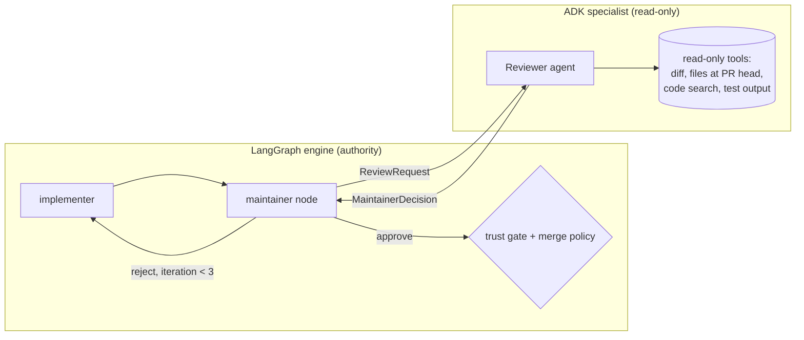

# Design note: ADK specialist agents under the LangGraph orchestrator

Tracking issue: #525.

## Status

**Implemented behind a switch, off by default.** The default review backend
stays `langgraph`, so a deployment that changes nothing behaves as before.

Done in code:

| Item | Where | PR |
| --- | --- | --- |
| ADK Reviewer behind `reviewer_backend: "langgraph" \| "adk"` (`REVIEWER_BACKEND`), default `langgraph` | `backend/automaintainer/_specialists/` (`contracts.py`, `tools.py`, `reviewer_adk.py`), one seam in `maintainer_node` | #534 |
| `adk` optional extra (`google-adk`, `litellm`); the base SDK install is unchanged | `backend/pyproject.toml` | #533 |
| Spike script for the Groq go/no-go | `backend/evals/spike_adk_groq.py` | #534 |
| Reviewer comparison on the end-to-end evaluation set (`--reviewer-backend`) | `backend/evals/e2e/`, [docs/EVALS.md](../EVALS.md#comparing-reviewer-backends-525) | #531, #534 |
| `search_code` backed by the code index when retrieval is on and the index holds the PR head; ripgrep otherwise | `backend/automaintainer/_specialists/tools.py` | #539 |
| CI job that installs the `adk` and `rag` extras and fails if any specialist, ADK concurrency, RAG or red-team test is skipped | `test-extras` in `.github/workflows/ci-backend.yml` | #538 |
| Review tokens recorded as server-side metrics from the review's `TelemetryEvent` | `backend/telemetry_metrics.py` | #540 |

Pending (owner steps; they need provider keys and cost money):

1. Run the spike against Groq and record GO or NO-GO in #525 (see
   [Spike: the owner's go/no-go](#spike-the-owners-gono-go)).
2. Run the live Reviewer comparison (rollout step 3): at least 3 repeats per
   backend, compared with the `langgraph` live run of the same model and with
   the 3/14 fixture baseline.
3. Decide whether to enable `adk` (rollout step 4). Until then, keep
   `REVIEWER_BACKEND=langgraph`.

See [Implementation](#implementation) for what was built and where it
differs from the plan. The architecture overview is in
[ARCHITECTURE.md, Specialists](../../ARCHITECTURE.md#specialists).

## Why

AutoMaintainer's pipeline is a five-node LangGraph graph: architect,
brainstormer, pm, implementer, maintainer (see
[ARCHITECTURE.md](../../ARCHITECTURE.md#the-agent-pipeline-langgraph)). Each node
makes one or two single-shot LLM calls. The Maintainer, for example, reviews at
most 20 000 characters of the PR diff in one prompt and cannot look at anything
else: not the full changed file, not its callers, not the test output beyond
the summary it is handed.

We want to add **specialist agents** that work in a tool-use loop (reason, call
a tool, observe, repeat) and to build them with Google's **Agent Development
Kit (ADK)**. The goal is better decisions on the steps where one prompt is not
enough, measured against today's behaviour, without giving up what the
LangGraph engine already guarantees.

This is not a port. LangGraph stays.

## Decision

Two layers with a strict boundary.

**LangGraph is the orchestrator and the only layer with authority.** It keeps:

- the run lifecycle and statuses in Supabase;
- per-engine isolation and cancellation (`AutoMaintainerEngine`, #519, and the
  concurrency suite, #522);
- the retry loop: Maintainer rejects, Implementer revises, at most 3 attempts;
- the trust gate and merge policy (#411): who may trigger a run, and whether a
  PR may merge;
- every side effect on GitHub: comments, branches, PRs, merges.

**ADK agents are specialists.** A LangGraph node calls one, passes a typed
request, and gets a typed result back. A specialist reads; it never writes.
It has no tool that comments, pushes, merges or changes a run's status.



## First specialist: the Reviewer

The Reviewer replaces the single-shot review prompt inside the `maintainer`
node. Nothing else about the node changes.

**Why the Reviewer first.** Its output is already a validated contract
(`MaintainerDecision`), so the swap is local. Its mistakes are measurable: a
wrong approval or a wrong rejection. And it is where tool use helps most,
because a reviewer that can open the changed file, its callers and the test
log sees far more than a truncated diff.

**Contract.**

- Input `ReviewRequest`: repository, PR number, head SHA, the directive, the
  iteration number, the verification result for this iteration, and the diff
  (the agent may fetch more through tools).
- Output: the existing `MaintainerDecision` (`verdict`, `reasons`,
  `blocking_issues`, `requested_changes`), validated by the same pydantic model.
  An invalid reply gets the same single corrective retry. A second failure is a
  rejection, so the step still fails closed.

**Tools (all read-only, scoped to the run's repository and head SHA):**

- `get_diff(path=None, page=1)`: the PR diff, whole or per file, one page
  per call.
- `read_file(path, start, end)`: a file at the PR head.
- `search_code(query)`: with retrieval on (`rag_retrieval_enabled`) and the
  RAG index holding exactly the PR head commit, the nearest code chunks of
  the run's repository; otherwise ripgrep over the PR head checkout, as
  before. An index error or empty result falls back to ripgrep. See
  [docs/RAG.md](../RAG.md).
- `get_verification_log()`: the test output of this iteration, truncated.

**Budgets.** At most 8 tool calls and a token cap per review. A per-review
timeout. Hitting any budget returns a rejection that says why, never an
approval.

**Model.** ADK targets Gemini first and reaches other providers through its
LiteLLM wrapper. Before anything else, a spike must confirm that ADK can drive
Llama 3.3 70B on Groq with reliable tool calls. If it cannot, the fallback is
Gemini on Vertex AI for the Reviewer only, routed through `ModelRouting`, with
its cost measured in the comparison.

## Rules the boundary must keep

1. **Authority stays in LangGraph.** The maintainer node turns the verdict into
   a comment and applies the trust gate and merge policy exactly as today.
2. **Typed contracts only.** Pydantic models on both sides. No free text between
   layers.
3. **Cancellation reaches the specialist.** The ADK call runs inside the run's
   task, so `engine.cancel()` and `aclose()` stop it. A cancelled review never
   produces an approval.
4. **One budget across layers.** The run's token and cost accounting includes
   specialist calls.
5. **Isolation holds.** A new ADK session per review. Clients and credentials
   come from the engine context, never from module globals. The concurrency
   suite gets a case with two engines running ADK reviews at once.
6. **Untrusted input stays data.** The diff, files and test logs are attacker
   controlled. The red-team fixtures (`tests/redteam`) run against the ADK
   Reviewer before it can be enabled.
7. **One trace.** Each specialist call is an OpenTelemetry span under the run's
   trace, with tool calls as child spans.

## Rollout

1. **Spike** (throwaway): ADK, LiteLLM and Groq tool calling. Go or no-go on the
   model.
2. **Behind a switch:** `reviewer_backend: "langgraph" | "adk"` in
   `AutoMaintainerConfig`, default `langgraph`. `google-adk` ships as an
   optional `adk` extra, so the base SDK install stays as slim as #521 left it.
3. **Compare** on the evaluation set (the end-to-end set from #531):
   - false-approval rate (approving a change that breaks hidden tests) —
     the number that matters most;
   - false-rejection rate;
   - fix iterations per run;
   - cost and latency per review.

   Each figure is reported as a mean and spread over repeated runs. How to
   run it: [docs/EVALS.md](../EVALS.md#comparing-reviewer-backends-525)
   (`--reviewer-backend`).
4. **Enable** only if the false-approval rate does not get worse and at least
   one other figure improves. Otherwise keep the switch off and record why.

## Implementation

Code: `backend/automaintainer/_specialists/` (`contracts.py`,
`tools.py`, `reviewer_adk.py`); one seam in `maintainer_node`
(`agents.py`); `reviewer_backend` in `AutoMaintainerConfig`. Tests:
`backend/tests/specialists/` and
`backend/tests/concurrency/test_concurrency_adk_reviewer.py`.

- **Switch.** `reviewer_backend: "langgraph" | "adk"` (env
  `REVIEWER_BACKEND`). An engine config with `adk` and no `adk` extra fails
  validation; a process without an engine that reads `REVIEWER_BACKEND=adk`
  without the extra aborts the run with `REVIEWER_BACKEND_UNAVAILABLE`.
  Neither falls back to the other review.
- **Seam.** `maintainer_node` builds its prompt as before and then asks
  either `_llm_decision` (unchanged) or `reviewer_adk.review_pull_request`.
  The comment, merge policy, trust gate and checkpoint after it are shared.
- **Checkout.** The tools read a shallow clone of the PR branch at exactly
  the head SHA, in a temporary directory deleted after the review (cloned
  as verification does). The run's own clone is not used: it is at the base
  branch and shared with the run's other steps. A branch that moved, or a
  failed clone, is a rejection.
- **Tools** (`tools.ReviewTools`, plain Python, no ADK): paths resolved to
  real paths and refused outside the checkout (including through symlinks)
  or under `.git`; ripgrep with the query after `--`, fixed-string,
  `--no-config`, no symlink following, repository ignore files ignored;
  every output capped. A refused call costs a tool call and is answered as
  a refusal; it does not end the review.
- **Budgets** (`ReviewBudget`): 8 tool calls, 11 model calls, 60 000
  tokens as reported by the
  provider (a response without usage counts an estimate of about four
  characters per token of its prompt and answer, so a route that reports
  no usage cannot disable the cap), 4 096 output tokens per answer, 180 s
  for the whole review. Of the 11 model calls, the code's own comment
  accounts for 10: 8 turns that call tools, the answer after the last tool
  result, and the corrective retry. The eleventh is headroom that neither
  the code nor this note explains; the ADK runner itself is given
  `max_llm_calls` of 12 so that the review's own counter, not ADK, ends an
  over-budget loop. Constants for now; the comparison should show
  which values to keep before they become configuration.
- **Rate limiter (trade-off).** A review reserves `estimated_tokens` (3 000)
  once, when it takes its key, but may use up to the 60 000-token cap, and
  its real usage is not fed back to the limiter. With the default 6 000
  TPM per key an ADK review can overrun the engine's per-minute budget, so
  per-engine budget isolation is weaker than on the LangGraph path. The
  limiter's own wait timeout is a rejection that says no key was available,
  not a review timeout.
- **Model and credentials.** `ModelRouting.maintainer` names the model. A
  Groq model goes through ADK's `LiteLlm` with a key from the engine's rate
  limiter (one key and one reservation per review, not per model call in
  the loop). A Gemini name (`gemini-...` or `vertex_ai/gemini-...`) uses
  ADK's native client on Vertex AI with the process's Google credentials.
- **Fail closed.** Budgets, timeout, exceptions, a call to an unregistered
  tool, a stop requested by `engine.cancel()` (also one arriving during the
  final answer) and an invalid answer after the retry all return a
  rejection that says why. Each such rejection also emits a non-fatal
  `ErrorEvent` with `error_code="SPECIALIST_REVIEW_FAILED"` and the reason
  in its message, so the run log shows why the Reviewer rejected. The
  rejection is then handled like any other Maintainer rejection (the
  Implementer revises, at most 3 attempts). A cancelled task (`engine.cancel(grace_seconds=)`,
  `aclose()`) propagates `CancelledError`: no decision at all. ADK reports
  exceptions raised in callbacks as error events and swallows the
  cancellation of its own root task; the reviewer records the first abort
  reason itself and treats a model call that never returned as cancelled.
- **Accounting and tracing.** One `TelemetryEvent` per review with its
  tokens (as the LangGraph review reports its own), a `specialist.reviewer`
  span and a `specialist.tool` child span per tool call, from the
  OpenTelemetry API's global tracer (`opentelemetry.trace.get_tracer`,
  imported lazily). The package never imports the server's `observability`
  module, which the SDK wheel does not ship; in the server,
  `init_observability` installs the global provider, so the spans join the
  run's trace. The server records the review's tokens and estimated cost as
  metrics with phase `maintainer` from that `TelemetryEvent`
  (`MetricsEmitter` in `backend/telemetry_metrics.py`, #540), as it does
  for the LangGraph review.
- **Package location.** `automaintainer/_specialists/`, a sibling of
  `_runtime`, not inside it: `_runtime` holds only the modules moved there
  by #187, each aliased under its old top-level name, and the SDK packaging
  test pins that set.
- **The engine's LLM transport is bypassed.** The ADK Reviewer calls the
  provider through ADK (LiteLLM or the Gemini client), not through an
  engine's injected `llm` transport. A host that injects its own transport
  (an SDK user, the eval harness's recording/replay) does not see the
  Reviewer's calls; with `reviewer_backend="adk"` they go to the provider.
- **No pull request, no review.** Without a GitHub client or a PR (pr is
  None) the ADK backend has no head to check out and always rejects, where
  the LangGraph review still reviews the generated code in the graph state.
  This is fail-closed and intended.
- **CI coverage.** The main test matrix installs only the `server` extra, so
  the `needs_adk` tests (approve, reject, budgets, timeout, cancel, the
  red-team re-run, the two-engine isolation test) skip there. The
  `test-extras` job in `.github/workflows/ci-backend.yml` (#538) installs the
  `adk` and `rag` extras, runs `tests/specialists`,
  `tests/concurrency/test_concurrency_adk_reviewer.py`, `tests/rag` and
  `tests/redteam`, and fails if any of them is skipped. Rules 5 and 6 are
  therefore checked in CI. These tests use scripted fake models; they do not
  measure a live model.
- **Red-team.** `tests/specialists/test_reviewer_redteam.py` runs every
  `tests/redteam` test with `REVIEWER_BACKEND=adk` and a model that obeys the
  payload with its tools; every fixture's outcome holds.
  `tests/specialists/test_search_code_redteam.py` does the same for a
  poisoned code index behind `search_code`.

## Spike: the owner's go/no-go

`backend/evals/spike_adk_groq.py` (manual; not run in CI or here, it calls
the provider) gives Llama 3.3 70B on Groq, through ADK's LiteLLM wrapper,
the Reviewer's real system prompt and its four tool declarations on one
small review task, and prints every tool call, whether it parsed, whether
the answer parses as a `MaintainerDecision`, and the verdict:

```bash
cd backend
GROQ_API_KEY=... uv run --extra adk python -m evals.spike_adk_groq --repeats 5
```

Options: `--model` (the routed model name; default Llama 3.3 70B on Groq)
and `--repeats` (default 3, at least 1). Exit codes: 0 for GO, 1 for NO-GO,
2 for a setup error such as a missing key or the `adk` extra not installed.

**GO** (exit 0) when every repeat made at least one tool call, every call
named a registered tool with a JSON object of arguments, and every answer
parsed. Record the output in #525. On **NO-GO**, try the fallback, Gemini on
Vertex AI for the Reviewer only: the same script with
`--model vertex_ai/gemini-2.5-flash` and `GOOGLE_GENAI_USE_VERTEXAI=true`,
`GOOGLE_CLOUD_PROJECT`, `GOOGLE_CLOUD_LOCATION` and Application Default
Credentials. If it passes, route only the Reviewer there with
`ModelRouting(maintainer="vertex_ai/gemini-2.5-flash")`; the other roles stay
on Groq. Its cost must then be part of the comparison (Groq's pricing table
in `evals/e2e/pricing.py` does not cover it; pass `--prices`).

## Non-goals

- Porting the other nodes or replacing LangGraph.
- Giving any ADK agent write access to GitHub or to run state.
- A2A (agent-to-agent over the network). Revisit only if a specialist needs to
  scale or deploy on its own.
- Changing the retry cap or the graph's edges. `test_build_graph.py` keeps
  pinning them.

## Risks

- **Groq tool calling through LiteLLM may be unreliable.** The spike decides;
  the fallback costs money.
- **A tool loop costs more than one prompt.** Budgets cap it, and the comparison
  must show the extra cost buys fewer bad approvals.
- **More dependencies.** The optional extra keeps them out of the base install.
- **A wider injection surface.** A reviewer that reads more files reads more
  untrusted text. Rule 6 applies before enabling.

## Open questions

None at the moment. The questions below were open when this note was
written and are now resolved.

## Resolved questions

- **Which evaluation tasks give enough bad changes for the false-approval
  rate to mean something?** Resolved by the end-to-end evaluation (#531):
  its Reviewer change set has 27 cases, 14 defective and 13 correct
  (`backend/evals/e2e/reviewer/`). With 14 defective cases one approval moves
  the rate by about 0.07, so the comparison uses at least 3 repeats and
  treats a difference smaller than the two spreads as no difference
  ([docs/EVALS.md](../EVALS.md#comparing-reviewer-backends-525)). Whether 14
  cases are enough to detect a small change is a judgement for the
  comparison itself.
- **Does the PM get retrieval as a tool-using specialist or in its prompt?**
  In its prompt (#539). The RAG retriever arrived first and is shared
  (#526). The PM node stays a single LangGraph prompt and gets retrieved
  code in it (`agents.retrieved_context`); the Reviewer's `search_code` uses
  the same resolution (`agents.resolve_retriever`: an engine's injected
  factory, #541, else a pgvector retriever over the run's database client).
  Both are behind `rag_retrieval_enabled`, off by default. Whether the PM
  becomes a tool-using specialist is left until the retrieval numbers on the
  evaluation set with Vertex embeddings are in: a retriever in the prompt is
  cheaper than a tool loop, and the loop only pays off if the PM needs to
  look further than the top chunks. Retrieved chunks are one more source of
  untrusted text; the red-team fixtures run with retrieval on, through the
  PM prompt and through `search_code` (rule 6).
- **Does CI run the ADK tests?** Yes, since #538 (the `test-extras` job; see
  [Implementation](#implementation)).
