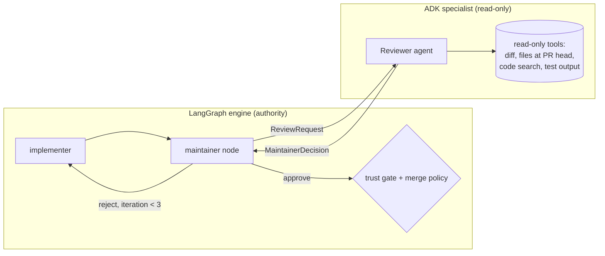

# Design note: ADK specialist agents under the LangGraph orchestrator

Status: proposed. Tracking issue: #525.
Branch: `feat/adk-migration`.

## Why

AutoMaintainer's pipeline is a five-node LangGraph graph: architect,
brainstormer, pm, implementer, maintainer (see
[ARCHITECTURE.md](../../ARCHITECTURE.md#the-agent-pipeline-langgraph)). Each node
makes one or two single-shot LLM calls. The Maintainer, for example, reviews at
most 20 000 characters of the PR diff in one prompt and cannot look at anything
else: not the full changed file, not its callers, not the test output beyond
the summary it is handed.

We want to add **specialist agents** that work in a tool-use loop (reason, call
a tool, observe, repeat) and to build them with Google's **Agent Development
Kit (ADK)**. The goal is better decisions on the steps where one prompt is not
enough, measured against today's behaviour, without giving up what the
LangGraph engine already guarantees.

This is not a port. LangGraph stays.

## Decision

Two layers with a strict boundary.

**LangGraph is the orchestrator and the only layer with authority.** It keeps:

- the run lifecycle and statuses in Supabase;
- per-engine isolation and cancellation (`AutoMaintainerEngine`, #519, and the
  concurrency suite, #522);
- the retry loop: Maintainer rejects, Implementer revises, at most 3 attempts;
- the trust gate and merge policy (#411): who may trigger a run, and whether a
  PR may merge;
- every side effect on GitHub: comments, branches, PRs, merges.

**ADK agents are specialists.** A LangGraph node calls one, passes a typed
request, and gets a typed result back. A specialist reads; it never writes.
It has no tool that comments, pushes, merges or changes a run's status.

## First specialist: the Reviewer

The Reviewer replaces the single-shot review prompt inside the `maintainer`
node. Nothing else about the node changes.

**Why the Reviewer first.** Its output is already a validated contract
(`MaintainerDecision`), so the swap is local. Its mistakes are measurable: a
wrong approval or a wrong rejection. And it is where tool use helps most,
because a reviewer that can open the changed file, its callers and the test
log sees far more than a truncated diff.

**Contract.**

- Input `ReviewRequest`: repository, PR number, head SHA, the directive, the
  iteration number, the verification result for this iteration, and the diff
  (the agent may fetch more through tools).
- Output: the existing `MaintainerDecision` (`verdict`, `reasons`,
  `blocking_issues`, `requested_changes`), validated by the same pydantic model.
  An invalid reply gets the same single corrective retry. A second failure is a
  rejection, so the step still fails closed.

**Tools (all read-only, scoped to the run's repository and head SHA):**

- `get_diff(path=None)`: the PR diff, whole or per file, paginated.
- `read_file(path, start, end)`: a file at the PR head.
- `search_code(query)`: search in the run's clone (ripgrep; later the RAG
  retriever).
- `get_verification_log()`: the test output of this iteration, truncated.

**Budgets.** At most 8 tool calls and a token cap per review. A per-review
timeout. Hitting any budget returns a rejection that says why, never an
approval.

**Model.** ADK targets Gemini first and reaches other providers through its
LiteLLM wrapper. Before anything else, a spike must confirm that ADK can drive
Llama 3.3 70B on Groq with reliable tool calls. If it cannot, the fallback is
Gemini on Vertex AI for the Reviewer only, routed through `ModelRouting`, with
its cost measured in the comparison.

## Rules the boundary must keep

1. **Authority stays in LangGraph.** The maintainer node turns the verdict into
   a comment and applies the trust gate and merge policy exactly as today.
2. **Typed contracts only.** Pydantic models on both sides. No free text between
   layers.
3. **Cancellation reaches the specialist.** The ADK call runs inside the run's
   task, so `engine.cancel()` and `aclose()` stop it. A cancelled review never
   produces an approval.
4. **One budget across layers.** The run's token and cost accounting includes
   specialist calls.
5. **Isolation holds.** A new ADK session per review. Clients and credentials
   come from the engine context, never from module globals. The concurrency
   suite gets a case with two engines running ADK reviews at once.
6. **Untrusted input stays data.** The diff, files and test logs are attacker
   controlled. The red-team fixtures (`tests/redteam`) run against the ADK
   Reviewer before it can be enabled.
7. **One trace.** Each specialist call is an OpenTelemetry span under the run's
   trace, with tool calls as child spans.

## Rollout

1. **Spike** (throwaway): ADK, LiteLLM and Groq tool calling. Go or no-go on the
   model.
2. **Behind a switch:** `reviewer_backend: "langgraph" | "adk"` in
   `AutoMaintainerConfig`, default `langgraph`. `google-adk` ships as an
   optional `adk` extra, so the base SDK install stays as slim as #521 left it.
3. **Compare** on the evaluation set (built before this work starts):
   - false-approval rate (approving a change that breaks hidden tests) —
     the number that matters most;
   - false-rejection rate;
   - fix iterations per run;
   - cost and latency per review.

   Each figure is reported as a mean and spread over repeated runs.
4. **Enable** only if the false-approval rate does not get worse and at least
   one other figure improves. Otherwise keep the switch off and record why.

## Non-goals

- Porting the other nodes or replacing LangGraph.
- Giving any ADK agent write access to GitHub or to run state.
- A2A (agent-to-agent over the network). Revisit only if a specialist needs to
  scale or deploy on its own.
- Changing the retry cap or the graph's edges. `test_build_graph.py` keeps
  pinning them.

## Risks

- **Groq tool calling through LiteLLM may be unreliable.** The spike decides;
  the fallback costs money.
- **A tool loop costs more than one prompt.** Budgets cap it, and the comparison
  must show the extra cost buys fewer bad approvals.
- **More dependencies.** The optional extra keeps them out of the base install.
- **A wider injection surface.** A reviewer that reads more files reads more
  untrusted text. Rule 6 applies before enabling.

## Open questions

- Which evaluation tasks give enough bad changes for the false-approval rate to
  mean something? This depends on the evaluation set (roadmap step 2).
- Should the PM node be the second specialist, or should the RAG retriever
  arrive first and be shared by both?
